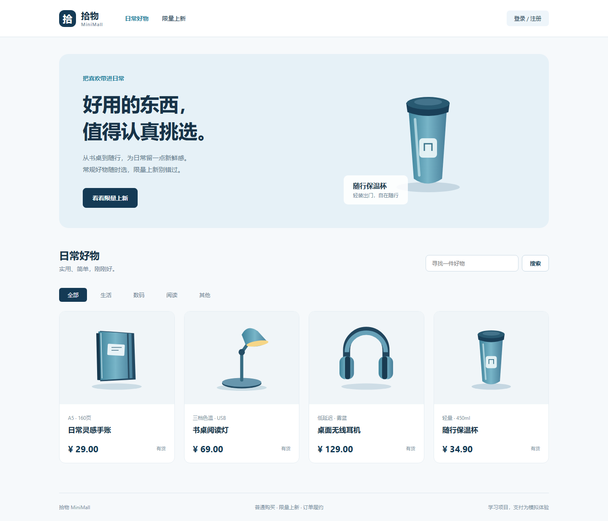

# 拾物 MiniMall · 限量商品商城与订单系统

Java 21 + Spring Boot + Vue 3 的完整商城订单项目。用户可以买普通商品、结算购物车、参与限量活动、模拟支付、取消订单和确认收货；管理员维护商品、库存、活动，并给已付款订单发货。

本项目的主线是**订单、库存与支付状态的一致性**。商品维护是入口，优惠券属于原开发指南中的可选扩展，本版不包含优惠券。支付和退款都为模拟业务，没有连接真实资金渠道。



## 在这台电脑上开始

项目就在 `F:\Project Practice\java项目\限量商品商城与订单系统`。在 VS Code 中选择“文件 → 打开文件夹”，打开整个项目目录。

打开新的 VS Code 终端，执行：

```powershell
powershell -NoProfile -ExecutionPolicy Bypass -File scripts/check-env.ps1
```

已经安装 Java 21、Maven、Node，并安装 Java Extension Pack、Spring Boot Extension Pack、Vue 和 Docker 扩展；`.vscode` 配置指定了项目使用的版本。机器原有 Java、Node 和其他 Docker 项目保留。项目 PowerShell 脚本使用 UTF-8 BOM，以兼容 Windows PowerShell 5.1。

### 模式一：本地调试 Java 和 Vue

先启动 Docker Desktop。MySQL、Redis、RocketMQ 用容器提供依赖；Java、Vue 在 Windows 本机运行。

```powershell
powershell -NoProfile -ExecutionPolicy Bypass -File scripts/start-local.ps1
```

已有打包结果且源码没有变化时可添加 `-SkipBuild`。脚本会停止本项目的整套 Docker 应用，启动本地模式依赖，启动 Java 与 Vite，并检查 HTTP 健康状态。

- 页面：<http://127.0.0.1:5173>
- API：<http://127.0.0.1:8080/api/v1>
- Swagger：<http://127.0.0.1:8080/swagger-ui/index.html>
- 健康检查：<http://127.0.0.1:8080/actuator/health>
- 日志：`runtime/backend.log`、`runtime/backend-error.log`、`runtime/frontend-error.log`

停止本项目 Java/Vue 进程：

```powershell
powershell -NoProfile -ExecutionPolicy Bypass -File scripts/stop-local.ps1
```

添加 `-WithInfrastructure` 可一起停止本项目依赖。所有停止操作保留数据库和消息队列的命名卷。

### 在 VS Code 中打断点

1. 如果后台运行过 `start-local.ps1`，先执行 `stop-local.ps1`，释放 8080、5173。
2. 菜单“终端 → 运行任务 → 启动依赖”。该任务会停止本项目Docker应用，释放端口并启动本地模式依赖；不会停止其他Docker项目。F5也配置为先执行这个依赖任务。
3. 等待 Java 扩展完成 Maven 导入，打开 `backend/src/main/java/com/lsy/minimall/MiniMallApplication.java`。
4. 在“运行和调试”选择“MiniMall 后端调试”，按 F5；密钥从本地的 `deploy/local.env` 读取。
5. 另一个终端运行“启动前端”任务；访问 5173。
6. 建议在 `OrderService.createNormal`、`InventoryService.change`、`PaymentService.processCallback`、`MessageService.consume` 打断点。

若你更喜欢终端前台显示日志，“启动后端”任务使用 `mvn spring-boot:run`；与 F5、后台启动脚本三者任选其一，避免同一个端口启动两次。

VS Code 自动导入、F5 配置和插件均已准备；实际自动化验收通过命令行与浏览器运行完成，F5 界面交互不属于本次自动化验收。

### 模式二：前后端全部 Docker 运行

```powershell
powershell -NoProfile -ExecutionPolicy Bypass -File scripts/start-docker.ps1
```

- 页面：<http://127.0.0.1:8088>
- API、Swagger、健康检查仍在 8080。
- 全部由 `deploy/compose.yml` 管理，项目名 `minimall-docker`。
- 镜像：`minimall-backend:0.1.0`、`minimall-frontend:0.1.0`。
- `-SkipBuild` 可复用已构建镜像；源码变化后需要重新构建。

前后端镜像还导出为 `F:\app\images\minimall-0.1.0.tar`（约198MiB）。需要恢复这两个镜像时运行 `docker load -i F:/app/images/minimall-0.1.0.tar`；这个归档不包含数据库数据或MySQL/Redis/RocketMQ镜像。哈希与镜像信息见 `docs/image-export.json`。

Windows 的 BuildKit 在中文构建目录上出现过 gRPC 头部错误。脚本使用 `F:\app\workspaces\minimall` 这个英文 junction；它指向原项目目录，源码只有一份。这个入口只解决构建路径兼容问题。

两个运行模式共享宿主机端口，**不能同时启动**；切换脚本只停止本项目资源。两个 Compose 项目使用独立命名卷，因此各自的订单、用户、库存分别保存。

## 登录和业务演示

- 管理员用户名：`admin`；当前电脑上的密码查看 `deploy/.env` 的 `BOOTSTRAP_ADMIN_PASSWORD`。
- 普通用户点击“登录 / 注册”，自主注册；不会通过注册请求获得管理员权限。
- 首次启动空数据库时自动初始化 4 件商品和 1 场持续 7 天的限量活动。
- 初始化只在数据库没有商品时执行；重启不会重新创建商品或恢复已消耗库存。
- 活动过期后，管理员可以新建活动；不要为重新看到活动而清空数据库。

演示顺序：注册 → 商品详情 → 购物车或立即购买 → 填地址 → 下单 → 模拟支付 → 切换管理员后台发货 → 切回原用户确认收货。普通订单默认 10 分钟未付款关闭。限量订单取消释放活动库存，但不会恢复该用户该场活动的下单资格。

商品通过上下架维护生命周期，不物理删除历史商品。编辑价格不会修改已经创建的订单明细快照。后台“调库存”操作记录调整原因、管理员和幂等键，不能把库存扣成负数。

## 已实现的功能

| 模块 | 内容 |
|---|---|
| 登录权限 | BCrypt 密码、随机 Bearer Token、Redis 2 小时滑动会话（认证成功请求续期）、角色与数据归属校验 |
| 商品 | 新建、编辑、上下架、分页查询、分类、金额/库存维护、版本冲突检查 |
| 详情缓存 | Redis 正缓存、空值缓存、随机 TTL、互斥加载与持有者校验释放、DB 回源并发限制 |
| 购物车 | 添加、修改数量、删除、当前价格检查、事务内结算与清理 |
| 普通订单 | 直接购买 / 购物车购买、服务端算价、价格确认、金额与商品快照、列表详情、取消 |
| 模拟支付 | 失败后在原订单创建新支付尝试、每次尝试独立幂等、成功/失败场景、HMAC 回调验签、重复回调处理、晚到成功退款补偿 |
| 履约 | 已付款发货、物流信息、用户确认收货、重复动作幂等 |
| 限量活动 | 草稿、编辑、发布、停用、结束、回收、活动时间与库存检查、每人限购 |
| 可靠消息 | 本地事务 Outbox、租约抢占、至少一次发送、ACK 后标记、指数退避、事务消费去重 |
| 后台任务 | 超时扫描、活动结束、退款修复、库存账本核对与失败事件告警日志 |
| 前端 | 用户侧 9 个页面 + 后台 3 个路由，桌面/手机适配、加载错误、价格/状态提示 |

13 张业务表（含用户下单锁表）、34 个业务接口。数据库额外存在 Flyway 的迁移记录表，它不计入业务表数量。

## 技术栈和目录

Java 21、Spring Boot 3.5.16、Spring Security、MyBatis-Plus 3.5.17、MySQL 8.4、Redis 7.4、RocketMQ 5.3.2、Flyway、Springdoc OpenAPI；Vue 3、TypeScript、Vite 7、Vue Router、Pinia、Axios、Element Plus；JUnit 5、Testcontainers、Vitest、Playwright；Docker Compose、Nginx、Maven Wrapper、GitHub Actions。

业务数据库访问统一使用 MyBatis-Plus Mapper：基础插入、查询和分页使用 BaseMapper / QueryWrapper，行锁、条件库存更新、联表查询和 Outbox 租约在各表 Mapper 中封装。Mapper 共用 Spring 事务和同一个数据源；MapperRows 保持响应字段驼峰、ID 字符串、空字段和 UTC 时间格式。迁移说明见 [MyBatis-Plus 数据访问迁移](docs/mybatis-plus-migration.md)。本项目是一个应用的分包模块，不是微服务。

```text
backend/
  pom.xml, mvnw, mvnw.cmd
  src/main/java/com/lsy/minimall/
    auth/ security/ product/ inventory/ cart/
    order/ payment/ seckill/ messaging/ jobs/
    common/ infrastructure/
  src/main/resources/db/migration/
  src/test/java/com/lsy/minimall/
frontend/
  src/views/ stores/ api.ts reliable.ts router.ts
  public/images/    # 本地 SVG，不依赖远程商品图片
  tests/ e2e/
deploy/
  compose.yml compose.local.yml
  Dockerfile.backend Dockerfile.frontend nginx.conf
  broker.local.conf broker.docker.conf
  .env.example     # 可提交的配置模板
  .env local.env   # 当前机器私密配置，不提交 Git
scripts/           # Windows 启动、检查、测试；Node 验收脚本
docs/              # 架构、环境、验收报告、截图和接口导出
examples/HelloJava.java
.vscode/           # JDK、终端、任务、调试与插件推荐
.github/workflows/verify.yml
开发执行指南.md    # 原始详细设计与学习路线
```

## 关键实现原则

1. **数据库是库存事实源。** 限量接口返回 201 之前，订单、明细、限购记录、库存账本和 Outbox 已在同一数据库事务提交。Redis Lua 用于限流，不用于先扣虚拟库存再赌异步落库。
2. **普通库存与活动库存分开。** 发布从普通池划拨；取消只归还本订单原库存池；回收要求无待支付活动订单，再归还剩余活动库存。
3. **保存状态使用数据库竞争仲裁。** 支付与取消都先锁订单。过了截止时间的成功回调会关闭订单并进入模拟退款，不会把关闭订单复活。
4. **幂等键和数据库约束共同保证。** 同键同规范化业务内容返回原订单；同键不同内容拒绝；消费标记与实际业务在同一事务，消费失败会共同回滚。
5. **金额与时间规范明确。** 整数分、服务端算价、JSON ID 是字符串。数据库、连接会话和 JDBC 时间转换统一 UTC，界面转换为浏览器本地时间。
6. **消息只推进可恢复的后续动作。** MQ 负责超时检查、缓存失效、模拟支付和退款。Broker 短期中断时下单事务照常提交，Outbox 留存并重试；数据库超时扫描不依赖 MQ。

详见 [架构和一致性说明](docs/architecture.md)。

## 运行测试和演练

```powershell
# 后端：真实临时 MySQL/Redis，由 Testcontainers 管理
powershell -NoProfile -ExecutionPolicy Bypass -File scripts/test-backend.ps1

# 前端类型、lint、单测、生产构建
powershell -NoProfile -ExecutionPolicy Bypass -File scripts/test-frontend.ps1

# 启动本地或Docker应用后，在项目根目录加载专用环境
. ./scripts/env.ps1
node scripts/smoke.mjs
node scripts/concurrency.mjs

# E2E，先启动应用。Docker模式传8088，本地模式传5173
powershell -NoProfile -ExecutionPolicy Bypass -File scripts/test-frontend.ps1 -Browser -BaseUrl http://127.0.0.1:8088

# Broker停止/恢复、Outbox补偿、数据库超时扫描
# 本地模式先 $env:COMPOSE_PROJECT='minimall-local'
# Docker模式使用默认 minimall-docker
node scripts/failure-drill.mjs

# Docker模式：先运行smoke，再验证整套停止/启动后订单仍保存
node scripts/restart-drill.mjs
```

演练脚本会创建测试用户、商品和订单，保留业务记录作为证据。并发脚本结束会取消自己的抢购订单、回收活动库存并下架自己的商品。故障脚本仅人为缩短它刚创建的测试订单期限，不更改其他订单。Broker 在 `finally` 中恢复。

JUnit 集成测试使用独立临时容器，不清理本地或 Docker 演示数据库。执行 `verify` 时不要同时运行 `mvn clean`；Windows 运行中的 JAR 可能被锁定，修改源码后先停应用再打包。

验收结果见 [验收报告](docs/acceptance.md)。指标仅代表记录的本机、小批次验证；不能据此宣称生产环境秒杀容量。

## 配置、数据和排查

敏感配置仅在 `deploy/.env` 与 `deploy/local.env`。本机已生成；克隆到新环境后，可先执行 `scripts/init-env.ps1` 创建随机密码，并同步 VS Code 配置。原有 `.env` 不会被该脚本覆盖。修改已有 MySQL 卷的 `.env` 密码不会自动修改数据库账号；应先用原密码登录数据库按正式流程修改，再同步配置。

所有下载工具、安装包、npm 缓存、Playwright 浏览器放在 `F:\app` 的项目专用目录。项目终端通过 `.vscode/settings.json` 或 `scripts/env.ps1` 优先使用新版本。新开的普通系统终端可能仍然命中机器原有 Java/Node；在本项目终端运行 `check-env.ps1` 可核对。

```powershell
# 容器与健康状态
docker compose -p minimall-docker --env-file deploy/.env -f deploy/compose.yml ps -a
# 日志
docker compose -p minimall-docker --env-file deploy/.env -f deploy/compose.yml logs --tail 100 backend broker
# Java 示例：本机不需要Docker便可运行
& 'F:/app/java/jdk-21.0.12.1+1/bin/java.exe' examples/HelloJava.java
```

- 端口占用：检查是不是自己同时开了 F5 和后台 Java；脚本不会停止无关进程。
- 登录 503：认证依赖 Redis 和数据库，故障时拒绝登录，不绕过权限。
- 页面库存可能短暂滞后：详情缓存最终一致；提交订单时以数据库库存和最新价格为准。
- MQ 失败：看 `outbox_event.status/attempts/last_error`。发送失败 20 次进入 FAILED；需要定位原因后有审计地重放。退款修复任务会补发未完成退款事件。
- 数据账本不一致：查看定时审计日志，查订单与账本业务键；不要直接修改库存数字掩盖问题。
- 新电脑安装依赖：查看 [环境锁定](docs/environment-lock.md)，先安装官方 JDK/Maven/Node/Docker，再调整 Windows 脚本和 VS Code 中的本机路径。

## 边界和继续学习

这是一份可运行、可测试的开发实习项目；没有接真实支付、真实物流、生产退款、优惠券、多 SKU、退款售后、地址簿和多服务分布式事务。通知型业务可以基于现有 Outbox 扩展，当前不包含邮件、短信或 webhook 通知服务。

商品缓存可能存在短暂陈旧窗口，TTL 与异步失效限定窗口；不将缓存视为强一致承诺。Redis 故障时商品匿名查询有单实例最多 8 个 DB 回源的保护；抢购限流依赖 Redis，故障时拒绝抢购，普通订单库存事务仍依赖数据库保证。

前端当前整体引入 Element Plus，主 JS 约 1.09 MB（gzip 约 363 KB），构建有 chunk 大小提示；页面已按路由加载。组件级按需引入、CDN、生产可观测面板和持续长时间负载测试可作为后续优化。GitHub Actions 已配置，但本次只验证了本机运行，并未将远程工作流执行记录当作通过证据。

原详细指南包含更完整的开发教学和扩展方案。实际完成范围与证据以 README、当前代码和 `docs/acceptance.md` 为准。


2026-10-11 边界修复：支付失败允许重试，普通/限量下单共用每用户 20 个待付款订单上限，缓存回填受失效代次与加载锁保护。客户端支付使用 `Idempotency-Key`，网络结果不确定时复用原键；确认失败后使用新键。Flyway V3 保留多次支付记录，V4 增加独立下单锁，均保留现有数据。详见 [本次修复验收](docs/boundary-fixes-2026-10-11.md)。
