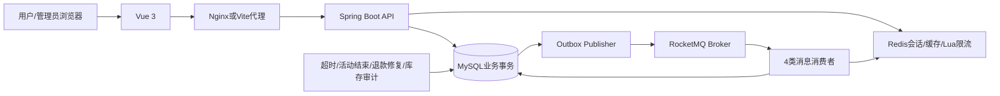
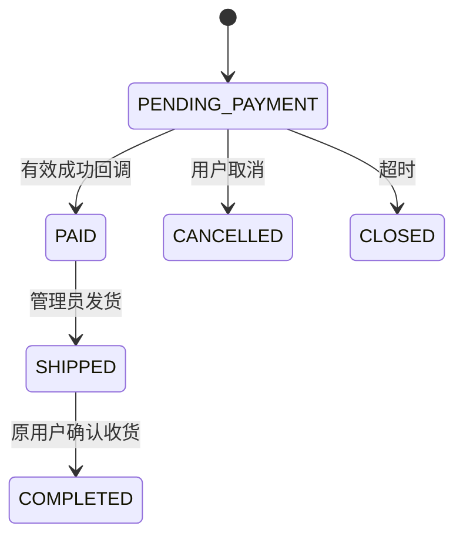

# 架构和一致性说明

当前版本为单 Spring Boot 应用、单 MySQL 主库、Redis 和 RocketMQ 经典 Broker。前端 Vue；Docker 模式由 Nginx 提供静态资源并代理 API。没有引入微服务或分布式事务。

## 数据流

## 数据访问

登录会话保存为 Redis `auth:session:<Token哈希> → 用户ID`，初始有效期 2 小时。BearerFilter 在每次认证通过、账户有效后对现有 key 执行 EXPIRE，将有效期重置为 2 小时；Token 不轮换，后台轮询也会续期。无效/过期会话及禁用账户不续期；读取后会话已被删除时续期失败，返回 401，不重新创建会话。退出继续删除当前会话。

业务代码通过各表的 MyBatis-Plus Mapper 访问 MySQL，不再依赖 Db / JdbcTemplate，也不在 Service 中拼接 SQL。基础插入、条件查询和分页分别使用 BaseMapper.insert、QueryWrapper、分页插件；条件库存更新、联表和 Outbox 领取等特殊操作由 Mapper 中的绑定参数 SQL 表达。Spring 事务仍覆盖订单、明细、库存账本、消费去重和 Outbox 的所有写入。

MapperRows 仅整理返回值：字段转驼峰、ID 转字符串、时间转 UTC 文本，缺少必需记录时抛业务异常。MyBatis 配置 call-setters-on-nulls 保留空字段，local-cache-scope=STATEMENT 保证同一事务内每次时间查询与锁查询都访问数据库。测试专用 DatabaseFixture 用 JDBC 独立准备和核验数据，不进入业务 JAR。

## 13张表的职责

| 表 | 职责 | 关键约束 |
|---|---|---|
| mall_user | 用户、密码哈希、角色 | username唯一 |
| product | 单规格商品、普通可用库存、版本 | stock_available为非负；业务更新检查边界 |
| cart_item | 当前用户购物车 | user_id + product_id唯一 |
| seckill_activity | 活动时间、价格、划拨库存池 | 草稿才可编辑；发布后库存池独立 |
| mall_order | 收货信息、金额快照、状态、截止时间 | order_no唯一；user_id + request_key唯一 |
| order_item | 商品与价格快照、购买数量、库存来源 | 关联订单、活动，取消时按来源归还 |
| payment_record | 模拟支付、第三方交易号、退款状态 | payment_no唯一；order_id + request_key唯一，每次尝试独立记录 |
| seckill_purchase | 活动资格占用 | activity_id + user_id唯一，取消不删除 |
| inventory_ledger | 所有库存效果与变更后余额 | effect_key唯一 |
| outbox_event | 尚待发送和已发送事件 | event_id唯一；状态/重试时间索引 |
| consumer_event | 消费和回调去重 | consumer_name + event_id唯一 |
| operation_log | 关键操作审计、后台幂等结果 | actor_id + action + request_key唯一 |

V1 是初始 DDL；V2 为后台操作幂等增加唯一约束；V3 将支付约束改为订单 + 请求键；V4 增加独立的 order_creation_lock 下单锁表。Flyway 会自动迁移，禁止 clean。库存余额须等于对应库存池全部 ledger.delta 之和，定时任务检查这个不变量。

## 普通订单如何创建

`OrderController → OrderService.create → Transactions.run → createNormal → InventoryService.change → Events.add`。

1. 根据来源规范化商品/购物车项目、数量、预计总额和收货信息，计算请求内容哈希。
2. 根据用户和幂等键查已有订单。同内容返回原订单，不同内容返回409；仅校验失败没有订单时可纠正后重新提交。
3. 在事务中按 productId 升序锁商品行。购物车来源先非锁定读取不可变的 productId，锁商品，再锁购物车项并重新校验归属与数量。
4. 校验商品上架、当前库存和数量，使用整数分计算。预计金额与当前价格不匹配返回 PRICE_CHANGED，不悄悄按新价格扣款。
5. 同事务插入订单、明细，条件扣减库存，插入库存账本、超时检查 Outbox，删除已结算购物车项。
6. 提交成功返回201。任何异常都会使这些变更一起回滚。

同时提交相同幂等键时，以数据库唯一约束仲裁。重复请求即使在第一次事务提交前进入，也不能插入第二个订单；碰到重复后重新读取已提交的原订单。

## 锁顺序

| 操作 | 锁顺序 |
|---|---|
| 普通直接下单 | 用户下单锁 → 商品按ID升序 |
| 购物车下单 | 用户下单锁 → 商品按ID升序 → 购物车项按ID升序，重新校验 |
| 加购物车 | 商品 → 购物车项 |
| 限量下单 | 用户下单锁 → 商品 → 活动 |
| 发布 / 回收 | 商品 → 活动 |
| 活动改关联商品 | 旧/新商品按ID升序 → 活动 |
| 支付 / 取消 / 发货 / 收货 | 已有订单 → 支付记录（需要时）→ 商品按ID升序 → 活动按ID升序（需要时） |

保证相关流程不使用相反锁顺序。数据库仍可能因复杂冲突或连接故障返回错误；业务事务回滚后，客户端使用原幂等键重试。不能靠吞掉数据库错误返回“下单成功”。

库存更新采用条件SQL，非负约束由数据库更新检查和表约束共同保证。库存字段为无符号类型，判断算术先 `CAST(stock_available AS SIGNED)`，避免减法判断先发生 unsigned underflow。

## 两个库存池

例如普通商品原库存100，活动发布划拨20，则普通80、活动20。抢购2单后普通80、活动18；取消1个未付款活动订单后普通80、活动19；最终活动结束且没有待付款订单，回收19后普通99、活动0。活动已卖出的1件不会归还。

活动生命周期 DRAFT → PUBLISHED → ENDED/DISABLED → CLOSED。活动买单必须同时满足 PUBLISHED、数据库当前时间落在开始/结束窗口内、商品上架、活动有库存、当前用户未使用资格。不能只由前端按钮判断时间。

资格在成功创建订单时占用，同一用户同一活动最多一单；取消不删除资格。这是明确业务口径，并非“每用户累计购买量限购N件”的实现。

Redis Lua 使用 Redis TIME 实现按用户/活动的滑动窗口限流；只有限流作用，不持有业务库存。限流服务失效则拒绝抢购并返回503。订单、限购和活动库存以MySQL提交结果为准。

## 订单与支付状态

支付 CREATED → SUCCEEDED/FAILED；订单取消或超期后晚到成功回调 → REFUND_PENDING → REFUNDED。退款只是记录可恢复的模拟行为，没有真实资金接口。

支付回调核验 timestamp、原始body的HMAC-SHA256、支付号、金额和币种。签名原文为 `timestamp + "\n" + rawBody`；5分钟有效窗口。回调不能把单纯客户端传入的“成功”当成事实。

同一订单可以有多次支付尝试，只有上一尝试 FAILED 且订单仍待支付、未过期时才创建下一尝试。每次支付有独立的 payment_no、request_key 和 Outbox 事件；相同请求键重放原尝试，旧失败事件不能作用于新尝试。不同请求键遇到正在处理的支付会返回 PAYMENT_IN_PROGRESS；不带键的旧客户端仍兼容查询当前支付，但要可靠确认网络重试必须传 Idempotency-Key。订单详情展示最新尝试。模拟支付消息的 callbackId 从稳定eventId派生，occurredAt固定为支付记录创建时间，避免重试时同一回调ID内容哈希变化。

支付和取消都先锁同一订单行。支付在截止时间前获锁则PAID，取消随后拒绝；取消或超时先获锁则释放库存，后续成功支付进入模拟退款。任何路径库存只归还一次。

## Outbox与消费

业务事务插入Outbox以后，Publisher每秒领取最多10条可发送记录，用 `FOR UPDATE SKIP LOCKED` 与120秒租约协调。事务只领取，网络发送在事务外；Broker返回SEND_OK才标记PUBLISHED。发送失败指数退避，上限60秒；20次失败进入FAILED并记录错误。

ACK成功但标记失败、或者消费者成功但ACK丢失，都可能造成重投。因此语义是**至少一次**；业务幂等使效果不会重复，不能宣称传输层“恰好一次”。

| Topic / tag | Consumer group | 行为 |
|---|---|---|
| minimall-order / TIMEOUT | minimall-order-timeout | 检查订单截止时间并关闭未付款订单 |
| minimall-cache / PRODUCT_INVALIDATE | minimall-product-cache | 删除详情缓存 |
| minimall-payment / REQUESTED | minimall-mock-payment | 执行模拟回调 |
| minimall-payment / REFUND | minimall-mock-refund | 完成模拟退款 |

消费事务先插入 consumer_event，再执行实际业务。消费失败抛异常，标记和业务共同回滚，让MQ重试；同ID不同payloadHash拒绝。缓存删除是外部可重复操作，事务回滚后再次删除也安全。支付回调另有消费者命名空间进行回调去重。

`minimall-audit` 已初始化为扩展预留topic，本版没有audit消费者；普通审计直接保存在operation_log。不要把预留topic当作实现了新的通知服务。

## 后台任务

| 任务 | 间隔 | 说明 |
|---|---|---|
| closeExpired | 30秒 | 每批最多100条；数据库期限检查、订单锁、归还库存；MQ中断也可以关闭 |
| endActivities | 30秒 | 将过期PUBLISHED活动标记ENDED，不自动强行回收有待付款订单的池 |
| repairRefunds | 60秒 | 对长时间REFUND_PENDING补Outbox或重置失败事件 |
| auditStock | 5分钟 | 核对产品/活动账本余额，记录不一致与FAILED事件数量 |
| OutboxPublisher | 1秒 | 发送、租约恢复、失败重试 |

默认10分钟订单采用RocketMQ经典延时等级14。超时检查是“到期再核验”，不能仅收到消息就无条件取消；测试可缩短期限，数据库扫描仍核验实际 expires_at。

## 缓存和前端重试的边界

详情缓存60–120秒随机TTL，空值20秒，加载锁3秒。缓存命中不查询数据库时间；服务器时间用应用UTC时钟。竞争加载会503让客户端重试；Redis故障时匿名详情可回源，单实例Semaphore最多8个并发回源。商品更新通过事务Outbox失效缓存；消费者用 Lua 原子递增 product:generation:{id} 并删除缓存。加载器在 DB 查询前读取代次，写缓存时同时校验代次及加载锁所有者；过期加载器和跨失效的旧查询不能回填。代次键不设置 TTL，避免归零造成 ABA。异步消息到达前仍存在短暂陈旧窗口，所有下单仍重新校验数据库价格、上架状态和库存。

订单提交和后台库存调整的网络未知结果保留原请求键、原body，不因“重试”再次扣库存。购物车结算的pending尝试保存在sessionStorage；后台库存调整也按用户/商品保存，刷新后可确认原结果。存储在当前浏览器标签页，关闭标签后的跨设备恢复依靠订单列表/审计，而非浏览器内存。

抢购页面在当前页面保留请求键/body，刷新后资格唯一约束仍防重复订单；但没有跨刷新自动恢复那次抢购提交键的完整体验。可从订单列表确认已创建订单。这是当前UI实现边界。

## 工程与投递说明

有实际事务、并发库存测试、支付/取消竞争、重复消息、失败回滚和Broker停机演练，可以用源码和证据解释实现。项目采用单机依赖、单数据库事务；未经多副本、长时间高负载、真实支付审计和公网安全部署验收。没有高可用承诺，不能将小规模本机指标描述成生产秒杀峰值。

面试最适合讲清三条链路：普通下单事务、支付/超时竞争、Outbox失败恢复。先定位实际service和SQL，再讲Redis、MQ的职责，不把技术名词当作贡献。

普通下单和限量下单在读取业务快照前取得 `order_creation_lock` 的用户行锁；锁内先确认幂等请求，再检查全部 PENDING_PAYMENT 订单总数（上限 20）。独立锁不独占 mall_user，避免与持有商品锁的购物车插入外键检查形成环路。取消、超时和付款减少待付款订单数，下一次下单重新 COUNT 即可，无需维护易漂移的计数器。
