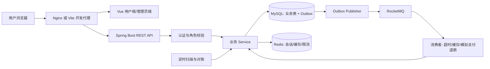
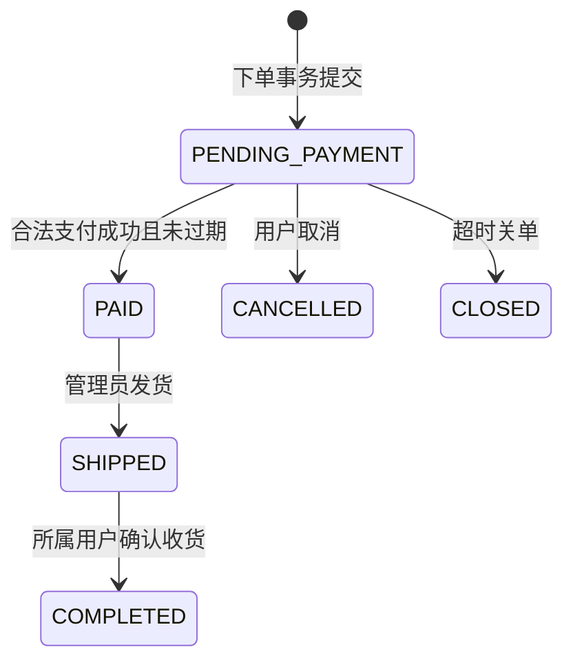

# MiniMall：限量商品商城与订单系统——完整开发执行指南

> 文档日期：2026-10-09。目标读者：希望独立完成 Java 后端与 Vue 前端项目、准备开发实习面试的开发者。
>
> 2026-10-09实施更新：基础项目已完成，Windows本地与Docker模式均已运行。具体通过的测试与演练以 README.md 和 docs/acceptance.md 为准。本指南保留详细教学及可选扩展；不能把计划清单全部视为已实现。

## 导航

建议第一次按顺序阅读；开发时按章节查阅。

- [0. 先明确：你到底要做什么](#chapter-0)
- [1. 阅读顺序与阶段交付](#chapter-1)
- [2. 技术栈、版本与职责](#chapter-2)
- [3. 总体架构与关键设计决策](#chapter-3)
- [4. 业务规则与状态机](#chapter-4)
- [5. 数据库：12 张表及完整初始 DDL](#chapter-5)
- [6. API 合同：34 个业务接口](#chapter-6)
- [7. 从空目录开始：工程创建、依赖与配置](#chapter-7)
- [8. 登录、鉴权与权限边界](#chapter-8)
- [9. 商品、库存管理和详情缓存](#chapter-9)
- [10. 购物车](#chapter-10)
- [11. 普通订单：最重要的事务](#chapter-11)
- [12. 模拟支付、回调和可恢复退款](#chapter-12)
- [13. 取消、超时关闭、发货与收货](#chapter-13)
- [14. 限量抢购：库存池、时间和限购](#chapter-14)
- [15. Redis：缓存、限流和短期防重复](#chapter-15)
- [16. RocketMQ、Outbox 和后台任务](#chapter-16)
- [17. Vue 前端：页面、组件与联调](#chapter-17)
- [18. 拆成可执行开发任务](#chapter-18)
- [19. 测试：证明正确性的具体用例](#chapter-19)
- [20. 压测和结果解释](#chapter-20)
- [21. 本地运行、镜像打包和完整容器部署](#chapter-21)
- [22. 常见故障排查：按证据定位](#chapter-22)
- [23. 可选扩展：完成基础版后再考虑](#chapter-23)
- [24. 投递材料、证据与面试准备](#chapter-24)
- [25. 最终完成清单与执行记录](#chapter-25)

- [附录 A：接口字段与 DTO](#appendix-a)
- [附录 B：实现约定、观测与 CI](#appendix-b)
- [附录 C：完整账本示例](#appendix-c)


<a id="chapter-0"></a>

## 0. 先明确：你到底要做什么

项目场景：一家自营商城销售普通商品，并定期发布限量商品活动。用户可以注册登录、查看商品、加入购物车、创建订单、模拟支付、取消未支付订单、查看发货信息和确认收货。管理员维护商品、普通库存和抢购活动，并处理订单发货。

商品 CRUD 是基础；订单、支付、库存、活动额度和消息之间的一致性是核心。仅完成商品和优惠券的增删改查，不足以支撑这份项目方案。

本版的“限量抢购”指抢购实物商品，不是抢商家兑换券。优惠券不是基础版必做模块；它的扩展方法见第 23 章。先完成下单、支付、关单、库存释放和发货闭环，再考虑满减券。

### 0.1 完成目标与范围

| 项目项 | 基础版约束 |
| --- | --- |
| 商业模式 | 单商城、自营；没有商家入驻和跨商家结算 |
| 商品规格 | 一个商品对应一个可售规格；多 SKU 留作扩展 |
| 前端 | 一个 Vue 3 SPA，包含用户端和管理员端 |
| 后端 | 一个 Spring Boot 单体应用，按业务模块组织代码 |
| 数据库 | 12 张业务与可靠性表；Flyway 的迁移历史表不计入业务表 |
| API | 34 个业务接口；Actuator、OpenAPI 不计入 |
| 支付 | 模拟支付适配器；有支付记录、签名回调校验、迟到支付补偿 |
| 物流 | 管理员录入物流公司和单号；不对接真实物流平台 |
| 抢购 | 一个活动绑定一个商品；每个用户每个活动最多成功创建一笔订单 |
| 限购规则 | 抢购数量固定为 1；成功创建后即消耗资格，取消后不恢复个人资格 |
| 库存来源 | 普通销售池与活动销售池分离；发布活动时从普通池划拨 |
| 首个付款窗口 | 10 分钟；测试配置允许缩短到 1 分钟 |
| 所有权 | 用户只能查看、支付、取消和确认自己的订单 |
| 完成方式 | 正常订单同步事务落库；消息用于超时与异步副作用 |
| 不做 | 真实资金、完整售后、积分、搜索引擎、微服务、分库分表、推荐算法 |

“每人限购”必须有可执行定义。基础版选择“一人一活动最多成功下单一次”，便于用数据库唯一约束兜底。订单取消会归还活动库存，供其他用户购买，但当前用户不能再次参加该活动。页面和接口错误信息都要明确说明。若以后要支持取消后重购，必须另行设计有效资格与历史订单的关系，不能直接删除去重记录。

### 0.2 什么叫达到可用于投递的质量

以大厂开发实习常见的项目追问方向准备工程证据，不承诺凭这个项目获得面试或录用。达标标准是：

- 能独立解释一条下单请求从 Vue 到数据库、消息和库存流水的完整调用链。
- 能解释事务范围、锁顺序、幂等键、唯一约束、支付与取消的竞争结果。
- 能证明测试失败时确实可以阻止合并，而不是只有一份没有执行的测试文件。
- 能演示本地启动和 Docker 完整部署，并保留构建与业务验收日志。
- 能测出自己的吞吐、延迟和错误分布，明确机器、数据量与测试配置。
- 能区分独立实现、参考开源代码、未来规划与已验证结果。

<a id="chapter-1"></a>

## 1. 阅读顺序与阶段交付

不要从最后一章倒着堆组件。按以下顺序使用本指南：

1. 先读第 0—6 章，冻结业务规则、版本、状态和表结构。
2. 执行第 7—10 章，先跑通健康接口、登录、商品和购物车。
3. 执行第 11—13 章，跑通普通订单、模拟支付、取消与履约。
4. 执行第 14—16 章，加入活动、缓存、限流、Outbox 和消费者。
5. 执行第 17—20 章，完成前后端联调、测试和压测。
6. 执行第 21—22 章，完成镜像、容器、故障排查和交付验收。
7. 第 23—25 章用于扩展、证据整理和面试准备。

| 阶段 | 必须交付 | 进入下一阶段的条件 |
| --- | --- | --- |
| P0 工程基础 | 后端、前端、MySQL、Flyway、健康接口、Git | Vue 能代理访问公开商品空列表，后端健康接口与迁移成功 |
| P1 交易闭环 | 登录、商品、购物车、普通订单、支付、取消、发货、收货 | 一笔订单完整演示；金额和库存可核对 |
| P2 正确性 | 权限、幂等、条件更新、流水、支付取消竞争 | 关键失败与并发测试通过 |
| P3 活动与消息 | 活动库存划拨、限购、缓存、限流、Outbox、MQ、扫描补偿 | 依赖短暂失败后仍能恢复；无负库存 |
| P4 工程交付 | E2E、压测报告、镜像、Compose、README | 本地和容器两套业务验收全部通过 |

可以按任务安排 4—6 个迭代，不能把迭代数当作固定工期。Java、Spring、SQL 和 Vue 的熟悉程度会显著影响工作量。

<a id="chapter-2"></a>

## 2. 技术栈、版本与职责

### 2.1 后端与基础设施

以下是本指南建议的冻结起点，不是已经完成联调的兼容性证明。首次构建、数据库迁移、MQ 收发冒烟全部通过后，将实际版本写入 `docs/environment-lock.md`。

| 技术 | 选型 | 用途与边界 |
| --- | --- | --- |
| Java | JDK 21，编译目标 21 | 本地与容器统一；你现有 JDK 25 可保留，IDE 为本项目另设 SDK 21 |
| Spring Boot | 3.5.16 | Web、依赖管理、配置、健康检查；本指南统一 3.x |
| Maven | 3.9.x + Maven Wrapper | 依赖、测试、打包；提交 Wrapper 文件 |
| Spring Web | Boot 管理版本 | REST API、参数绑定、异常处理 |
| Spring Validation | Boot 管理版本 | DTO 校验；业务约束另由 Service 判断 |
| Spring Security | Boot 管理版本 | 认证过滤器、角色权限、密码散列 |
| MyBatis-Plus | 3.5.17，Boot3 starter | 普通查询与映射；关键库存和状态 SQL 明写 |
| MySQL | 8.4 LTS，InnoDB | 订单、库存和业务事实唯一权威 |
| Flyway | Boot 管理版本 + flyway-mysql | 建表和版本迁移；不依赖手工导 SQL |
| Redis | 7.4 | 会话、商品详情缓存、限流、短期重复请求保护 |
| Lua | Redis 脚本 | 原子限流、按持有者释放短期请求锁 |
| RocketMQ Broker | 5.3.2，经典客户端兼容模式 | 延迟关单、缓存失效、模拟支付/退款事件 |
| RocketMQ Spring starter | 2.3.6 | 使用 `rocketmq-spring-boot-starter` 经典 API |
| springdoc-openapi | 2.8.17 | 与 Boot 3.x 配套的 OpenAPI/Swagger UI |
| Actuator / Micrometer | Boot 管理版本 | 健康检查、业务指标、线程与连接池指标 |
| JUnit 5 / Mockito | Boot 管理版本 | 业务单元测试 |
| Testcontainers | 先用 Boot BOM 管理版本 | 真实 MySQL/Redis 集成测试，依赖 Docker |
| Awaitility | 测试依赖 | 等待异步状态收敛，不写无依据的长 sleep |
| Docker / Compose | Docker Desktop Linux containers，Compose v2 | 本地依赖、镜像、完整容器环境 |
| Nginx | 1.28-alpine | Vue 静态资源、SPA 路由、同源 API 代理 |

选择 Boot 3.x 是为了与参考项目和经典 RocketMQ Spring API 保持相近。前面讨论中提过 Boot 4.x；如果已经生成了 4.x 空项目，正式实施本指南前统一改用此表，不能混用 Boot4 starter、Springdoc3 和本指南 Boot3 配置。

Spring Boot 3.5 的官方系统要求允许 Java 17—25，本项目仍统一以 21 构建和运行。初始化器若不提供 3.5，可创建 Maven 项目并使用第 7 章 POM；不要选择 SNAPSHOT 后直接照抄旧版本依赖。[Spring Boot 系统要求](https://docs.spring.io/spring-boot/3.5/system-requirements.html)

RocketMQ Spring 的经典 starter 与 v5 gRPC starter 是不同集成方案。不要同时加入两种 starter，也不要一边用 `RocketMQTemplate`、一边照搬 v5 gRPC 的 endpoint 配置。[RocketMQ Spring 官方仓库](https://github.com/apache/rocketmq-spring)

### 2.2 前端

| 技术 | 选型 | 用途 |
| --- | --- | --- |
| Node.js | 24.x，至少 24.12 | 与当前 Vue 创建工具要求一致；锁定实际补丁版本 |
| Vue | 3.x，Composition API + script setup | 用户端与管理员端 |
| TypeScript | create-vue 生成的稳定版本 | API DTO、金额与状态类型 |
| Vite | create-vue 配套版本 | 开发代理和构建 |
| Vue Router | 4.x | 页面、登录守卫、管理员守卫 |
| Pinia | 稳定版 | 当前用户、轻量购物车状态 |
| Axios | 1.x | HTTP 客户端、Token、错误处理 |
| Element Plus | 2.x | 表单、表格、对话框、分页、通知 |
| Vitest + Vue Test Utils | 生成器配套版本 | 组件与状态测试 |
| Playwright | 锁定安装版本 | 浏览器端端到端测试 |
| ESLint / Prettier | 生成器配套版本 | 静态检查与格式化 |
| npm | 随 Node 配套 | 提交 package-lock.json，CI 和 Docker 使用 npm ci |

前端不必逐个手写 Vite/TypeScript 版本。用官方工具创建一次、通过测试和构建后提交锁文件；后续通过独立依赖升级提交维护。[Vue 官方快速开始](https://vuejs.org/guide/quick-start.html)

### 2.3 技术引入顺序

P0 引入 Web、Validation、MyBatis、MySQL、Flyway、Security；P1 接入 Redis 会话并跑完整订单链；P2 完成数据库正确性；P3 引入 Redis 商品缓存、Lua 限流和 MQ；P4 完成测试与镜像验收。不要在第一天同时排查六个中间件。

第一阶段按第 7 章通过 profile/条件配置实现 `app.messaging.enabled=false`，关闭所有 MQ listener、producer 和 publisher，Outbox 表仍保留；关单先由数据库扫描任务完成。开启 MQ 后增加延迟消息主路径，扫描继续兜底。

<a id="chapter-3"></a>

## 3. 总体架构与关键设计决策



### 3.1 必须固定的设计决策

| 编号 | 决策 | 原因与代价 |
| --- | --- | --- |
| ADR-01 | MySQL 是订单与库存权威 | Redis 丢失不改变已提交交易；热点写仍受数据库能力约束 |
| ADR-02 | 基础版同步创建订单 | 避免返回订单号后数据库仍无订单；事务容易验证 |
| ADR-03 | 普通与活动库存分池 | 两种购买流程不会分别出售同一份库存 |
| ADR-04 | 使用条件更新及唯一约束 | 库存、状态和重复请求在数据库层兜底 |
| ADR-05 | 本地事务同时写业务和 Outbox | 业务已提交但消息未发送时，有持久补偿入口 |
| ADR-06 | 消费去重与业务变化同事务 | 不出现“去重成功，业务失败，重试被跳过” |
| ADR-07 | MQ 延迟消息 + DB 扫描关单 | MQ 不可用或延迟时，订单仍会被关闭 |
| ADR-08 | 金额使用人民币分整数 | 避免 double 运算误差，前端只能展示和提交预期报价 |
| ADR-09 | 抢购每人每活动终身一单 | 用唯一约束可靠实现；取消仍消耗活动资格 |
| ADR-10 | 优惠券与 Redis 预扣异步建单为扩展 | 冻结基础版工作量，避免主链正确性未完成时扩散 |

本版不会宣称 Redis Lua 已经替代数据库库存扣减。Lua 在基础版处理入口限流与请求短锁；数据库承担扣库存和资格判断。Redis 预扣与异步落库需要额外的预占凭证、恢复协议和收据状态，见第 23 章。

### 3.2 代码目录

```text
minimall/
├── backend/
│   ├── pom.xml
│   ├── mvnw / mvnw.cmd / .mvn/
│   ├── src/main/java/com/lsy/minimall/
│   │   ├── MiniMallApplication.java
│   │   ├── common/       # Result、错误码、traceId、分页、时钟
│   │   ├── config/       # Security、MyBatis、Redis、OpenAPI、MQ
│   │   ├── auth/         # controller/service/mapper/entity/dto
│   │   ├── product/
│   │   ├── cart/
│   │   ├── order/
│   │   ├── payment/
│   │   ├── seckill/
│   │   ├── inventory/
│   │   └── messaging/   # outbox、consumer inbox、listener、jobs
│   ├── src/main/resources/
│   │   ├── application.yml
│   │   ├── application-local.yml
│   │   ├── application-docker.yml
│   │   ├── db/migration/V1__init_schema.sql
│   │   ├── mapper/
│   │   └── lua/
│   └── src/test/java/... # unit、integration、concurrency
├── frontend/
│   ├── package.json / package-lock.json
│   ├── vite.config.ts
│   ├── src/api/          # 按模块封装 API
│   ├── src/types/        # DTO 与状态联合类型
│   ├── src/stores/       # auth/cart
│   ├── src/router/
│   ├── src/views/shop/
│   ├── src/views/admin/
│   ├── src/components/
│   └── tests/           # 单元与浏览器测试
├── deploy/
│   ├── compose.yml
│   ├── compose.local.yml
│   ├── Dockerfile.backend
│   ├── Dockerfile.frontend
│   ├── nginx.conf
│   ├── broker.local.conf
│   ├── broker.docker.conf
│   └── .env.example
├── scripts/             # smoke.ps1、seed-dev.ps1、loadtest、验收脚本
├── docs/                # 接口、ADR、运行记录、故障、性能报告
├── .github/workflows/ci.yml
├── .gitignore / .dockerignore
└── README.md
```

按业务模块组织，模块内使用 Controller → Service → Mapper。Controller 不写 SQL、库存判断和金额规则。不得为了“架构高级”拆成多个服务，也不得通过通用工具类互相调用所有业务模块。

<a id="chapter-4"></a>

## 4. 业务规则与状态机

### 4.1 通用规则

1. 所有 ID 经 JSON 输出为字符串，避免 Java Long 超过 JavaScript 安全整数范围。
2. 金额字段以 `...Fen` 命名；数据库为 BIGINT，Java 为 long/Long；前端限制显示金额在安全整数范围内。
3. 时间以 UTC 存储；API 输出带 `Z` 的 ISO-8601。页面按中国时区或浏览器时区展示，并注明。
4. 下单时间、活动窗口、支付截止、超时判断以服务端数据库时钟为准；页面倒计时只供提示。
5. 普通商品数量 1—99；一笔普通订单最多 20 行；同商品合并为一行。
6. 普通订单支持直接购买或选中购物车商品，两种来源互斥。
7. 运费固定为 0；先不实现优惠券、税费、会员价和多币种。
8. 收货人、手机号和地址是订单快照；基础版每次结算填写，不单独做地址簿。
9. 普通商品下架阻止新购买，不改变已下单订单的付款与履约。
10. 商品名称、图片和规格改变，不影响历史订单快照。
11. 对库存和状态不能使用“查出来在 Java 里减一再 update 全对象”的写法。
12. 任何外部 RPC、MQ 同步发送、HTTP 调用，都不放进持有库存行锁的数据库事务。

### 4.2 订单状态



| 状态 | 用户可做 | 管理员可做 | 库存处理 |
| --- | --- | --- | --- |
| PENDING_PAYMENT | 支付、取消 | 查看 | 下单时已扣可售库存 |
| PAID | 查看 | 发货 | 不再次扣库存 |
| SHIPPED | 确认收货 | 查看 | 不变 |
| COMPLETED | 查看 | 查看 | 不变 |
| CANCELLED | 查看 | 查看 | 归还一次 |
| CLOSED | 查看 | 查看 | 归还一次 |

订单不做物理删除；基础版已支付订单不能直接取消，不做完整退货退款。迟到支付的自动模拟退款是技术补偿，与用户主动申请售后不同。

### 4.3 支付状态

```text
CREATED -> SUCCEEDED                  # 有效成功付款
CREATED -> FAILED                     # 模拟失败，没有扣用户资金
CREATED -> REFUND_PENDING -> REFUNDED  # 成功通知到达时订单已取消/关闭/过期
```

一个订单基础版只建一个支付意图，重复创建返回同一个记录。失败支付意图不能再次改成成功；用户创建新订单再尝试。这个限制控制范围，未来允许多次付款尝试时要修改唯一约束与状态协议。

收到成功回调，即使订单状态已经变更，也不能只忽略。需要区分“已经成功处理的同一笔交易”与“对已关闭订单新发生的成功付款”。前者幂等返回，后者进入可观察的退款补偿。

### 4.4 活动状态与库存生命周期

```text
DRAFT -> PUBLISHED -> ENDED -> CLOSED
                  -> DISABLED -> CLOSED
```

- DRAFT：只记录计划库存，尚未划拨；可编辑名称、时间、活动价、计划库存。
- PUBLISHED：发布事务从商品普通库存划拨活动额度，参数冻结。是否可购买还要检查 `start_at <= now < end_at`。
- ENDED：超过结束时间；可以由任务更新，但购买接口必须自行判断时间。
- DISABLED：管理员提前停止活动；不再接受新订单。
- CLOSED：停止购买且无未支付活动订单，把剩余活动库存退回普通池，库存池关闭。
- 活动结束时未支付订单仍按它自己的支付截止时间处理；不能同时把其已占用库存划拨回普通池。
- 活动已发布后不允许直接编辑库存、商品、价格和时间；需要新活动。管理员状态接口只接收允许的动作。

<a id="chapter-5"></a>

## 5. 数据库：12 张表及完整初始 DDL

### 5.1 表职责总览

| 序号 | 表 | 核心职责 |
| --- | --- | --- |
| T01 | mall_user | 账号、密码散列、角色、启用状态 |
| T02 | product | 单规格商品与普通池可售库存 |
| T03 | cart_item | 用户商品数量 |
| T04 | mall_order | 金额、状态、收货/物流快照、幂等键 |
| T05 | order_item | 商品与成交价格快照、库存来源 |
| T06 | payment_record | 模拟付款、回调、退款补偿状态 |
| T07 | seckill_activity | 商品活动与独立活动库存 |
| T08 | seckill_purchase | 每人每活动成功下单资格记录 |
| T09 | inventory_ledger | 每次库存变化的原因与业务键 |
| T10 | outbox_event | 与业务同事务创建的待发送事件 |
| T11 | consumer_event | 消费者业务去重凭证 |
| T12 | operation_log | 管理员操作与订单状态变化审计 |

分类使用固定枚举 `BOOK / DIGITAL / LIFE / OTHER`，不建分类表；地址与物流在订单中保存快照；这两项避免为了简单功能继续扩表。

### 5.2 DDL 使用方式

把以下 SQL 放入 `backend/src/main/resources/db/migration/V1__init_schema.sql`。数据库由 Compose 创建为 `minimall`，Flyway 管理建表。第一次迁移成功后不修改 V1；变更写 V2、V3。不要用 `DROP TABLE` 作为升级方案。

使用 InnoDB、utf8mb4。唯一请求键和事件键采用区分大小写的 ASCII 类型。关联字段本版通过外键约束保护；历史订单只能引用不被物理删除的商品和用户。

```sql
CREATE TABLE mall_user (
  id BIGINT UNSIGNED NOT NULL AUTO_INCREMENT,
  username VARCHAR(64) NOT NULL,
  password_hash VARCHAR(100) NOT NULL,
  role VARCHAR(16) NOT NULL DEFAULT 'USER',
  status VARCHAR(16) NOT NULL DEFAULT 'ACTIVE',
  created_at DATETIME(3) NOT NULL DEFAULT CURRENT_TIMESTAMP(3),
  updated_at DATETIME(3) NOT NULL DEFAULT CURRENT_TIMESTAMP(3) ON UPDATE CURRENT_TIMESTAMP(3),
  PRIMARY KEY (id),
  UNIQUE KEY uk_user_username (username),
  CONSTRAINT ck_user_role CHECK (role IN ('USER','ADMIN')),
  CONSTRAINT ck_user_status CHECK (status IN ('ACTIVE','DISABLED'))
) ENGINE=InnoDB DEFAULT CHARSET=utf8mb4;

CREATE TABLE product (
  id BIGINT UNSIGNED NOT NULL AUTO_INCREMENT,
  name VARCHAR(128) NOT NULL,
  category_code VARCHAR(16) NOT NULL,
  specification VARCHAR(128) NOT NULL DEFAULT '',
  description TEXT,
  image_url VARCHAR(512) NOT NULL DEFAULT '',
  price_fen BIGINT UNSIGNED NOT NULL,
  stock_available INT UNSIGNED NOT NULL DEFAULT 0,
  status VARCHAR(16) NOT NULL DEFAULT 'DRAFT',
  version BIGINT UNSIGNED NOT NULL DEFAULT 0,
  created_at DATETIME(3) NOT NULL DEFAULT CURRENT_TIMESTAMP(3),
  updated_at DATETIME(3) NOT NULL DEFAULT CURRENT_TIMESTAMP(3) ON UPDATE CURRENT_TIMESTAMP(3),
  PRIMARY KEY (id),
  KEY idx_product_listing (status, category_code, id),
  CONSTRAINT ck_product_price CHECK (price_fen > 0),
  CONSTRAINT ck_product_status CHECK (status IN ('DRAFT','ON_SALE','OFF_SALE'))
) ENGINE=InnoDB DEFAULT CHARSET=utf8mb4;

CREATE TABLE cart_item (
  id BIGINT UNSIGNED NOT NULL AUTO_INCREMENT,
  user_id BIGINT UNSIGNED NOT NULL,
  product_id BIGINT UNSIGNED NOT NULL,
  quantity INT UNSIGNED NOT NULL,
  created_at DATETIME(3) NOT NULL DEFAULT CURRENT_TIMESTAMP(3),
  updated_at DATETIME(3) NOT NULL DEFAULT CURRENT_TIMESTAMP(3) ON UPDATE CURRENT_TIMESTAMP(3),
  PRIMARY KEY (id),
  UNIQUE KEY uk_cart_user_product (user_id, product_id),
  CONSTRAINT fk_cart_user FOREIGN KEY (user_id) REFERENCES mall_user(id),
  CONSTRAINT fk_cart_product FOREIGN KEY (product_id) REFERENCES product(id),
  CONSTRAINT ck_cart_quantity CHECK (quantity BETWEEN 1 AND 99)
) ENGINE=InnoDB DEFAULT CHARSET=utf8mb4;

CREATE TABLE seckill_activity (
  id BIGINT UNSIGNED NOT NULL AUTO_INCREMENT,
  product_id BIGINT UNSIGNED NOT NULL,
  title VARCHAR(128) NOT NULL,
  activity_price_fen BIGINT UNSIGNED NOT NULL,
  planned_stock INT UNSIGNED NOT NULL,
  stock_total INT UNSIGNED NOT NULL DEFAULT 0,
  stock_available INT UNSIGNED NOT NULL DEFAULT 0,
  per_user_limit INT UNSIGNED NOT NULL DEFAULT 1,
  start_at DATETIME(3) NOT NULL,
  end_at DATETIME(3) NOT NULL,
  status VARCHAR(16) NOT NULL DEFAULT 'DRAFT',
  version BIGINT UNSIGNED NOT NULL DEFAULT 0,
  created_at DATETIME(3) NOT NULL DEFAULT CURRENT_TIMESTAMP(3),
  updated_at DATETIME(3) NOT NULL DEFAULT CURRENT_TIMESTAMP(3) ON UPDATE CURRENT_TIMESTAMP(3),
  PRIMARY KEY (id),
  KEY idx_activity_listing (status, start_at, id),
  KEY idx_activity_product (product_id, id),
  CONSTRAINT fk_activity_product FOREIGN KEY (product_id) REFERENCES product(id),
  CONSTRAINT ck_activity_price CHECK (activity_price_fen > 0),
  CONSTRAINT ck_activity_time CHECK (start_at < end_at),
  CONSTRAINT ck_activity_limit CHECK (per_user_limit = 1),
  CONSTRAINT ck_activity_stock CHECK (stock_available <= stock_total),
  CONSTRAINT ck_activity_status CHECK (status IN ('DRAFT','PUBLISHED','ENDED','DISABLED','CLOSED'))
) ENGINE=InnoDB DEFAULT CHARSET=utf8mb4;

CREATE TABLE mall_order (
  id BIGINT UNSIGNED NOT NULL AUTO_INCREMENT,
  order_no CHAR(32) CHARACTER SET ascii COLLATE ascii_bin NOT NULL,
  user_id BIGINT UNSIGNED NOT NULL,
  order_type VARCHAR(16) NOT NULL,
  activity_id BIGINT UNSIGNED NULL,
  status VARCHAR(24) NOT NULL,
  total_fen BIGINT UNSIGNED NOT NULL,
  payable_fen BIGINT UNSIGNED NOT NULL,
  currency CHAR(3) NOT NULL DEFAULT 'CNY',
  request_key VARCHAR(64) CHARACTER SET ascii COLLATE ascii_bin NOT NULL,
  request_hash CHAR(64) CHARACTER SET ascii COLLATE ascii_bin NOT NULL,
  receiver_name VARCHAR(64) NOT NULL,
  receiver_phone VARCHAR(32) NOT NULL,
  receiver_address VARCHAR(512) NOT NULL,
  expires_at DATETIME(3) NOT NULL,
  paid_at DATETIME(3) NULL,
  cancelled_at DATETIME(3) NULL,
  cancel_reason VARCHAR(128) NULL,
  shipped_at DATETIME(3) NULL,
  completed_at DATETIME(3) NULL,
  logistics_company VARCHAR(64) NULL,
  tracking_no VARCHAR(64) NULL,
  version BIGINT UNSIGNED NOT NULL DEFAULT 0,
  created_at DATETIME(3) NOT NULL DEFAULT CURRENT_TIMESTAMP(3),
  updated_at DATETIME(3) NOT NULL DEFAULT CURRENT_TIMESTAMP(3) ON UPDATE CURRENT_TIMESTAMP(3),
  PRIMARY KEY (id),
  UNIQUE KEY uk_order_no (order_no),
  UNIQUE KEY uk_order_user_request (user_id, request_key),
  KEY idx_order_user_list (user_id, created_at, id),
  KEY idx_order_timeout (status, expires_at, id),
  KEY idx_order_activity_status (activity_id, status, id),
  CONSTRAINT fk_order_user FOREIGN KEY (user_id) REFERENCES mall_user(id),
  CONSTRAINT fk_order_activity FOREIGN KEY (activity_id) REFERENCES seckill_activity(id),
  CONSTRAINT ck_order_amount CHECK (payable_fen > 0 AND payable_fen = total_fen),
  CONSTRAINT ck_order_type CHECK (order_type IN ('NORMAL','SECKILL')),
  CONSTRAINT ck_order_activity CHECK ((order_type='NORMAL' AND activity_id IS NULL) OR (order_type='SECKILL' AND activity_id IS NOT NULL)),
  CONSTRAINT ck_order_status CHECK (status IN ('PENDING_PAYMENT','PAID','SHIPPED','COMPLETED','CANCELLED','CLOSED'))
) ENGINE=InnoDB DEFAULT CHARSET=utf8mb4;

CREATE TABLE order_item (
  id BIGINT UNSIGNED NOT NULL AUTO_INCREMENT,
  order_id BIGINT UNSIGNED NOT NULL,
  product_id BIGINT UNSIGNED NOT NULL,
  product_name VARCHAR(128) NOT NULL,
  specification VARCHAR(128) NOT NULL DEFAULT '',
  image_url VARCHAR(512) NOT NULL DEFAULT '',
  unit_price_fen BIGINT UNSIGNED NOT NULL,
  quantity INT UNSIGNED NOT NULL,
  subtotal_fen BIGINT UNSIGNED NOT NULL,
  stock_source VARCHAR(16) NOT NULL,
  activity_id BIGINT UNSIGNED NULL,
  created_at DATETIME(3) NOT NULL DEFAULT CURRENT_TIMESTAMP(3),
  PRIMARY KEY (id),
  UNIQUE KEY uk_item_order_product (order_id, product_id),
  CONSTRAINT fk_item_order FOREIGN KEY (order_id) REFERENCES mall_order(id),
  CONSTRAINT fk_item_product FOREIGN KEY (product_id) REFERENCES product(id),
  CONSTRAINT fk_item_activity FOREIGN KEY (activity_id) REFERENCES seckill_activity(id),
  CONSTRAINT ck_item_quantity CHECK (quantity BETWEEN 1 AND 99),
  CONSTRAINT ck_item_subtotal CHECK (subtotal_fen = unit_price_fen * quantity),
  CONSTRAINT ck_item_stock_source CHECK ((stock_source='PRODUCT' AND activity_id IS NULL) OR (stock_source='ACTIVITY' AND activity_id IS NOT NULL))
) ENGINE=InnoDB DEFAULT CHARSET=utf8mb4;

CREATE TABLE payment_record (
  id BIGINT UNSIGNED NOT NULL AUTO_INCREMENT,
  payment_no CHAR(32) CHARACTER SET ascii COLLATE ascii_bin NOT NULL,
  order_id BIGINT UNSIGNED NOT NULL,
  amount_fen BIGINT UNSIGNED NOT NULL,
  currency CHAR(3) NOT NULL DEFAULT 'CNY',
  status VARCHAR(24) NOT NULL DEFAULT 'CREATED',
  request_key VARCHAR(64) CHARACTER SET ascii COLLATE ascii_bin NOT NULL,
  provider_trade_no VARCHAR(64) CHARACTER SET ascii COLLATE ascii_bin NULL,
  mock_scenario VARCHAR(16) NOT NULL DEFAULT 'SUCCESS',
  paid_at DATETIME(3) NULL,
  refunded_at DATETIME(3) NULL,
  failure_reason VARCHAR(256) NULL,
  version BIGINT UNSIGNED NOT NULL DEFAULT 0,
  created_at DATETIME(3) NOT NULL DEFAULT CURRENT_TIMESTAMP(3),
  updated_at DATETIME(3) NOT NULL DEFAULT CURRENT_TIMESTAMP(3) ON UPDATE CURRENT_TIMESTAMP(3),
  PRIMARY KEY (id),
  UNIQUE KEY uk_payment_no (payment_no),
  UNIQUE KEY uk_payment_request (order_id, request_key), -- V3 替换旧 order_id 唯一约束
  UNIQUE KEY uk_payment_provider_trade (provider_trade_no),
  KEY idx_payment_refund (status, updated_at, id),
  CONSTRAINT fk_payment_order FOREIGN KEY (order_id) REFERENCES mall_order(id),
  CONSTRAINT ck_payment_amount CHECK (amount_fen > 0),
  CONSTRAINT ck_payment_status CHECK (status IN ('CREATED','SUCCEEDED','FAILED','REFUND_PENDING','REFUNDED'))
) ENGINE=InnoDB DEFAULT CHARSET=utf8mb4;

CREATE TABLE seckill_purchase (
  id BIGINT UNSIGNED NOT NULL AUTO_INCREMENT,
  activity_id BIGINT UNSIGNED NOT NULL,
  user_id BIGINT UNSIGNED NOT NULL,
  order_id BIGINT UNSIGNED NOT NULL,
  created_at DATETIME(3) NOT NULL DEFAULT CURRENT_TIMESTAMP(3),
  PRIMARY KEY (id),
  UNIQUE KEY uk_purchase_activity_user (activity_id, user_id),
  UNIQUE KEY uk_purchase_order (order_id),
  CONSTRAINT fk_purchase_activity FOREIGN KEY (activity_id) REFERENCES seckill_activity(id),
  CONSTRAINT fk_purchase_user FOREIGN KEY (user_id) REFERENCES mall_user(id),
  CONSTRAINT fk_purchase_order FOREIGN KEY (order_id) REFERENCES mall_order(id)
) ENGINE=InnoDB DEFAULT CHARSET=utf8mb4;

CREATE TABLE inventory_ledger (
  id BIGINT UNSIGNED NOT NULL AUTO_INCREMENT,
  effect_key VARCHAR(128) CHARACTER SET ascii COLLATE ascii_bin NOT NULL,
  pool_type VARCHAR(16) NOT NULL,
  pool_id BIGINT UNSIGNED NOT NULL,
  product_id BIGINT UNSIGNED NOT NULL,
  order_id BIGINT UNSIGNED NULL,
  activity_id BIGINT UNSIGNED NULL,
  delta INT NOT NULL,
  balance_after INT UNSIGNED NOT NULL,
  reason VARCHAR(32) NOT NULL,
  operator_id BIGINT UNSIGNED NULL,
  created_at DATETIME(3) NOT NULL DEFAULT CURRENT_TIMESTAMP(3),
  PRIMARY KEY (id),
  UNIQUE KEY uk_inventory_effect (effect_key),
  KEY idx_ledger_pool (pool_type, pool_id, id),
  KEY idx_ledger_order (order_id, id),
  CONSTRAINT fk_ledger_product FOREIGN KEY (product_id) REFERENCES product(id),
  CONSTRAINT ck_ledger_delta CHECK (delta <> 0),
  CONSTRAINT ck_ledger_pool CHECK (pool_type IN ('PRODUCT','ACTIVITY'))
) ENGINE=InnoDB DEFAULT CHARSET=utf8mb4;

CREATE TABLE outbox_event (
  id BIGINT UNSIGNED NOT NULL AUTO_INCREMENT,
  event_id CHAR(32) CHARACTER SET ascii COLLATE ascii_bin NOT NULL,
  event_type VARCHAR(48) NOT NULL,
  aggregate_type VARCHAR(24) NOT NULL,
  aggregate_id BIGINT UNSIGNED NOT NULL,
  topic VARCHAR(96) NOT NULL,
  tag VARCHAR(48) NOT NULL,
  delay_level INT UNSIGNED NOT NULL DEFAULT 0,
  payload JSON NOT NULL,
  status VARCHAR(16) NOT NULL DEFAULT 'PENDING',
  attempts INT UNSIGNED NOT NULL DEFAULT 0,
  next_attempt_at DATETIME(3) NOT NULL DEFAULT CURRENT_TIMESTAMP(3),
  lease_owner VARCHAR(64) NULL,
  lease_until DATETIME(3) NULL,
  last_error VARCHAR(1000) NULL,
  published_at DATETIME(3) NULL,
  created_at DATETIME(3) NOT NULL DEFAULT CURRENT_TIMESTAMP(3),
  updated_at DATETIME(3) NOT NULL DEFAULT CURRENT_TIMESTAMP(3) ON UPDATE CURRENT_TIMESTAMP(3),
  PRIMARY KEY (id),
  UNIQUE KEY uk_outbox_event (event_id),
  KEY idx_outbox_dispatch (status, next_attempt_at, id),
  KEY idx_outbox_lease (status, lease_until, id),
  CONSTRAINT ck_outbox_status CHECK (status IN ('PENDING','SENDING','PUBLISHED','FAILED'))
) ENGINE=InnoDB DEFAULT CHARSET=utf8mb4;

CREATE TABLE consumer_event (
  id BIGINT UNSIGNED NOT NULL AUTO_INCREMENT,
  consumer_name VARCHAR(64) CHARACTER SET ascii COLLATE ascii_bin NOT NULL,
  event_id VARCHAR(64) CHARACTER SET ascii COLLATE ascii_bin NOT NULL,
  payload_hash CHAR(64) CHARACTER SET ascii COLLATE ascii_bin NOT NULL,
  result_code VARCHAR(48) NOT NULL,
  processed_at DATETIME(3) NOT NULL DEFAULT CURRENT_TIMESTAMP(3),
  PRIMARY KEY (id),
  UNIQUE KEY uk_consumer_event (consumer_name, event_id)
) ENGINE=InnoDB DEFAULT CHARSET=utf8mb4;

CREATE TABLE operation_log (
  id BIGINT UNSIGNED NOT NULL AUTO_INCREMENT,
  actor_type VARCHAR(16) NOT NULL,
  actor_id BIGINT UNSIGNED NULL,
  action VARCHAR(48) NOT NULL,
  target_type VARCHAR(24) NOT NULL,
  target_id BIGINT UNSIGNED NOT NULL,
  request_key VARCHAR(64) CHARACTER SET ascii COLLATE ascii_bin NULL,
  before_state JSON NULL,
  after_state JSON NULL,
  trace_id VARCHAR(64) NULL,
  created_at DATETIME(3) NOT NULL DEFAULT CURRENT_TIMESTAMP(3),
  PRIMARY KEY (id),
  KEY idx_operation_target (target_type, target_id, id),
  KEY idx_operation_actor (actor_id, created_at, id)
) ENGINE=InnoDB DEFAULT CHARSET=utf8mb4;
```

### 5.3 数据库约束之外仍要写的校验

- 商品分类必须属于固定枚举；价格与数量有应用级上限，避免溢出和巨大请求。
- 抢购明细只有一行且 quantity=1；明细 activity_id 必须与订单一致。
- 流水的 pool_id 必须与 pool_type 对应；PRODUCT 对应商品，ACTIVITY 对应活动。
- 订单和支付只能进入合法状态，不接受客户端任意 status。
- 数据库会阻止负库存，但“库存不够”的业务结果仍要通过影响行数明确判断。
- 普通商品管理接口不能直接覆盖 stock_available；库存只能通过库存调整接口增减。
- 管理员创建商品库存大于0时，同事务写初始库存流水；初始库存为0则不写 delta=0 的流水，仅写创建日志，否则违反非零流水约束。

### 5.4 库存会计与幂等 effect_key

普通库存是“还没有被普通订单占用、也没有划入活动池的可售份数”。活动库存是“活动已划拨额度中还没有被活动订单占用的份数”。支付和发货不再扣这两个可售数。

| 动作 | 普通池 delta | 活动池 delta | 流水业务键示例 |
| --- | ---: | ---: | --- |
| 新建商品初始 100 件 | +100 | 0 | PRODUCT_INIT:42 |
| 发布活动划拨 20 件 | -20 | +20 | ACTIVITY_PUBLISH_OUT:7 / ACTIVITY_PUBLISH_IN:7 |
| 普通订单购买 2 件 | -2 | 0 | ORDER_RESERVE:{orderNo}:42 |
| 活动订单购买 1 件 | 0 | -1 | ORDER_RESERVE:{orderNo}:42 |
| 普通订单关闭 | +2 | 0 | ORDER_RELEASE:{orderNo}:42 |
| 活动订单关闭 | 0 | +1 | ORDER_RELEASE:{orderNo}:42 |
| 活动最终关闭剩余 3 件 | +3 | -3 | ACTIVITY_CLOSE_IN:7 / ACTIVITY_CLOSE_OUT:7 |

库存修改与该流水必须同事务提交。不能依靠“流水插入失败后忽略异常”阻止已经发生的重复库存变化；先通过订单状态或操作请求唯一键获得执行资格，重复路径直接返回已完成结果。

对账采用：当前普通池/活动池余额，应等于该池所有已提交流水 delta 之和。活动内还要验证 `stock_total = stock_available + 有效占用订单件数 + 已归还普通池件数`。CLOSED 活动不能继续通过仅统计库存占用的简化公式判断。差异先告警并查订单和流水，不能自动拿一个可能过期的 Redis 值覆盖数据库。

<a id="chapter-6"></a>

## 6. API 合同：34 个业务接口

### 6.1 通用约定

- 根路径 `/api/v1`。
- `Authorization: Bearer <opaque-session-token>`；内部模拟支付回调使用独立 HMAC 校验。
- 普通/活动下单、库存调整、活动状态动作必须使用 `Idempotency-Key`，ASCII 16—64 字符。其他接口按状态/唯一约束幂等或显式说明不支持自动重试，不把一个请求头当作全接口幂等机制。
- 有持久幂等协议的接口（普通/活动下单、库存调整、活动状态动作）：同一个业务键、相同规范化请求内容返回同一个结果；同一个键、不同内容：409 `IDEMPOTENCY_CONFLICT`。
- 请求 hash 由后端按规范化业务字段生成；不能直接信任客户端提供的 hash。
- 分页 `page=1,size=20`，size 最大 50，排序字段白名单；普通商品名称搜索先使用有边界的 LIKE。
- 公开商品详情隐藏 OFF_SALE/DRAFT；管理员详情通过列表数据与编辑弹窗获取，必要扩展接口要另计数量。
- 成功用真实 HTTP 200/201，失败用 400/401/403/404/409/429/503，不统一包装为 200。

```json
{
  "code": "OK",
  "message": "success",
  "data": {"orderId": "81", "orderNo": "ab12cd34...", "status": "PENDING_PAYMENT", "payableFen": 3980},
  "traceId": "trace-identifier"
}
```

分页 data：`items、page、size、total`；错误 data 可以提供 PRICE_CHANGED 的新报价，不能泄露 SQL、密码、令牌和堆栈。

### 6.2 接口清单

| 编号 | 方法 | 路径（省略 /api/v1） | 权限 | 说明 |
| --- | --- | --- | --- | --- |
| A01 | POST | /auth/register | 匿名 | 注册 USER，忽略/拒绝 role 字段 |
| A02 | POST | /auth/login | 匿名 | 用户名密码换会话令牌 |
| A03 | POST | /auth/logout | 登录 | 删除当前会话 |
| A04 | GET | /auth/me | 登录 | 返回用户 ID、用户名、角色 |
| A05 | GET | /products | 匿名 | 上架商品分页和筛选 |
| A06 | GET | /products/{id} | 匿名 | 商品详情与展示库存 |
| A07 | GET | /categories | 匿名 | 固定分类枚举 |
| A08 | POST | /cart/items | USER | 添加商品；已有商品累加且校验上限 |
| A09 | GET | /cart | USER | 购物车、当前价格、失效商品说明 |
| A10 | PATCH | /cart/items/{id} | USER | 修改数量 |
| A11 | DELETE | /cart/items/{id} | USER | 删除自己的购物车项 |
| A12 | POST | /orders | USER | 普通下单，201，必须幂等键 |
| A13 | GET | /orders | USER | 自己的订单列表 |
| A14 | GET | /orders/{id} | USER | 自己的订单详情与快照 |
| A15 | POST | /orders/{id}/cancel | USER | 未支付取消；重复取消返回原结果 |
| A16 | POST | /orders/{id}/confirm | USER | SHIPPED → COMPLETED |
| A17 | POST | /orders/{id}/mock-payments | USER | 创建支付尝试或按请求键重放 |
| A18 | GET | /payments/{id} | USER | 自己的支付/退款状态 |
| A19 | POST | /internal/mock-payments/callback | HMAC | 签名模拟平台通知；禁止普通令牌冒充 |
| A20 | GET | /seckill-activities | 匿名 | 活动列表、时间、展示库存 |
| A21 | GET | /seckill-activities/{id} | 匿名 | 活动详情和服务端时间 |
| A22 | POST | /seckill-activities/{id}/orders | USER | 数量 1，201，同步提交完整订单 |
| A23 | GET | /admin/products | ADMIN | 全状态商品分页 |
| A24 | POST | /admin/products | ADMIN | 创建商品及初始库存流水 |
| A25 | PUT | /admin/products/{id} | ADMIN | 更新名称/描述/图片/价格/规格，带版本 |
| A26 | POST | /admin/products/{id}/status | ADMIN | 商品上下架；不删除历史 |
| A27 | POST | /admin/products/{id}/stock-adjustments | ADMIN | 有理由的库存 delta；必须幂等键 |
| A28 | GET | /admin/orders | ADMIN | 订单筛选、分页 |
| A29 | GET | /admin/orders/{id} | ADMIN | 订单、支付、物流、状态日志 |
| A30 | POST | /admin/orders/{id}/shipments | ADMIN | PAID → SHIPPED，物流信息必填 |
| A31 | GET | /admin/seckill-activities | ADMIN | 活动维护列表 |
| A32 | POST | /admin/seckill-activities | ADMIN | 创建草稿；不提前扣商品库存 |
| A33 | PUT | /admin/seckill-activities/{id} | ADMIN | 仅 DRAFT 可编辑 |
| A34 | POST | /admin/seckill-activities/{id}/status | ADMIN | PUBLISH / DISABLE / CLOSE 动作 |

健康检查 `/actuator/health`、OpenAPI `/v3/api-docs`、Swagger UI 和静态文件不算业务接口。暂不增加管理端库存流水、Outbox 重试和用户管理页面 API；开发期通过受控脚本和数据库工具查看，未来需要时明确扩范围。

### 6.3 关键请求 DTO

普通下单：

```json
{
  "source": "DIRECT",
  "items": [{"productId": "42", "quantity": 2}],
  "cartItemIds": [],
  "expectedTotalFen": 3980,
  "receiver": {"name": "测试用户", "phone": "13800000001", "address": "测试地址"}
}
```

购物车下单使用 source=CART、cartItemIds 非空、items 为空；后端读取当前用户的购物车行。成功创建后同事务清理已结算行；失败不清理。前端展示金额与服务器新报价不同则返回 409，让用户确认新金额并生成新的幂等键。

抢购下单只接收收货信息与 expectedTotalFen；活动 ID 来自路径，数量固定 1，用户 ID 从认证上下文读取。不得接收任意 productId、price、userId、status。

支付回调字段：`callbackId、paymentNo、providerTradeNo、amountFen、currency、result、occurredAt`。签名头为 `X-Mock-Timestamp` 与 `X-Mock-Signature`。金额、币种、支付意图、交易号全匹配才处理。

### 6.4 必须定义的错误码

| 错误码 | HTTP | 用户处理 |
| --- | ---: | --- |
| VALIDATION_ERROR | 400 | 展示具体表单问题 |
| UNAUTHENTICATED | 401 | 清除过期会话，跳转登录 |
| FORBIDDEN | 403 | 提示无权限；不能当登录过期 |
| NOT_FOUND | 404 | 对他人私有订单也使用不暴露存在性的提示 |
| PRODUCT_UNAVAILABLE | 409 | 刷新商品状态 |
| STOCK_NOT_ENOUGH | 409 | 调整数量或返回商品页 |
| PRICE_CHANGED | 409 | 展示新报价，请用户重新确认 |
| ORDER_STATE_CONFLICT | 409 | 刷新订单详情 |
| ORDER_EXPIRED | 409 | 提示订单过期；后台关单最终释放库存 |
| ACTIVITY_NOT_STARTED / ACTIVITY_ENDED | 409 | 更新活动时间与按钮 |
| PURCHASE_LIMIT_REACHED | 409 | 提示本活动已使用资格 |
| IDEMPOTENCY_CONFLICT | 409 | 不自动换键重试，提示请求内容冲突 |
| VERSION_CONFLICT | 409 | 管理员重新加载后编辑 |
| RATE_LIMITED | 429 | 按 Retry-After 提示稍后重试 |
| DEPENDENCY_UNAVAILABLE | 503 | 保留当前输入，不宣称操作已失败或成功 |

超时、断网和 503 后，下单请求必须沿用原幂等键查询/重试。因为请求可能已经提交，只是响应没有到达浏览器。

<a id="chapter-7"></a>

## 7. 从空目录开始：工程创建、依赖与配置

### 7.1 开发前的环境清单

先安装或确认：Git、JDK 21、Maven 3.9.x、Node.js 24 LTS、Docker Desktop、IDEA、VS Code。Windows 上 Docker Desktop 使用 Linux containers；开启 WSL2 和虚拟化。IDEA 的 Project SDK、Maven Runner JRE、JAVA_HOME 必须指向同一个 JDK 21。机器已有 JDK 25 时可以保留，但本项目固定使用 21，避免本地与镜像编译环境不一致。

PowerShell 逐条执行：

```powershell
Set-Location -LiteralPath 'F:\Project Practice\限量商品商城与订单系统'
java -version
javac -version
mvn -version
node --version
npm --version
git --version
docker version
docker compose version
```

`docker version` 必须同时看到 Client 和 Server；只有客户端版本不算 Docker 可用。Maven 不在 PATH 时先安装并配置，不要用 IDE 编译成功代替命令行验收。路径含中文和空格，命令中使用引号和 `-LiteralPath`。

建议创建：

```powershell
New-Item -ItemType Directory -Force -Path backend, frontend, deploy, scripts, docs
```

`git init` 后先提交 `.gitignore`：排除 `.idea/`、`backend/target/`、`frontend/node_modules/`、`frontend/dist/`、`.env`、日志、压测产生的 token 文件和真实密钥；保留 `.env.example`、Maven Wrapper、`package-lock.json`、SQL 迁移和测试脚本。不要上传管理员密码和数据库导出中的个人数据。

### 7.2 后端创建方式

可以用 IDEA 创建 Maven 工程，也可以手写 POM。Spring Initializr 如果只提供较新的大版本，不要直接选择后再混用本指南依赖；统一调整 parent 和 starter 到下列 Boot 3.5 配置。基础工程包名 `com.lsy.minimall`，Java release 21，最终 JAR 名 `minimall-app.jar`。

下面是最终阶段的 POM 起点。第一阶段暂不接入 MQ 时，可以暂缓添加 RocketMQ starter，第三阶段再加入；这比导入依赖后靠一堆排除配置更适合第一次开发。

```xml
<?xml version="1.0" encoding="UTF-8"?>
<project xmlns="http://maven.apache.org/POM/4.0.0"
         xmlns:xsi="http://www.w3.org/2001/XMLSchema-instance"
         xsi:schemaLocation="http://maven.apache.org/POM/4.0.0 https://maven.apache.org/xsd/maven-4.0.0.xsd">
  <modelVersion>4.0.0</modelVersion>
  <parent>
    <groupId>org.springframework.boot</groupId>
    <artifactId>spring-boot-starter-parent</artifactId>
    <version>3.5.16</version>
    <relativePath/>
  </parent>
  <groupId>com.lsy</groupId>
  <artifactId>minimall</artifactId>
  <version>0.1.0</version>
  <properties>
    <java.version>21</java.version>
    <mybatis-plus.version>3.5.17</mybatis-plus.version>
    <springdoc.version>2.8.17</springdoc.version>
    <rocketmq-spring.version>2.3.6</rocketmq-spring.version>
  </properties>
  <dependencies>
    <dependency><groupId>org.springframework.boot</groupId><artifactId>spring-boot-starter-web</artifactId></dependency>
    <dependency><groupId>org.springframework.boot</groupId><artifactId>spring-boot-starter-validation</artifactId></dependency>
    <dependency><groupId>org.springframework.boot</groupId><artifactId>spring-boot-starter-security</artifactId></dependency>
    <dependency><groupId>org.springframework.boot</groupId><artifactId>spring-boot-starter-data-redis</artifactId></dependency>
    <dependency><groupId>org.springframework.boot</groupId><artifactId>spring-boot-starter-actuator</artifactId></dependency>
    <dependency><groupId>com.baomidou</groupId><artifactId>mybatis-plus-spring-boot3-starter</artifactId><version>${mybatis-plus.version}</version></dependency>
    <dependency><groupId>com.mysql</groupId><artifactId>mysql-connector-j</artifactId><scope>runtime</scope></dependency>
    <dependency><groupId>org.flywaydb</groupId><artifactId>flyway-core</artifactId></dependency>
    <dependency><groupId>org.flywaydb</groupId><artifactId>flyway-mysql</artifactId></dependency>
    <dependency><groupId>org.springdoc</groupId><artifactId>springdoc-openapi-starter-webmvc-ui</artifactId><version>${springdoc.version}</version></dependency>
    <dependency><groupId>org.apache.rocketmq</groupId><artifactId>rocketmq-spring-boot-starter</artifactId><version>${rocketmq-spring.version}</version></dependency>
    <dependency><groupId>org.springframework.boot</groupId><artifactId>spring-boot-starter-test</artifactId><scope>test</scope></dependency>
    <dependency><groupId>org.springframework.security</groupId><artifactId>spring-security-test</artifactId><scope>test</scope></dependency>
    <dependency><groupId>org.testcontainers</groupId><artifactId>junit-jupiter</artifactId><scope>test</scope></dependency>
    <dependency><groupId>org.testcontainers</groupId><artifactId>mysql</artifactId><scope>test</scope></dependency>
    <dependency><groupId>org.awaitility</groupId><artifactId>awaitility</artifactId><scope>test</scope></dependency>
  </dependencies>
  <build>
    <finalName>minimall-app</finalName>
    <plugins>
      <plugin><groupId>org.springframework.boot</groupId><artifactId>spring-boot-maven-plugin</artifactId></plugin>
      <plugin>
        <groupId>org.apache.maven.plugins</groupId><artifactId>maven-failsafe-plugin</artifactId>
        <executions><execution><goals><goal>integration-test</goal><goal>verify</goal></goals></execution></executions>
      </plugin>
    </plugins>
  </build>
</project>
```

MyBatis-Plus 不再额外引入 `mybatis-spring-boot-starter`。需要分页插件时，按所选 MP 版本添加对应 `mybatis-plus-jsqlparser` 同版本模块，并注册 `PaginationInnerInterceptor(DbType.MYSQL)`；没有这个模块不能只复制旧版分页配置。可以先用自定义 SQL 分页，稳定后再换插件。

入口类放在根包：

```java
package com.lsy.minimall;

@SpringBootApplication
@EnableScheduling
@MapperScan("com.lsy.minimall.infrastructure.persistence.mapper")
public class MiniMallApplication {
    public static void main(String[] args) {
        SpringApplication.run(MiniMallApplication.class, args);
    }
}
```

补齐 import；不要把主类放到某个 controller 子包导致其他 bean 扫不到。优先采用构造器注入。Controller 负责参数、认证身份和 HTTP；Application Service 负责事务编排；Mapper 负责 SQL；领域方法负责状态规则。不要让 Controller 直接操作 Redis 再拼 SQL。

### 7.3 配置文件

`backend/src/main/resources/application.yml`：

```yaml
server:
  port: 8080
spring:
  application:
    name: minimall
  jackson:
    time-zone: UTC
  datasource:
    url: ${DB_URL:jdbc:mysql://127.0.0.1:13306/minimall?useUnicode=true&characterEncoding=utf8&serverTimezone=UTC}
    username: ${DB_USER:minimall}
    password: ${DB_PASSWORD}
    hikari:
      maximum-pool-size: 20
      minimum-idle: 5
      connection-timeout: 3000
  flyway:
    enabled: true
    locations: classpath:db/migration
    clean-disabled: true
  data:
    redis:
      host: ${REDIS_HOST:127.0.0.1}
      port: ${REDIS_PORT:16379}
      password: ${REDIS_PASSWORD}
      timeout: 2s
mybatis-plus:
  configuration:
    map-underscore-to-camel-case: true
  mapper-locations: classpath*:mapper/**/*.xml
management:
  endpoints:
    web:
      exposure:
        include: health,info
  endpoint:
    health:
      probes:
        enabled: true
      show-details: never
app:
  order:
    timeout-minutes: ${ORDER_TIMEOUT_MINUTES:10}
  auth:
    session-ttl-seconds: 7200
  mock-payment:
    secret: ${MOCK_PAYMENT_SECRET}
  bootstrap:
    admin-password: ${BOOTSTRAP_ADMIN_PASSWORD:}
  messaging:
    enabled: ${MESSAGING_ENABLED:false}
  jobs:
    enabled: ${JOBS_ENABLED:true}
rocketmq:
  name-server: ${ROCKETMQ_NAMESERVER:127.0.0.1:9876}
  producer:
    group: minimall-producer
    send-message-timeout: 3000
```

所有环境都要求密码显式提供，配置里不要设置真实默认密码。`app.jobs.enabled` 必须由配置条件实际控制定时任务 bean，`app.messaging.enabled` 必须实际控制 MQ bean；只写配置字段不会自动停任务。不要直接把 `.env` 当成 Spring 自动支持的格式：Spring Boot 不会自动加载任意 `.env` 文件。本地运行在 PowerShell 设置环境变量；Compose 使用 `environment` 显式传递。

MQ 依赖加入之后，`messaging.enabled=false` 需要同时阻止 producer 自动配置、listener 和 publisher 初始化。可在早期 `application-local-no-mq.yml` 中排除 `org.apache.rocketmq.spring.autoconfigure.RocketMQAutoConfiguration`，并在自定义 MQ 配置与消费者上使用 `@ConditionalOnProperty`。最终 local/docker 配置不排除，启用 MQ。集成测试不需要 MQ 的场景也使用专门的 no-mq profile，不能把自动配置失败当成业务测试失败。

测试中的时间规则封装在 `TimeProvider` 或 `Clock`，但判断数据库过期、争抢状态的最终 SQL 使用数据库 UTC 时间，避免两个应用实例时间不同产生不一致。连接初始化统一 session timezone `+00:00`，测试验证 `SELECT @@session.time_zone`；`DATETIME` 本身没有时区。

### 7.4 第一条验收链路

1. 建立数据库与应用账号；只运行 Flyway 建表，不手工改已经提交的 V1 文件。
2. 主类启动成功，`/actuator/health` 返回 HTTP 200 和 `UP`。
3. 未登录访问订单返回 401，不是框架默认 HTML 登录页。
4. 公开商品接口返回 JSON，管理接口未登录 401、普通用户 403。
5. `mvnw.cmd clean verify` 能完成；没有测试时只能说明编译成功，不能声称业务已验证。

生成 Wrapper 并提交它，后续统一用 Wrapper：

```powershell
Set-Location -LiteralPath 'F:\Project Practice\限量商品商城与订单系统\backend'
mvn wrapper:wrapper -Dmaven=3.9.11
.\mvnw.cmd -version
.\mvnw.cmd clean verify
```

Wrapper 版本是工程锁定值；首次下载成功后将 `.mvn/wrapper/`、`mvnw`、`mvnw.cmd` 一起入库。不要每次临时升级依赖。

### 7.5 前端创建

根目录执行 `npm create vue@latest frontend`，选择 TypeScript、Vue Router、Pinia、Vitest、端到端测试、ESLint、Prettier；不选 JSX。若 frontend 目录已经包含文件，先核对文件，不能让脚手架覆盖已有工作。

```powershell
Set-Location -LiteralPath 'F:\Project Practice\限量商品商城与订单系统\frontend'
npm install
npm install axios element-plus
npm run dev
npm run type-check
npm run build
```

脚手架选项会随版本变化，生成后将实际 Node、npm、Vue、Vite、Router、Pinia 等版本记录到 `docs/environment-lock.md`。有锁文件之后，CI 和 Docker 使用 `npm ci`。不存在 `package-lock.json` 就不能直接照抄 `npm ci` 的镜像模板。

`vite.config.ts` 的开发代理：

```typescript
export default defineConfig({
  plugins: [vue()],
  server: {
    host: '127.0.0.1',
    port: 5173,
    strictPort: true,
    proxy: {
      '/api': { target: 'http://127.0.0.1:8080', changeOrigin: true },
    },
  },
})
```

本地浏览器访问 5173；前端请求 `/api/v1`，Vite 代理到后端。容器环境请求相同路径，由 Nginx 代理。不能把前端构建参数写死为 `http://localhost:8080`，否则部署后用户浏览器会访问用户自己的电脑。

<a id="chapter-8"></a>

## 8. 登录、鉴权与权限边界

### 8.1 注册和登录

注册只接受 username/password，角色强制 USER。username 规范化后检查长度、允许字符、唯一约束；密码 BCrypt 编码，禁止明文、MD5、可逆加密。账户重复由数据库唯一约束兜底；日志不输出密码。

登录流程：校验账号状态 → BCrypt.matches → 生成 32 字节安全随机数并 Base64URL 编码 → 返回 token 和当前用户。Redis 保存 `auth:session:{SHA256(token)}`，内容包含 userId、role、createdAt、expiresAt，TTL 两小时。保存 token 的哈希作为 key，避免 Redis 中明文 token 被随手打印；请求日志也过滤 Authorization。

本项目选择 opaque token，不同时实现 JWT。Bearer 请求经 Security Filter 验证 token、读取会话、建立 Authentication。登出删除当前会话；禁用用户要撤销该用户会话或每次读取用户 ACTIVE 状态，两种选一种实现完整，基础版推荐每次加载用户状态并在后续优化中缓存短 TTL。

### 8.2 Security 配置要点

- PermitAll：注册、登录、公开商品与活动 GET、health；Mock callback 由独立签名鉴权。
- `/api/v1/admin/**` 要求 ADMIN；其他业务接口 authenticated。
- 订单详情、取消、付款、收货必须校验 `order.user_id == currentUserId`；管理员只通过管理接口读取他人订单。
- 购物车 itemId 查询带 userId 条件。不能只凭 URL 中的 itemId 修改。
- 用户 ID 来自 Authentication，不从 JSON 中读取；DTO 中不存在 role/userId 等提权字段。
- 本项目 Bearer 认证、无会话 cookie；关闭默认表单登录、HTTP Basic，并明确采用无状态 SecurityContext。CSRF 策略按认证形式配置；以后改 cookie 认证必须重新处理 CSRF。
- 统一 AuthenticationEntryPoint 和 AccessDeniedHandler，返回 JSON 401/403。
- Swagger 在 local profile 开启，容器演示可开启，正式公共环境关闭或鉴权。
- 日志记录 traceId、userId、接口、状态码、耗时；不记录 Authorization、密码、完整地址和 callback 密钥。

### 8.3 管理员初始化

开发账号例如 `admin`，通过环境变量提供初始密码，启动初始化程序只在账号不存在时 BCrypt 后创建 ADMIN。重启不能覆盖管理员已修改的密码。初始化完成清除 bootstrap 环境变量，或者使用仅开发 profile 的一次性初始化命令。禁止公开 `/make-admin` 接口。

### 8.4 必须验证

用户 A 无法查询/取消/付款用户 B 的订单；普通用户无法操作后台；注册提交 `role=ADMIN` 不会产生管理员；登出后原 token 失效；Redis 暂不可用时返回明确 503，前端不把这个状态当作密码错误或自动清空用户输入。

<a id="chapter-9"></a>

## 9. 商品、库存管理和详情缓存

### 9.1 商品字段与 CRUD

创建商品时：name 非空 1–100 字、categoryCode 属于固定枚举、规格描述长度受限、priceFen > 0、初始库存 >= 0、图片 URL 只接受配置允许的 HTTPS 或站内静态资源路径。基本版不做文件上传，以示例图片 URL 完成页面。

商品创建为 DRAFT；管理员上架后用户可查询和下单。下架只阻止新购买，已经创建的订单仍按快照支付、履约。商品不做物理删除，因为订单明细、活动和流水引用它；后台使用下架状态。

更新 DTO 只允许名称、分类、规格、描述、图片、价格和 version，不能带 `stockAvailable` 覆盖库存。更新 SQL：

```sql
UPDATE product
SET name = :name, category_code = :category,
    specification = :spec, description = :description,
    image_url = :image, price_fen = :price,
    version = version + 1, updated_at = UTC_TIMESTAMP(3)
WHERE id = :id AND version = :expectedVersion;
```

影响 0 行先区分不存在和版本冲突。订单创建时保存名称、规格、图片和价格快照，商品改价不能修改旧订单。

### 9.2 人工调整库存

A27 body：`delta`、`reason`；requestKey 统一来自 `Idempotency-Key` 请求头。delta 可正可负但不能 0；数量设置合理上限。正值代表入库，负值代表盘点扣减。库存调整事务锁定商品，检查库存非负，变更库存，插入唯一 effectKey=`ADJUST:{adminId}:{requestKey}` 的流水，写操作日志。相同 key 相同内容返回原结果；相同 key 不同商品/数量/原因返回 409，需要比较已有流水关联内容或在 operation_log 保存请求摘要。

不要做“读取库存 10 → Java 算成 9 → 无条件 update=9”，它会覆盖其他并发修改。可以使用条件加减：

```sql
UPDATE product
SET stock_available = stock_available + :delta,
    version = version + 1, updated_at = UTC_TIMESTAMP(3)
WHERE id = :id AND CAST(stock_available AS SIGNED) + :delta >= 0;
```

DDL 库存列是 UNSIGNED，负向调整的条件表达式使用 CAST AS SIGNED，避免 MySQL 在比较前计算负数时报无符号溢出；同时限制 delta 和最终库存不超出列范围。在同一事务内读取新余额写 ledger，不能在提交后读取被其他事务更改的余额。已有活动独立库存池不被商品库存调整覆盖。

### 9.3 缓存边界

只缓存商品详情读模型。列表分页先走 MySQL 索引，不一开始做复杂列表缓存。商品详情缓存内库存只是展示提示，不是订单判断依据；服务器创建订单必须回数据库校验最新价格、状态和库存。

变更商品信息、状态、普通库存或普通订单库存释放后，在同一事务写 `PRODUCT_CACHE_INVALIDATE` Outbox。提交后可以立刻删缓存减少延迟，可靠性仍由 Outbox 重试保证。缓存 TTL 60–120 秒加随机值，必要时将可用库存从长缓存内容拆出短 TTL 字段。接受界面库存短暂陈旧，但不能接受数据库超卖。更详细流程见第 15 章。

<a id="chapter-10"></a>

## 10. 购物车

1. 添加：校验当前用户、商品上架、quantity 1–99。相同商品合并数量，但不预占库存。
2. 查询：返回 cartItemId、productId、数量、最新价格、当前库存、是否可购买；页面显示下架或缺货项，不静默删除。
3. 修改：按 userId + cartItemId 更新，仍校验数量；不允许修改 productId 或 userId。
4. 删除：当前用户不存在该项可以返回幂等成功，不暴露他人记录。
5. 库存不足不意味着不能存在于购物车；明确产品规则：加入和修改可以提示不足，下单时最终强校验。
6. CART 下单在订单事务中读取并锁定被选中的购物车行；核对都属于当前用户，读取数据库数量；下单成功后在同一事务删除选中行；失败全部保留。
7. DIRECT 下单不修改购物车。不能前端先删购物车再提交订单。
8. 避免重复商品：DTO 合并重复 productId 或直接拒绝，本项目推荐拒绝以降低歧义。

前端数量按钮做 debounce，维护单行 request sequence，忽略旧响应覆盖新值。提交按钮等待相关修改完成，之后再下单；服务端仍以锁定后数据为准，客户端的请求顺序不能作为数据库正确性的前提。

<a id="chapter-11"></a>

## 11. 普通订单：最重要的事务

### 11.1 入参和金额

DIRECT：items[{productId,quantity}]；CART：cartItemIds。两者互斥；商品项数 <= 20，每项数量 1–99。receiver 三项校验；普通/限量下单在独立用户下单锁内共用 20 个待付款订单上限，防止大量长期占库存。

金额用整数分：`subtotal = Math.multiplyExact(priceFen, quantity)`，合计用 `Math.addExact`，并限制单价和订单总额上限。禁止 double。优惠券尚未接入，`totalFen == payableFen`。expectedTotalFen 只用于发现用户看到的价格变了，服务端不相信它是应收金额。发现变化返回 PRICE_CHANGED 和可展示的新报价，用户确认后用新请求键提交。

返回 ID 必须为字符串，例如 `"orderId":"1234567890123456789"`，避免 JavaScript 精度损失。只对 ID 字段使用字符串 VO 或 `ToStringSerializer`；不要全局把所有 Long 序列化为字符串，否则金额、时间戳类型也变了。

### 11.2 幂等规则

幂等键用户在一个“提交尝试”开始前生成；重复点击、请求超时、刷新后的重试都沿用该键。服务端规范化参数计算 SHA-256 请求摘要，固定字段顺序、归一化 ID 和地址空白规则。request_hash 包含 orderType、source、活动ID（活动单）、商品与数量或购物车项集合、expectedTotalFen、收货信息；同一键不同摘要直接 409。

唯一索引 `(user_id,request_key)` 是最终兜底。Redis 锁可减少重复并发，但不能代替唯一索引；锁超时、Redis 重启都不能产生两笔订单。

先查询已有订单可优化常见重试。并发时两个事务可能都查不到；创建冲突后必须让失败事务完全回滚，再在事务外或新事务读取已有订单并比对摘要。禁止在业务事务里捕获唯一冲突然后返回成功，使前面扣库存被错误提交。

建议结构：外层非事务 `createOrGetOrder` 调用另一个 bean 的 `@Transactional createNewOrder`，外层捕获目标唯一约束冲突后读已有结果。不是所有 DuplicateKeyException 都代表相同请求，例如 orderNo 意外冲突应单独处理，不能掩盖其他数据错误。不要同类方法调用导致 Spring 事务代理不生效。

### 11.3 锁顺序

固定规则：已有订单流程先锁订单，再锁支付记录；需要商品与活动共同变更时，再按 productId 升序锁商品，最后按 activityId 升序锁活动。创建普通订单按 productId 升序锁商品；购物车来源先非锁定读取其不可变商品ID，锁商品后再锁选中购物车项并重新校验。活动下单锁商品再锁活动。发布和活动回收同样商品 → 活动。不要有一处商品 → 活动、另一处活动 → 商品。

事务尽量短，不在锁内调用 MQ、HTTP 或执行复杂 Redis 操作。发生死锁 MySQL 会回滚一个事务；仅对确认已回滚的事务进行有限重试，仍沿用业务幂等键，不能无上限重试。

### 11.4 创建订单的事务步骤

```text
外层：认证 → DTO 校验 → 生成请求摘要 → 查已有订单
进入事务：
  1. CART 时先非锁定读取当前用户选中购物车的不可变商品ID，锁商品后再锁购物车行并重新确认数量和商品集合
  2. 按 ID 升序 SELECT 商品 FOR UPDATE
  3. 确认每个商品 ON_SALE、数量有效、库存够、价格与用户确认一致
  4. 插入 PENDING_PAYMENT 订单，写 DB UTC 过期时间和请求唯一键
  5. 按数据库价格插入所有 order_item 快照
  6. 条件扣减库存，任何一项影响行数不为 1 就抛异常
  7. 对每项插入库存流水，effectKey=ORDER_RESERVE:{orderNo}:{productId}
  8. CART 时删除选中购物车项
  9. 写 ORDER_TIMEOUT_CHECK Outbox、商品缓存失效 Outbox、操作日志
提交 → HTTP 201 完整订单（实际创建完成）
唯一约束冲突 → 整个事务回滚 → 外层查已有订单并比对摘要
任何业务失败 → 整个事务回滚 → 返回明确业务错误
```

库存 SQL：

```sql
UPDATE product
SET stock_available = stock_available - :quantity,
    version = version + 1, updated_at = UTC_TIMESTAMP(3)
WHERE id = :productId AND status = 'ON_SALE'
  AND stock_available >= :quantity;
```

`SELECT FOR UPDATE` 有助于读取一致价格和写 ledger；条件 UPDATE 仍保留，作为代码改动后不超卖的保护。不需要再给每个数据库行额外叠加 Redis 分布式锁。

### 11.5 查询与取消行为

详情查询使用 `id + currentUserId`；包含商品快照、金额、截止时间、允许操作列表。列表游标或 page/size 分页，size <= 50，按 created_at + id 稳定排序，禁止任意客户端 SQL 排序字段。

前端不负责决定是否能支付或取消，后端返回状态并再次校验。允许操作字段只是界面提示，POST 时不能因此跳过检查。

### 11.6 此链路的故障点

| 故障位置 | 预期结果 |
| --- | --- |
| 第一件商品扣成功，第二件缺货 | 订单、明细、第一件扣减、流水全部回滚 |
| 流水或 Outbox 插入失败 | 所有库存和订单回滚 |
| 提交成功，HTTP 响应丢失 | 相同幂等键取回相同订单 |
| 提交成功，应用马上退出 | Outbox 仍在数据库，重启后补发 |
| 多用户同时买最后一件 | 至多一笔订单成功，其余明确缺货 |
| 商品展示价陈旧 | 返回 PRICE_CHANGED，不按旧价成交 |

<a id="chapter-12"></a>

## 12. 模拟支付、回调和可恢复退款

### 12.1 明确模拟边界

模拟支付不调用支付宝/微信，不处理真实资金；模拟接口在服务端创建支付意图并产生签名回调。浏览器不能直接把订单状态改成 PAID，也不能直接调用内部 callback 并传“成功”。演示页面展示支付成功、失败、回调重试和延迟回调场景。

`POST /orders/{id}/mock-payments` 校验订单归属、状态和过期时间，锁订单后插入 payment_record。`order_id + request_key` 唯一（Flyway V3），一次支付尝试独立保存；FAILED 后可在同一未过期待付款订单创建新尝试。返回 paymentId（供 A18 路径查询）和 paymentNo（业务号）；不能只返回业务号却用数据库 ID 查询。相同 Idempotency-Key 返回原 paymentNo；失败后的新尝试使用新键、新 paymentNo，旧回调只处理旧记录。支付金额来自订单，不接受浏览器金额。

基础版 FAILED 为终态；同一意图的失败回调不能后来又改成功。失败后订单可以用户取消或超时关闭；若希望重试支付，需要另开“多支付尝试”设计，不能偷偷删唯一约束而不补竞态处理。

### 12.2 生成回调

服务端模拟支付组件执行支付场景，可以用独立异步 worker 或可控调度。为了应用退出后也能继续，推荐写 `MOCK_PAYMENT_REQUESTED` Outbox，由消费者生成确定性 providerTradeNo 与回调结果并调用同一个 CallbackApplicationService；外部 HTTP callback 也是这套 service 的适配入口。

模拟结果写入 payment_record 的 mock_scenario，后续重试保持相同结果。providerTradeNo 例如 `MOCK:{paymentNo}`，provider side 幂等键就是 paymentNo；不能每次重试随机生成交易号和成功/失败结果。

### 12.3 签名与防重放

签名 HMAC-SHA256，签名输入固定为 `timestamp + '\n' + 原始请求体字节`。服务端读取原始 body，常量时间比较签名，校验 timestamp 与服务器时间差，例如 5 分钟。不要先反序列化后再序列化签名，会因字段顺序和空格改变失败。

callbackId 是事件标识，写 consumer_event，consumerName=`mock-payment-callback`。相同 callbackId、相同摘要为重复；相同 callbackId 不同内容为异常并拒绝。还要通过 paymentNo/providerTradeNo、orderId、金额、currency 和当前状态确认，不仅依赖 callbackId。

模拟异步组件可以直接调用经过校验的内部命令服务，不必通过应用 HTTP 回环；HTTP 回调入口保留用于演示签名和测试。没有密钥的用户不能伪造付款。配置缺密钥时启动失败，不使用固定线上默认值。

### 12.4 回调事务

1. 查支付定位信息，确定 orderId；事务内先锁订单，再锁支付记录，重新读取状态。
2. 插入或校验回调去重凭证；真正落凭证与状态变更在同一事务。
3. 校验金额、币种、providerTradeNo 和预期模拟结果，异常不写成功状态。
4. SUCCESS 且订单仍 PENDING_PAYMENT 且数据库当前时间 < expires_at：订单变 PAID，支付变 SUCCEEDED，写 paid_at、日志和 ORDER_PAID Outbox。库存不再次扣减。
5. SUCCESS 但订单取消/关闭，或尚未关单但已过期：对未关闭的过期订单执行同一套关闭和库存释放，支付变 REFUND_PENDING，写 MOCK_REFUND_REQUESTED Outbox。
6. FAILED 且意图 CREATED：支付变 FAILED，订单保持未支付等待取消/超时。
7. 已成功的相同回调返回成功；已退款的成功回调不反转状态；冲突结果记录告警，不覆盖已有事实。
8. 提交成功后才向回调方返回 2xx。数据库错误返回可重试错误。

不要在 callback 事务中做真实 HTTP 退款或消息发送。日志“需要退款”不能代替退款状态和任务。

### 12.5 退款消费者

模拟退款消费者按 paymentNo 调用幂等模拟退款器。建议退款器返回由 paymentNo 确定的 refundNo；若有可注入失败，任务返回异常并重试。最终事务中锁订单和支付，REFUND_PENDING → REFUNDED，记录 refunded_at 与操作日志，并写 consumer_event。重复调用返回相同结果。

这相当于实现了模拟域内可追踪、可重试的退款，并不意味着具备真实支付对账能力。未来接真实支付要增加支付渠道订单、退款单、对账、证书轮换、异步通知校验等，不在本项目基础规模内。

### 12.6 支付与关闭竞争

支付、主动取消、定时关闭都争抢同一条订单行。支付先获得锁且在截止前成立，订单变 PAID，关单随后看到 PAID 就退出；取消先获得锁，支付成功回调随后进入退款路径。支付回调在截止后才到达，即使超时消息未消费，也不能因为状态仍 PENDING_PAYMENT 就支付成功。

期限判断使用本系统受信数据库当前时间，不信任浏览器或回调参数 `occurredAt` 声称的付款时间。真实支付接入时“渠道支付时间是否可受信”和对账规则要重新设计。

<a id="chapter-13"></a>

## 13. 取消、超时关闭、发货与收货

### 13.1 一个库存释放入口

实现 `closePendingOrder(orderId, targetStatus, reason)`，由用户取消、超时扫描和 MQ 超时消费者复用。事务锁订单；不是 PENDING_PAYMENT 时按语义返回幂等结果或冲突；超时关闭还必须校验 expires_at <= UTC_TIMESTAMP(3)。

订单状态变 CANCELLED 或 CLOSED，与全部库存归还、释放流水、缓存失效 Outbox、日志在同一事务里。根据 order_item.stock_source 决定归还商品池或活动池。流水 effectKey=`ORDER_RELEASE:{orderNo}:{productId}` 唯一；不能让不同取消入口生成不同 key 导致归还两遍。

```sql
UPDATE mall_order
SET status = :terminalStatus, cancelled_at = UTC_TIMESTAMP(3),
    cancel_reason = :reason, version = version + 1,
    updated_at = UTC_TIMESTAMP(3)
WHERE id = :orderId AND status = 'PENDING_PAYMENT';
```

锁定后仍保留条件 UPDATE，影响行数不为 1 时不执行库存归还。付款已成功的订单不能走此入口；没有完整售后模块，界面不提供“已付款取消”。

### 13.2 发货

管理员发货需要 PAID 状态、物流公司和运单号；事务 PAID → SHIPPED，写 shipped_at、物流字段、operation_log 和 ORDER_SHIPPED Outbox。相同物流信息重复请求可幂等返回；已发货但提交不同运单信息返回冲突，修改物流需要另一个明确接口，本版本不额外扩展。

不能只靠前端隐藏发货按钮；普通用户请求必须 403。发货不再次扣库存。

### 13.3 收货

当前用户且订单 SHIPPED → COMPLETED，写 completed_at 和日志。同一用户重复确认已完成订单返回现有结果。PAID 未发货不能确认收货。基本版不做自动收货，以避免再引入售后时间规则。

### 13.4 运维查询

后台订单页能按状态、orderNo、用户 ID、时间范围过滤；分页限制、允许排序字段白名单。日志能追踪订单创建、付款、取消、释放库存、发货和收货。UI 展示“最近更新时间”和当前可操作按钮；遇到状态冲突刷新详情，不用前端强改状态。

<a id="chapter-14"></a>

## 14. 限量抢购：库存池、时间和限购

### 14.1 草稿与发布

草稿允许编辑商品、活动价、开始结束时间和 plannedStock。校验开始 < 结束、活动价 > 0、计划库存 > 0、限购固定 1。基础版限制同一商品不能存在时间重叠的有效已发布活动，降低运营和库存理解成本；检查时锁商品行再查其他活动，避免两个管理员并发发布绕过校验。

发布事务：锁商品 → 锁活动 → 确认 DRAFT、商品上架、商品库存足够、时间有效且无重叠 → 普通商品库存 -= plannedStock → 活动 stockTotal/stockAvailable = plannedStock → 状态 PUBLISHED → 两条库存流水与日志、缓存失效 Outbox。

转移流水分别使用 `ACTIVITY_PUBLISH_OUT:{activityId}` 与 `ACTIVITY_PUBLISH_IN:{activityId}`。转移只是普通库存移入活动池，不是凭空增加两份库存。发布后库存额度、价格、商品和时间冻结；临时停卖使用 DISABLE，不能直接修改开始时间绕过订单规则。

### 14.2 抢购下单事务

Redis 先做限流与短期重复点击保护，数据库执行完整事务：

```text
认证与输入校验 → 查询请求幂等结果
事务：
  锁商品 → 锁活动
  验证商品仍上架，活动 PUBLISHED
  DB 当前时间 >= start_at 且 < end_at
  验证 quantity 固定 1、活动池库存足够、金额已确认
  插入订单和一条 ACTIVITY 来源明细
  插入 seckill_purchase（activityId,userId 唯一）
  activity.stock_available 条件减 1
  写活动库存流水、超时 Outbox、日志
提交 → 返回已创建订单
```

每人限购以数据库唯一约束为准；并发跨实例、Redis 丢数据也不会重复购买。唯一冲突要区分“同一 requestKey 的重试”和“相同活动已占用资格的另一次请求”，后者返回 PURCHASE_LIMIT_REACHED。

活动行 FOR UPDATE 会串行化热点扣库存，这是可证明正确的第一版。压测后可以优化锁持有时间或引入第 23 章异步方案，不能把这个版本包装成百万 QPS 秒杀。

### 14.3 限购语义必须公开

本项目选择：每用户每活动最多成功创建一张订单；取消、超时后库存归还给其他用户，**原用户资格不恢复**。seckill_purchase 不删除。这样规则简单、可审计，防止用户不断占用释放刷资格。活动详情页面和下单确认页说明这条规则。

如果改为“只能有一笔有效订单，取消可以再买”，需要资格状态与恢复协议，现有唯一索引就要重新设计；不能只删购买记录作为补丁。

### 14.4 停用、结束与回收

DISABLE：停止新下单，已有订单按原规则支付或关单；数据库活动时间检查始终存在，不能依赖定时任务及时把 PUBLISHED 改 ENDED。

结束任务将到期 PUBLISHED 转 ENDED。CLOSE：仅 ENDED/DISABLED，且当前已无 PENDING_PAYMENT 活动订单时，才将剩余活动池库存转回 product，活动 stockAvailable 归零、状态 CLOSED。剩余量为0时只写状态和操作日志，不写零 delta 的转移流水。锁商品再锁活动，和活动下单保持顺序；转移与双流水在一个事务内。

活动存在待支付订单时拒绝 CLOSE，让订单先支付或超时；不能先回收活动剩余量、后来取消再向 CLOSED 活动归还导致库存遗留。已付款活动订单占用的库存是销量，不能因为活动结束归还。

### 14.5 总量核对公式

对每个商品，考虑人工调整与活动转移后：

```text
累计入库净量 = 普通可用库存 + 各未回收活动可用库存
            + 普通/活动未支付占用数量 + 已支付及履约中的销量数量
```

取消/关闭订单不计占用和销量；活动转移的净增量为 0。库存流水是解释变化的审计记录，日常订单判断仍用业务库存行。对账发现异常只报警并记录任务，禁止无条件把 Redis 数值覆盖 MySQL。

<a id="chapter-15"></a>

## 15. Redis：缓存、限流和短期防重复

### 15.1 Key 与 TTL 规范

| Key | 值 | TTL | 权威性 |
| --- | --- | --- | --- |
| auth:session:{tokenHash} | userId/role/过期时间 | 7200 秒 | 会话凭证；数据库仍判定用户状态 |
| product:detail:{id} | 详情 JSON，不含用户私有信息 | 60–120 秒随机 | 派生缓存 |
| product:null:{id} | 不存在标记 | 15–30 秒 | 防穿透 |
| lock:product-load:{id} | 随机 ownerToken | 3 秒 | 只控制缓存回源 |
| rate:seckill:{activityId}:{userId} | 滑动窗口集合 | 窗口时长 | 限流，不是购买资格 |
| request:creating:{userId}:{requestKey} | ownerToken | 5–10 秒 | 短期重复保护 |

Redis key 中不能包含完整 token、手机号、地址。时间和 TTL 可配置；业务幂等不依赖 Redis TTL。Redis 会话不可用时认证无法继续，不应为了缓存“降级”让请求绕过登录。

### 15.2 Cache Aside 流程

```text
读取详情缓存 → 命中则返回
没命中 → 若为空值标记则返回不存在
尝试 SET lock NX PX（短 TTL）
获得锁 → 二次读缓存 → 查 DB → 写详情或空值标记 → token 校验释放锁
没有锁 → 短暂退避后再读缓存；超过预算返回繁忙或受控回源
```

不要让每个等待者 sleep 几秒阻塞线程。单实例可用本地 single-flight 合并回源；多实例用 Redis 短锁。拿锁后进数据库异常，finally 释放；锁过期后旧持有者不能删掉新持有者的锁：

```lua
-- KEYS[1] 锁 key，ARGV[1] ownerToken
if redis.call('GET', KEYS[1]) == ARGV[1] then
  return redis.call('DEL', KEYS[1])
end
return 0
```

不做无限等待或自动永久续期。缓存回源锁丢失最多增加数据库查询，不能影响订单正确性。

### 15.3 缓存失效与一致性边界

事务提交后删除缓存，Outbox 重试删除，TTL 兜底。还需要认识“旧查询晚于删除写回旧缓存”的窗口：A 查到旧商品，B 更新并删除缓存，A 才写缓存，就可能陈旧直到 TTL。基础版承认详情读的短暂最终一致；下单使用 DB，因此价格和库存仍强校验。

进阶可引入商品 version 的缓存写入比较、变更代数或读模型更新事件，必须测试乱序更新。不要用一句“延迟双删保证强一致”遮盖进程退出、调度延迟和查询时长不确定性。本版不要求同时实现互斥缓存、逻辑过期和延迟双删三套方案。

### 15.4 限流 Lua 示例

下面按用户活动滑动窗口限流，基础示例为每用户每秒 3 次。Redis TIME 提供窗口时间；member 使用请求随机 ID，避免同毫秒请求覆盖。阈值需要真实压测后再调整。

```lua
-- KEYS[1] rate key
-- ARGV[1] windowMs，ARGV[2] maxRequests，ARGV[3] 唯一 requestId
local now = redis.call('TIME')
local ms = tonumber(now[1]) * 1000 + math.floor(tonumber(now[2]) / 1000)
local window = tonumber(ARGV[1])
redis.call('ZREMRANGEBYSCORE', KEYS[1], '-inf', ms - window)
local count = redis.call('ZCARD', KEYS[1])
if count >= tonumber(ARGV[2]) then
  return {0, ms}
end
redis.call('ZADD', KEYS[1], ms, ARGV[3])
redis.call('PEXPIRE', KEYS[1], window + 1000)
return {1, ms}
```

活动级总限流、用户限流与 Nginx/IP 限流互为补充；只限 IP 会影响同校园/公司网络用户。只信任明确代理传入的客户端 IP，不直接相信客户端任意 X-Forwarded-For。拒绝返回 429 + Retry-After；它是保护结果，要在压测中单独统计。

### 15.5 依赖故障策略

| 故障 | 行为 |
| --- | --- |
| 商品缓存失败 | 受控回源 MySQL，保留数据库连接池和并发上限 |
| 会话 Redis 失败 | 503，不能跳过鉴权；不自动跳登录页 |
| 活动限流 Redis 失败 | 抢购入口暂时 503，避免失去保护后热点全部进 DB |
| 短期重复锁失败 | 已认证普通订单可依赖 DB 幂等；限流策略仍独立生效 |
| 库存展示缓存陈旧 | 下单按 DB 返回 PRICE_CHANGED / STOCK_NOT_ENOUGH |

<a id="chapter-16"></a>

## 16. RocketMQ、Outbox 和后台任务

### 16.1 消息模型

一条数据库 Outbox 对应一个稳定 eventId，重发不换 eventId。消息 envelope：

```json
{
  "eventId": "32位无连字符UUID",
  "eventType": "ORDER_TIMEOUT_CHECK",
  "schemaVersion": 1,
  "aggregateType": "ORDER",
  "aggregateId": "123",
  "occurredAt": "2026-10-09T01:00:00Z",
  "data": {"orderId":"123", "expiresAt":"2026-10-09T01:10:00Z"}
}
```

data 不放完整地址、密码、token。eventId 用作 MQ message key；MQ 的 messageId 不是本项目业务幂等键，因为重发可能产生不同 messageId。订单回调和补偿逻辑应读取数据库当前状态，不用消息里的旧状态覆盖。

### 16.2 Topic、Tag 和消费者

| Topic | Tag / 事件 | Consumer group | 工作 |
| --- | --- | --- | --- |
| minimall-order | TIMEOUT | minimall-order-timeout | 到期时复用关单服务 |
| minimall-cache | PRODUCT_INVALIDATE | minimall-product-cache | 删除商品详情/空值缓存 |
| minimall-payment | REQUESTED | minimall-mock-payment | 生成确定性模拟付款结果 |
| minimall-payment | REFUND | minimall-mock-refund | 模拟退款并落 REFUNDED |
| minimall-audit | PAID / SHIPPED / COMPLETED | minimall-audit-observer | 可选观察消费者，不再改核心订单 |

相同 group 的各实例 subscription 要一致。不同业务消费者使用不同 group，不能全部混在一个 group 但只写不同处理代码。消费模式 CLUSTERING，不使用广播完成一次性库存操作。

审计 Topic 可暂不启用；若启用必须有明确用途，不能只为“有 MQ”写日志。操作日志本身已经在核心事务中。

### 16.3 Outbox 发布器

每秒扫描，每批例如 50 条。多实例使用租约抢占，步骤如下：

1. 短事务查 `PENDING 且 next_attempt_at <= now`，或者 `SENDING 且 lease_until < now`，使用 `FOR UPDATE SKIP LOCKED`。
2. 逐行更新 SENDING、leaseOwner=本次随机 token、leaseUntil=now+30s、attempts+1，提交。
3. 在事务外发送 MQ，设置固定 eventId、topic/tag、延迟级别，等待发送 ACK。
4. 成功更新 PUBLISHED、publishedAt，并带 `WHERE lease_owner=:owner AND status='SENDING'`。
5. 失败更新 PENDING、nextAttemptAt、lastError，仍带 owner 条件；例如 1/2/4/8/16/30/60 秒退避并加 jitter。
6. 超过例如 20 次进入 FAILED，保留错误、指标与人工重试入口；失败不能把对应订单回滚成“未创建”。

扫描 SQL 的起点：

```sql
SELECT * FROM outbox_event
WHERE (status = 'PENDING' AND next_attempt_at <= UTC_TIMESTAMP(3))
   OR (status = 'SENDING' AND lease_until < UTC_TIMESTAMP(3))
ORDER BY id
LIMIT 50
FOR UPDATE SKIP LOCKED;
```

这是任务队列锁定用途；SQL 必须在事务中。随着数据量增长，可以拆成两条利用不同索引的查询，避免 OR 大扫描。MySQL 的锁定读需要注意事务与锁行为。[MySQL 锁定读说明](https://dev.mysql.com/doc/refman/8.4/en/innodb-locking-reads.html)

发布成功但写 PUBLISHED 前进程退出：重启会重复发送，这是预期的至少一次语义。消息发送超时也可能已送达，不能推断一定没发送。消费者幂等是必需，不是可选优化。

租约时长必须明显大于发送超时和批内处理预算；逐条处理大批量时要避免后面的租约先到期，可以减小批量或续租。本地初版也要记录 owner token，否则旧发布器可能覆盖新发布器的处理结果。

### 16.4 消费去重与事务

MySQL 业务消费者：消费事件 → 校验结构/版本/摘要 → 在同一事务插入 consumer_event 占位、执行状态变更、提交；出错时两者一起回滚。成功返回 ACK，临时错误抛出可重试异常，不在 catch 中只打印日志后返回成功。

若唯一约束冲突，让本事务回滚，事务外读取已有 consumer_event 并比较 payload_hash：相同则已处理，不同则记录消息 ID 冲突告警。只处理 `consumer_name + event_id` 这个约束，不能吞掉其他表的唯一冲突。

缓存删除是跨 MySQL/Redis 操作，不能假装与数据库事务原子：先删除 Redis，再记录消费完成；如果记录前退出，重复删除仍安全；如果删除失败，不记录完成。这个顺序确保完成凭证不会阻止失败缓存操作重试。

退款外部适配器也不能纳入数据库原子事务。模拟 provider 使用 paymentNo 幂等；外部动作已完成、本地状态尚未更新时重试取相同结果，再本地落状态。真实渠道需要渠道幂等退款号和查询确认机制。

### 16.5 延迟关单

经典 RocketMQ 默认延迟级别：5 = 1 分钟，14 = 10 分钟，15 = 20 分钟，16 = 30 分钟。本项目 10 分钟订单默认用 level 14；测试 1 分钟用 level 5。没有默认“15 分钟级别”。[RocketMQ 延迟消息说明](https://rocketmq.apache.org/docs/4.x/producer/04message3/)

创建订单时写入 delayLevel，Publisher 使用经典 API，例如 `syncSend(destination, message, timeoutMs, delayLevel)`。此签名属于 RocketMQ Spring 经典接口；最终按冻结 starter 版本编译验证。消息可能发布晚了，延迟从发送起算，消费者只以数据库 expiresAt 为准。

如果订单期限配置为无法映射的时长，选择不早于期望值的级别并由 DB 扫描补准，或另行实现受控重投；不能消息提前到达时记录永久“已处理”然后忘掉后续关单。本指南默认 1/10 分钟两个配置，其他配置需明确策略。

### 16.6 后台任务清单

| 任务 | 初始周期 | 核心条件 | 幂等/并发边界 |
| --- | --- | --- | --- |
| OutboxPublisher | 1 秒 | 待发送或租约过期 | SKIP LOCKED + owner 租约 |
| ExpiredOrderScanner | 30 秒 | PENDING_PAYMENT 且到期 | 每笔独立关单事务与订单锁 |
| ActivityEndScanner | 30 秒 | PUBLISHED 且 endAt <= DB now | 状态条件更新 |
| RefundRepairScanner | 60 秒 | REFUND_PENDING 超过阈值 | 按支付号查任务，稳定补偿键 |
| InventoryAuditJob | 5 分钟或手动开发触发 | 库存/订单/流水核对 | 只报告差异，不直接覆盖库存 |
| FailedEventMonitor | 60 秒 | FAILED / 队列积压 | 指标、结构化日志、开发报告 |

扫描任务分页或 keyset 扫描，每次限制数量，例如 100。处理一笔失败不能阻止整批，也不能让一个超大事务锁全表。多实例都扫描到同一订单没关系，状态锁和幂等库存释放必须兜底。

退款修复任务避免每次生成新事件（event_id 列为 CHAR(32)，确定性派生也必须保持32位十六进制格式）：可在支付行锁内查询是否已有对应 REFUND 事件并重置失败任务，或使用按 paymentNo 派生的固定 eventId（不使用随机 UUID）利用唯一约束。恢复事件必须保留同一业务含义和 schemaVersion。

FAILED Outbox 的人工重放基础版通过开发运维脚本完成，不额外增加业务接口；重置 status/nextAttemptAt 时保留 attempts、历史错误与审计。DLQ 需要能够查看和按原 eventId 重放。数据库扫描保证超时关单，即使 MQ 没恢复；缓存 TTL 保证最终过期；付款/退款失败要能由 repair task 发现。

### 16.7 故障演练

- 停 Broker → 下普通订单 → DB 和库存仍正确、Outbox 待发送 → 恢复 Broker → 发布并消费。
- 强制发送成功后不更新 Outbox → 重发 → 消费去重成功，库存不变化两次。
- 消费者在修改订单后、提交前抛异常 → 状态与 consumer_event 全部回滚 → 重试成功。
- 关单消费者停掉 → 到期 DB Scanner 关闭订单，释放一次库存。
- 模拟退款第一次失败 → REFUND_PENDING 保持，重试后 REFUNDED。
- 应用处理完业务但消费 ACK 丢失 → 再投递，不重复处理。

<a id="chapter-17"></a>

## 17. Vue 前端：页面、组件与联调

### 17.1 页面信息架构

用户端采用简洁商城风格：顶部导航、商品卡片、价格和库存提示、明确状态按钮。管理员端采用侧栏 + 查询表格 + 编辑对话框。优先让业务状态可理解，不追求复杂动画。

| 路由 | 页面 | 使用接口 | 验收重点 |
| --- | --- | --- | --- |
| /login、/register | 登录注册 | A01–A04 | 表单校验、返回原页面 |
| /products | 商品列表 | A05/A07 | 分类、分页、空态和错误态 |
| /products/:id | 商品详情 | A06/A08 | 价格分转换、数量、加入购物车、直接买 |
| /cart | 购物车 | A09–A11 | 选中、改量、失效商品、提交 |
| /checkout | 确认下单 | A06/A09/A12 | 最新报价、地址、幂等键 |
| /orders | 我的订单 | A13 | 状态筛选、分页 |
| /orders/:id | 订单详情 | A14–A18 | 截止时间、付款、取消、收货 |
| /activities | 抢购列表 | A20 | 未开始/进行中/结束标签 |
| /activities/:id | 抢购详情 | A21/A22 | 时间、限购说明、抢购结果 |
| /admin/products | 商品管理 | A23–A27 | 编辑版本、上下架、库存增减 |
| /admin/orders | 订单管理 | A28–A30 | 筛选、详情、发货 |
| /admin/activities | 活动管理 | A31–A34 | 草稿编辑、发布、停用、回收 |

### 17.2 文件结构与职责

```text
frontend/src/
  api/http.ts              # Axios 实例、错误标准化
  api/auth.ts              # 登录、登出、me
  api/products.ts          # 商品查询/后台管理
  api/cart.ts              # 购物车
  api/orders.ts            # 订单/履约
  api/payments.ts          # 模拟支付
  api/activities.ts        # 活动
  types/api.ts             # ApiResponse、分页、错误
  types/domain.ts          # ID/状态/VO
  stores/auth.ts           # token、用户、hydrate、logout
  router/index.ts          # 路由与守卫
  layouts/ShopLayout.vue
  layouts/AdminLayout.vue
  views/...                # 上表对应页面
  components/PriceText.vue
  components/OrderStatusTag.vue
  components/QuantityInput.vue
  components/AsyncState.vue
  composables/useSubmitAttempt.ts
  utils/money.ts
  utils/time.ts
```

每页先实现 loading/error/empty/success 四种状态。不要在 App.vue 一个文件里写完所有业务，也不把每个接口都缓存到 Pinia。Pinia 只保存跨页面状态，订单/商品详情一般以页面请求数据为准。

### 17.3 类型和金额

```typescript
export type Id = string
export type OrderStatus =
  | 'PENDING_PAYMENT' | 'PAID' | 'SHIPPED'
  | 'COMPLETED' | 'CANCELLED' | 'CLOSED'

export interface ApiResponse<T> {
  code: string
  message: string
  data: T
  traceId: string
}

export function formatFen(fen: number): string {
  if (!Number.isSafeInteger(fen) || fen < 0) throw new Error('invalid amount')
  return `${Math.floor(fen / 100)}.${String(fen % 100).padStart(2, '0')}`
}
```

后端限制金额在 JS 安全整数范围内，价格输入将十进制字符串按规则转换成分，最多两位小数，不用浮点累乘 `0.1 * 100` 完成金额逻辑。前端合计仅预览，最终金额以创建订单响应为准。

### 17.4 HTTP 客户端

```typescript
export const http = axios.create({
  baseURL: '/api/v1',
  timeout: 8000,
})
http.interceptors.request.use((config) => {
  const token = sessionStorage.getItem('minimall.token')
  if (token) config.headers.Authorization = `Bearer ${token}`
  return config
})
```

response interceptor 将 envelope.data 解包，错误保留 HTTP status、business code、traceId。401 才清会话并返回登录；403 显示无权限；409 按具体 code 处理；429 提示等待；503 保留当前页面；网络超时显示“结果暂未确认”，不能显示“订单创建失败”。

不对所有 POST 自动重试。订单重试必须沿用幂等键和原始 body；付款、发货、收货按各自服务端幂等语义。GET 可做最多一次短重试，但不要无限循环或同时引发很多请求。

token 放 sessionStorage 便于学习项目刷新恢复，但它仍可被 XSS 读取。禁止 v-html 渲染未经清洗的商品描述、禁用不受信脚本、限制图片来源。生产改 HttpOnly cookie 时同时重做 CSRF、CORS 和 SameSite 策略，不当作简单替换。

### 17.5 路由守卫

进入 protected 页面前先 hydrate：有 token 但用户信息未加载时调用 A04；401 清 token，503 保留 token 并展示依赖不可用。进入 admin 页面要求 user.role=ADMIN。守卫改善体验，后端仍做最终权限校验。返回地址只允许站内路由，防止开放重定向。

### 17.6 下单页面的提交尝试

`useSubmitAttempt` 保存 requestKey、body snapshot、创建时间和状态。首次点击前生成 `crypto.randomUUID()` 去连字符或直接使用允许格式，放请求头 Idempotency-Key。页面正在提交时按钮 disabled，但这只能防误点，可靠性在后端。

- 收到 201/已有订单响应：清理尝试并跳订单详情。
- 超时/断网：保留 key 和 body，显示“重试确认结果”，重试不换键。
- PRICE_CHANGED：展示新价，让用户确认；确认后产生新的提交尝试。
- 缺货/权限/参数错误：结束本次尝试，保留表单内容，调整后新键。
- 刷新恢复：sessionStorage 存最少必要的尝试信息，避免存完整敏感地址；可只存 key 与商品选择，待用户确认恢复 body。若无法保证原 body，不复用旧 key 修改内容。

不能一超时就跳回购物车、换个键再次下单，也不能每次 Axios 调用自动生成新键。CART 下单成功后重新请求购物车，而不是盲目减本地数量。

### 17.7 支付、倒计时与状态刷新

点击模拟支付调用 A17，取得 paymentId/paymentNo 后用 paymentId 调用 A18 轮询或订单详情轮询；每 1–2 秒、有总超时、组件卸载取消，成功终止。失败明确提示，退款中展示 REFUND_PENDING，不能全当支付成功。

订单倒计时根据后端 serverNow 与 expiresAt 校准；客户端时钟只用于展示。倒计时归零后禁用按钮并刷新详情，不能前端直接将订单状态写 CLOSED。浏览器恢复前台时刷新状态。

取消、付款或发货返回 ORDER_STATE_CONFLICT 时，重新读取详情并解释当前状态。管理员在另一个标签页发货后，用户页面的按钮不能继续基于旧状态执行。

### 17.8 管理页面细节

商品表格显示普通可用库存，活动详情显示活动池库存，两者分开命名。编辑基本信息对话框不允许输入绝对库存；库存单独“增加/扣减”对话框，必须填数量和原因。更新请求携带 version，冲突后展示新数据并重新编辑。

活动草稿编辑字段完整；发布前展示“从普通库存划拨 N 件”的确认说明；发布后字段只读。停用、结束与回收分别解释，不使用一个含糊的“删除活动”按钮。

订单管理默认显示待发货，发货表单物流必填，防重复点击；完成后刷新表格和详情。后台不让管理员任意填写订单状态字符串。

### 17.9 浏览器验收

至少覆盖手机宽度 390px 和桌面 1440px；登录、商品页、购物车、订单详情可以键盘操作；金额和状态文字清晰；长商品名和缺图有合理布局。E2E 给关键按钮设置 `data-testid`，避免测试依赖易变的中文文案和 CSS 结构。

<a id="chapter-18"></a>

## 18. 拆成可执行开发任务

每个任务一个小提交或 PR，提交后补对应测试和证据。下面不是“完成标记”，所有任务初始状态为未开始。

| 编号 | 任务 | 主要文件/位置 | 完成证据 |
| --- | --- | --- | --- |
| T01 | 环境检查、版本锁定、Git | docs/environment-lock.md | java/node/docker 输出 |
| T02 | 后端 POM、入口类、统一响应 | backend/pom.xml、common | mvnw compile 成功 |
| T03 | MySQL/Flyway 12 表 | db/migration/V1__init_schema.sql | 空库迁移与约束验证 |
| T04 | Security JSON 401/403 | security/ | 未登录/无权限测试 |
| T05 | 注册、BCrypt、管理员初始化 | auth/ | 数据库无明文密码 |
| T06 | Redis 会话、登出、me | auth/、Redis config | token 撤销测试 |
| T07 | 商品 DTO/Mapper/CRUD | product/ | 创建编辑上下架演示 |
| T08 | 库存调整与 ledger | inventory/ | 并发不覆盖、重复不重复加 |
| T09 | 前端工程、路由、HTTP | frontend/src | type-check/build |
| T10 | 登录页和权限守卫 | auth store、views | 浏览器登录流程 |
| T11 | 商品列表、详情 | product views | 分页/缺货/错误态 |
| T12 | 购物车 API 与页面 | cart/ | 改量/删除/归属测试 |
| T13 | 订单 DTO、金额函数 | order/ | 金额边界单测 |
| T14 | 普通订单事务 | OrderApplicationService | 多商品失败整体回滚 |
| T15 | 幂等外层入口 | OrderCreateFacade | 同键多线程仅一单 |
| T16 | 订单列表/详情与页面 | order query、views | 快照/权限验证 |
| T17 | 取消和统一库存释放 | closePendingOrder | 重复取消库存只加一次 |
| T18 | 超时扫描 | jobs/ | DB 到期自动关闭 |
| T19 | 支付意图与模拟适配器 | payment/ | 重复付款意图唯一 |
| T20 | 回调签名/状态竞争 | callback service | 金额篡改、过期回调测试 |
| T21 | 发货/收货 API 和页面 | fulfillment/ | 全订单闭环 |
| T22 | 迟到支付退款落状态 | refund/ | REFUND_PENDING→REFUNDED |
| T23 | 活动草稿/发布划拨 | seckill/ | 普通与活动总量守恒 |
| T24 | 同步抢购订单/限购 | seckill order | 最后库存并发测试 |
| T25 | 活动页面/后台页面 | activity views | 规则和状态可理解 |
| T26 | 活动结束/回收 | activity jobs | 有待支付订单不能回收 |
| T27 | 商品缓存/空值/回源锁 | cache/ | 缓存命中和更新失效 |
| T28 | Lua 限流与错误态 | redis scripts、Vue | 429 与缺货区分 |
| T29 | MQ 收发冒烟、Topic | mq/、deploy | 一条真实消息收发 |
| T30 | Outbox Publisher 租约重试 | outbox/ | Broker 停止恢复 |
| T31 | 超时消费者和去重 | consumers/ | 重复消息不重复释放 |
| T32 | 支付/退款/缓存消费者 | consumers/ | 故障恢复测试 |
| T33 | 库存对账和失败监控 | jobs/、metrics | 差异报告可定位 |
| T34 | MySQL 集成/竞争测试 | src/test | mvnw clean verify |
| T35 | 前端单测/E2E | tests/、e2e/ | 用户/管理员流程通过 |
| T36 | 性能脚本与报告 | scripts/perf、docs | 原始指标与环境 |
| T37 | 多阶段 Dockerfile | deploy/ | 两个业务镜像成功 |
| T38 | Compose/Nginx/健康检查 | deploy/ | 全容器业务闭环 |
| T39 | 重启/依赖故障容器演练 | docs/acceptance | 状态恢复证据 |
| T40 | README/设计/演示/简历 | docs/、README.md | 他人按说明可复现 |

### 18.1 第一晚应该做到什么

只做 T01–T04、T09 的最小骨架：Java 21 正确、空库迁移、后端 health、Security 错误 JSON、Vue 主页能调用商品空列表。先解决环境，不写抢购 Lua。

随后完成登录与商品；再写购物车和普通订单；订单事务稳定后再加模拟支付。每写一个 POST，就补一个正常场景和一个关键失败场景。开发时默认关闭异步模拟结果，允许测试显式驱动回调；演示环境才开启消息驱动付款，避免测试控制不了结果。

### 18.2 每次提交的最小自检

改 DTO/接口 → 同步前端类型/OpenAPI；改状态 → 同步状态图/条件 SQL/测试；改表 → 新 Flyway 迁移；改镜像 → 重建并验容器；改版本 → environment-lock 和构建测试；改业务范围 → 表/接口清单和 README。

完成一个任务意味着“代码已写、必要验证已通过、证据可定位”，不能用一个勾覆盖计划、实现和验证三种状态。

<a id="chapter-19"></a>

## 19. 测试：证明正确性的具体用例

### 19.1 测试层次与命名

| 层次 | 工具 | 验证内容 |
| --- | --- | --- |
| Unit | JUnit/Mockito | 金额、状态规则、摘要规范化、签名、输入边界 |
| Web/security | MockMvc/Spring Security Test | 401/403/归属/错误结构/JSON ID |
| Integration | Testcontainers MySQL 8.4、Redis 7.4 | 实际 SQL、约束、事务、锁与 TTL |
| MQ integration | 独立演示 Broker 或容器环境 | Outbox 重发、消费者回滚/去重、延迟 |
| Frontend unit | Vitest | 金额展示、按钮状态、幂等尝试状态 |
| E2E | Playwright | 浏览器到真实应用的完整流程 |

单元测试命名 `*Test`，数据库集成命名 `*IT`，由 Failsafe 在 verify 阶段执行。测试构建要求 Docker Engine 可达；不能 `disabledWithoutDocker=true` 后仍宣称数据库集成测试通过。CI 缺 Docker 应失败或明确显示未执行，不得作为正式交付合格。

不要用 H2 代替 MySQL 验证锁、唯一索引、JSON、时间和 SKIP LOCKED。Testcontainers 指定镜像与 UTC 配置，动态注入连接；测试建表走同一份 Flyway，不维护另一套手写测试表。

### 19.2 必须实现的用例

| 编号 | 场景 | 关键断言 |
| --- | --- | --- |
| U01 | 金额 1 分、99 件、多商品合计 | 精确整数结果 |
| U02 | 非法价格、数量、乘加溢出 | 拒绝而不是截断 |
| U03 | 请求摘要字段顺序/商品排序 | 规范化结果稳定 |
| U04 | 非法订单状态转移 | 明确业务错误 |
| U05 | HMAC body 字节改变 | 签名验证失败 |
| S01 | A 查 B 订单/购物车 | 无越权、无隐私泄漏 |
| S02 | USER 访问所有 admin POST | 403，无数据变化 |
| S03 | 注册传入 ADMIN | 仍 USER 或参数拒绝 |
| S04 | 登出后旧 token | 401 |
| O01 | DIRECT 正常下单 | order/item/stock/ledger/outbox 一致 |
| O02 | CART 成功/失败 | 成功删选中项，失败全部保留 |
| O03 | 第二商品缺货 | 第一商品扣减也回滚 |
| O04 | 强制 ledger/outbox 插入失败 | 整个订单事务回滚 |
| O05 | 同用户同 key 同 body 20 并发 | 一个订单、一次扣减 |
| O06 | 同 key 不同 body | 409，不覆盖原订单 |
| O07 | 50 用户购买库存 10 | 成功订单恰为 10、库存 0，无负库存 |
| O08 | 商品下架或变价后提交 | 拒绝或提示新价，旧订单快照不变 |
| O09 | 超时后同 key 重试已创建单 | 返回同一旧订单，不新建 |
| C01 | 重复取消、扫描和消息并发关单 | 释放流水一条、库存归还一次 |
| C02 | 支付赢过取消 | PAID，库存保持占用 |
| C03 | 取消赢过成功回调 | CANCELLED、支付退款流程 |
| C04 | 截止后回调、Scanner 尚未执行 | CLOSED + REFUND_PENDING |
| C05 | MQ 提前超时消息 | 不提前关闭，DB Scanner 后续能关 |
| P01 | 重复支付创建 | 同一 paymentNo、一条支付记录 |
| P02 | 重复 callbackId 同内容 | 幂等、无重复事件 |
| P03 | 相同 callbackId 不同内容 | 告警/拒绝 |
| P04 | 错误金额/币种/交易号/签名 | 不进入 PAID |
| P05 | 已成功后失败回调 | 不反转已有成功 |
| P06 | 退款首次失败、第二次成功 | 可重试并最终 REFUNDED |
| F01 | 未付款发货、未发货收货 | 拒绝 |
| F02 | 正常发货、重复发货、确认收货 | 无重复库存变化 |
| A01 | 发布活动划拨 5 件 | 商品 -5、活动 +5、双流水 |
| A02 | 发布库存不足/时间重叠 | 整体回滚 |
| A03 | 开始前/结束后购买 | API 强校验，无订单 |
| A04 | 同用户不同 key 10 并发抢购 | 最多一单、一份资格 |
| A05 | 100 用户抢库存 20 | 恰 20 单、库存非负 |
| A06 | 取消抢购 | 活动池恢复，原用户不可重购 |
| A07 | 普通购买与活动购买并发 | 各扣各池、总量守恒 |
| A08 | 有待支付订单回收活动 | 拒绝，无库存转移 |
| A09 | 活动关闭后重复回收 | 不重复给商品加库存 |
| M01 | MQ 停止后业务提交 | Outbox 存在，订单不丢 |
| M02 | 发送成功、ACK/落状态丢失 | 重发但业务不重复 |
| M03 | 消费业务更新后抛异常 | consumer_event 同时回滚 |
| M04 | 多 Publisher 竞争租约 | 同一租约归属正确、旧 owner 不覆盖 |
| R01 | 缓存未命中大量请求 | 回源受控，无无限等待 |
| R02 | 老 owner 释放已过期锁 | 新 owner 锁仍存在 |
| R03 | 限流同毫秒请求 | 每请求独立计数 |
| R04 | 商品更新后缓存删失败 | Outbox 重试/TTL 后恢复 |
| E01 | 浏览器普通订单闭环 | 下单→支付→发货→收货 |
| E02 | 浏览器取消/超时 | 详情状态与库存恢复 |
| E03 | 请求超时后用户重试 | 仍一个订单 |
| E04 | USER 打开后台路由/直接发请求 | 页面和服务器都拦截 |
| D01 | 全容器冷启动 | 迁移成功、健康检查、页面和代理可用 |
| D02 | 重启后查询已提交订单 | 数据持久，无重复库存 |

### 19.3 并发测试方法

使用固定线程池、CountDownLatch/CyclicBarrier，让多个线程真正同时调用同一个 service/API。每个线程使用独立数据库事务，不要整个测试套一个外层 `@Transactional`，使所有请求的数据看不到或测试回滚掩盖提交行为。

支付与取消竞争用测试钩子在订单锁前同步开始；结果允许支付赢或取消赢，但每一种结果都有对应的订单、支付、库存、流水断言。随机跑一次没出错不算证明。重复运行特定竞争测试是合理的稳定性验证，普通无改动测试不无限重复。

### 19.4 数据断言

```sql
SELECT id, stock_available FROM product WHERE stock_available < 0;
SELECT id, stock_available FROM seckill_activity WHERE stock_available < 0;
SELECT user_id, request_key, COUNT(*)
FROM mall_order GROUP BY user_id, request_key HAVING COUNT(*) > 1;
SELECT activity_id, user_id, COUNT(*)
FROM seckill_purchase GROUP BY activity_id, user_id HAVING COUNT(*) > 1;
SELECT effect_key, COUNT(*)
FROM inventory_ledger GROUP BY effect_key HAVING COUNT(*) > 1;
```

还要断言有且仅有期望数量的订单明细和库存流水。唯一索引让重复查询为空是基础，但测试应证明业务正确成功数，而不是“全失败所以无重复”。库存守恒按第 14.5 节计算，包含未支付占用与已付款销量。

### 19.5 测试运行与报告

```powershell
Set-Location -LiteralPath 'F:\Project Practice\限量商品商城与订单系统\backend'
.\mvnw.cmd clean verify
Set-Location -LiteralPath 'F:\Project Practice\限量商品商城与订单系统\frontend'
npm ci
npm run type-check
npm run lint
npm run test:unit -- --run
npm run build
npx playwright install chromium
npm run test:e2e
```

前端脚本名按生成器实际 package.json 确认，最终统一成上述名称。Playwright 中 baseURL 指向本地或容器站点；用户名/token 通过测试环境变量传入，不把真实登录凭证写测试源码。E2E 使用独立测试用户与商品，不能清空演示数据库。

保存 Surefire/Failsafe 报告、Playwright HTML 报告、失败 trace。遇到失败先定位业务/环境/时序，不能删除失败断言、跳过竞争用例后宣称完成。

<a id="chapter-20"></a>

## 20. 压测和结果解释

### 20.1 压测分成三类

1. 读性能：商品详情缓存命中与未命中、商品列表分页。记录数据库查询量，确认缓存减少实际查询。
2. 普通下单：足够库存、多用户独立幂等键，测成功吞吐和 p50/p95/p99，避免全被限流或库存卖空却宣称下单 QPS。
3. 热点抢购：多个独立用户抢有限库存，统计创建成功、缺货、限购、429、503 和未知错误，核对成功订单与库存。

压力脚本不得一个 token 模拟所有“用户”，否则每人限购让结果没有意义。同一个幂等键反复调用只是在测读取已有订单，不是订单创建吞吐。

### 20.2 工具与记录

可以选 k6 或 JMeter，二选一写完整脚本。本指南建议 k6，结果 JSON 与脚本一起保存。开发机上压测优先从 10/20/50 并发逐级增加，不一开始开几千连接导致 Docker 内存耗尽。

读取脚本示例 `scripts/perf/product-detail.js`：

```javascript
import http from 'k6/http';
import { check, sleep } from 'k6';
export const options = {
  stages: [
    { duration: '20s', target: 10 },
    { duration: '60s', target: 20 },
    { duration: '20s', target: 0 },
  ],
};
export default function () {
  const res = http.get(`${__ENV.BASE_URL}/api/v1/products/${__ENV.PRODUCT_ID}`);
  check(res, { 'http 200': r => r.status === 200 });
  sleep(0.1);
}
```

写下单脚本时用测试 token 列表轮换、每次提交唯一键，并分别计数各业务码。针对抢购，脚本中的用户身份与数量映射必须可复现；库存卖完后剩余时间的缺货响应不能混到“成功创建 p95”。

性能报告模板：

| 项目 | 必填值 |
| --- | --- |
| 代码版本 | Git commit |
| 环境 | CPU/内存/Windows/WSL/Docker 资源分配 |
| 组件版本 | JDK/MySQL/Redis/MQ/应用配置 |
| 数据规模 | 商品/用户/历史订单数、活动库存 |
| 流量模型 | 用户数、并发/VU、持续时间、ramp、think time |
| 业务结果 | 成功数、失败码分布、最终库存 |
| 延迟 | p50/p95/p99，成功与拒绝分开 |
| 资源 | CPU、堆、GC、连接池等待、慢 SQL、Redis 命中率 |
| 可复现性 | 脚本、种子数据、原始日志路径 |

禁止提前填写“支持高并发”“零超卖验证”“性能提升 80%”等结果。可以设置验收目标，例如“指定开发机 50 并发库存正确、无未知 5xx”，但是测量结果只能在实际执行后填写。

### 20.3 分析瓶颈的顺序

先看正确性 → 区分数据库锁等待与连接池等待 → 看 SQL 索引和扫描行数 → 看缓存回源 → 看应用线程/GC → 最后考虑架构变化。热点活动一行锁串行是设计约束；增加 HTTP 线程数量不能解决库存行写竞争。

优化前后使用同一数据集、相同用户模型和机器资源，记录是否暖缓存。缓存命中测试和真实订单写测试不能互相比“整体性能提升”。

<a id="chapter-21"></a>

## 21. 本地运行、镜像打包和完整容器部署

这一章是强制验收项。**JAR 打包成功、Docker build 成功、容器启动成功、业务跑通是四个不同结论，必须分别验收。** 以下代码是需要在开发时创建的文件模板，目前只存在于本指南，不代表已部署。

### 21.1 两种运行模式

| 模式 | Java/Vue | MySQL/Redis/MQ | 入口 | 用途 |
| --- | --- | --- | --- | --- |
| LOCAL | IDEA/命令行、Vite | Docker 容器 | http://127.0.0.1:5173 | 调试和开发 |
| DOCKER | 后端镜像、Vue Nginx 镜像 | Docker 容器 | http://127.0.0.1:8088 | 最终交付验收 |

本地模式连接 `127.0.0.1:13306/16379/9876`。全容器模式连接 `mysql:3306`、`redis:6379`、`namesrv:9876`，Broker 返回 `broker:10911`。容器里的 localhost 是容器自身，不是 Windows 宿主机。

两种模式不同时启动，因为示例映射相同宿主机端口。采用独立 Compose project 名 `minimall-local` 和 `minimall-docker`，因此数据卷也隔离；演示时分别初始化自己的测试数据。

### 21.2 文件清单

```text
deploy/
  .env.example
  .env                       # 本地生成，不能提交
  Dockerfile.backend
  Dockerfile.frontend
  nginx.conf
  compose.yml
  compose.local.yml
  broker.docker.conf
  broker.local.conf
.dockerignore
```

Compose 使用 `build.context: ..`，即项目根目录；Dockerfile 内 COPY 路径相对根目录，不是相对 Dockerfile 所在目录。

### 21.3 环境变量示例

`deploy/.env.example`：

```dotenv
MYSQL_DATABASE=minimall
MYSQL_USER=minimall
MYSQL_PASSWORD=replace-with-local-app-password
MYSQL_ROOT_PASSWORD=replace-with-local-root-password
REDIS_PASSWORD=replace-with-local-redis-password
MOCK_PAYMENT_SECRET=replace-with-at-least-32-random-characters
BOOTSTRAP_ADMIN_PASSWORD=replace-with-local-admin-password
ORDER_TIMEOUT_MINUTES=10
```

复制到 `.env` 并改值。示例里的 replace 字符串不是可接受的交付密码。环境变量在开发容器里可查看，生产应使用专用密钥管理；本项目先确保不入 Git 和日志。

```powershell
Set-Location -LiteralPath 'F:\Project Practice\限量商品商城与订单系统'
Copy-Item -LiteralPath 'deploy\.env.example' -Destination 'deploy\.env'
```

若已有 `.env`，保留已有配置，不重复覆盖。没有提供必填变量时 Compose 应报错。

### 21.4 Backend Dockerfile

`deploy/Dockerfile.backend`：

```dockerfile
# syntax=docker/dockerfile:1
FROM maven:3.9.11-eclipse-temurin-21 AS build
WORKDIR /workspace
COPY backend/pom.xml ./pom.xml
RUN mvn -B -ntp dependency:go-offline
COPY backend/src ./src
RUN mvn -B -ntp -DskipTests package

FROM eclipse-temurin:21-jre-jammy
RUN apt-get update \
    && apt-get install -y --no-install-recommends curl \
    && rm -rf /var/lib/apt/lists/* \
    && groupadd --system app \
    && useradd --system --gid app --home /app app
WORKDIR /app
COPY --from=build --chown=app:app /workspace/target/minimall-app.jar /app/app.jar
USER app
EXPOSE 8080
ENV JAVA_TOOL_OPTIONS="-XX:MaxRAMPercentage=70.0 -Duser.timezone=UTC"
HEALTHCHECK --interval=15s --timeout=3s --start-period=90s --retries=8 \
  CMD curl -fsS http://127.0.0.1:8080/actuator/health || exit 1
ENTRYPOINT ["java", "-jar", "/app/app.jar"]
```

镜像构建阶段跳过测试，是因为 Testcontainers 通常不能在普通 docker build 阶段直接访问 Docker；**这不意味着允许跳过项目验收测试**。先在宿主机或 CI 执行 `mvnw clean verify`，成功后再 build。镜像只能复制当前构建产生的 JAR，不能复制目录里来源不明的旧包。

`dependency:go-offline` 若某个插件解析失败，先核对依赖与网络，不用全局忽略失败。能先简化为 COPY 全部工程后 `mvn package`，代价是构建缓存命中率下降。

### 21.5 Frontend Dockerfile

`deploy/Dockerfile.frontend`：

```dockerfile
# syntax=docker/dockerfile:1
FROM node:24-alpine AS build
WORKDIR /workspace
COPY frontend/package.json frontend/package-lock.json ./
RUN npm ci
COPY frontend/ ./
RUN npm run type-check && npm run build

FROM nginx:1.28-alpine
COPY deploy/nginx.conf /etc/nginx/conf.d/default.conf
COPY --from=build /workspace/dist/ /usr/share/nginx/html/
EXPOSE 80
HEALTHCHECK --interval=15s --timeout=3s --start-period=10s --retries=5 \
  CMD wget -q -O /dev/null http://127.0.0.1/healthz || exit 1
```

这里 Nginx 健康检查只证明静态服务器活着；完整 API 可达仍要通过业务冒烟验证。

根目录 `.dockerignore`：

```text
.git
.idea
.vscode
**/node_modules
**/target
**/dist
**/.env
**/.env.local
**/*.log
**/test-results
**/playwright-report
work
outputs
```

实际输出目录若不在本项目根目录，则相关排除项无影响。保留 package-lock、src、POM 和 Nginx 配置。

### 21.6 Nginx 配置

`deploy/nginx.conf`：

```nginx
server {
    listen 80;
    server_name _;
    root /usr/share/nginx/html;
    index index.html;
    client_max_body_size 1m;

    location = /healthz {
        access_log off;
        default_type text/plain;
        return 200 "ok\n";
    }

    location /api/ {
        proxy_pass http://backend:8080;
        proxy_http_version 1.1;
        proxy_set_header Host $host;
        proxy_set_header X-Real-IP $remote_addr;
        proxy_set_header X-Forwarded-For $remote_addr;
        proxy_set_header X-Forwarded-Proto $scheme;
        proxy_connect_timeout 3s;
        proxy_read_timeout 15s;
    }

    location /assets/ {
        try_files $uri =404;
        expires 7d;
        add_header Cache-Control "public, immutable";
    }

    location / {
        try_files $uri $uri/ /index.html;
        add_header Cache-Control "no-cache";
    }
}
```

`proxy_pass http://backend:8080` 后面不加 `/`，保留 `/api/v1/...` 路径。SPA history 路由需要 `try_files`，否则刷新订单详情返回 404。API 错误不能被 fallback 到 index.html，浏览器期待 JSON。

### 21.7 Broker 地址配置

`deploy/broker.docker.conf`：

```properties
brokerClusterName=DefaultCluster
brokerName=minimall-broker
brokerId=0
brokerRole=ASYNC_MASTER
flushDiskType=ASYNC_FLUSH
listenPort=10911
brokerIP1=broker
autoCreateTopicEnable=false
autoCreateSubscriptionGroup=true
storePathRootDir=/home/rocketmq/store
storePathCommitLog=/home/rocketmq/store/commitlog
```

`deploy/broker.local.conf` 内容相同，只把 `brokerIP1=broker` 改为 `brokerIP1=127.0.0.1`。Broker 返回的地址必须被客户端解析和连接：本机 Java 不能解析 Compose 的 `broker`；容器 Java 不能把 127.0.0.1 当 Broker。

这套部署使用 Broker 经典协议，不启用 v5 gRPC Proxy，因此不会占用 Proxy 的 8080/8081。官方 Docker 示例可用于确认镜像和基本启动命令；本指南按经典客户端场景调整了地址与服务配置。[RocketMQ Docker 快速开始](https://rocketmq.apache.org/docs/quickStart/02quickstartWithDocker/)

### 21.8 完整 Compose

`deploy/compose.yml`：

```yaml
services:
  mysql:
    image: mysql:8.4
    environment:
      MYSQL_DATABASE: ${MYSQL_DATABASE:?required}
      MYSQL_USER: ${MYSQL_USER:?required}
      MYSQL_PASSWORD: ${MYSQL_PASSWORD:?required}
      MYSQL_ROOT_PASSWORD: ${MYSQL_ROOT_PASSWORD:?required}
      TZ: UTC
    command: ["--character-set-server=utf8mb4", "--collation-server=utf8mb4_0900_ai_ci", "--default-time-zone=+00:00"]
    ports: ["127.0.0.1:13306:3306"]
    volumes: ["mysql-data:/var/lib/mysql"]
    healthcheck:
      test: ["CMD-SHELL", "MYSQL_PWD=$$MYSQL_PASSWORD mysql -h 127.0.0.1 -u$$MYSQL_USER -D$$MYSQL_DATABASE -e 'SELECT 1'"]
      interval: 10s
      timeout: 5s
      start_period: 40s
      retries: 15
    restart: unless-stopped

  redis:
    image: redis:7.4-alpine
    environment:
      REDIS_PASSWORD: ${REDIS_PASSWORD:?required}
    command: ["sh", "-c", "exec redis-server --appendonly yes --requirepass \"$$REDIS_PASSWORD\""]
    ports: ["127.0.0.1:16379:6379"]
    volumes: ["redis-data:/data"]
    healthcheck:
      test: ["CMD-SHELL", "REDISCLI_AUTH=$$REDIS_PASSWORD redis-cli ping | grep -q PONG"]
      interval: 10s
      timeout: 3s
      retries: 10
    restart: unless-stopped

  namesrv:
    image: apache/rocketmq:5.3.2
    command: ["sh", "mqnamesrv"]
    environment:
      JAVA_OPT_EXT: "-Xms256m -Xmx256m -Xmn128m"
    ports: ["127.0.0.1:9876:9876"]
    healthcheck:
      test: ["CMD-SHELL", "bash -c 'echo > /dev/tcp/127.0.0.1/9876'"]
      interval: 10s
      timeout: 3s
      start_period: 20s
      retries: 15
    restart: unless-stopped

  broker:
    image: apache/rocketmq:5.3.2
    command: ["sh", "mqbroker", "-n", "namesrv:9876", "-c", "/home/rocketmq/rocketmq-5.3.2/conf/broker.conf"]
    environment:
      JAVA_OPT_EXT: "-Xms512m -Xmx512m -Xmn256m"
    depends_on:
      namesrv:
        condition: service_healthy
    ports:
      - "127.0.0.1:10911:10911"
      - "127.0.0.1:10909:10909"
    volumes:
      - ./broker.docker.conf:/home/rocketmq/rocketmq-5.3.2/conf/broker.conf:ro
      - broker-store:/home/rocketmq/store
      - broker-logs:/home/rocketmq/logs
    healthcheck:
      test: ["CMD-SHELL", "bash -c 'echo > /dev/tcp/127.0.0.1/10911'"]
      interval: 10s
      timeout: 3s
      start_period: 40s
      retries: 15
    restart: unless-stopped

  mq-init:
    image: apache/rocketmq:5.3.2
    depends_on:
      broker:
        condition: service_healthy
    command:
      - bash
      - -lc
      - |
        set -e
        sh mqadmin updateTopic -n namesrv:9876 -b broker:10911 -t minimall-order
        sh mqadmin updateTopic -n namesrv:9876 -b broker:10911 -t minimall-cache
        sh mqadmin updateTopic -n namesrv:9876 -b broker:10911 -t minimall-payment
        sh mqadmin updateTopic -n namesrv:9876 -b broker:10911 -t minimall-audit
    restart: "no"

  backend:
    image: minimall-backend:0.1.0
    build:
      context: ..
      dockerfile: deploy/Dockerfile.backend
    environment:
      SPRING_PROFILES_ACTIVE: docker
      DB_URL: jdbc:mysql://mysql:3306/${MYSQL_DATABASE}?useUnicode=true&characterEncoding=utf8&serverTimezone=UTC
      DB_USER: ${MYSQL_USER:?required}
      DB_PASSWORD: ${MYSQL_PASSWORD:?required}
      REDIS_HOST: redis
      REDIS_PORT: "6379"
      REDIS_PASSWORD: ${REDIS_PASSWORD:?required}
      ROCKETMQ_NAMESERVER: namesrv:9876
      MOCK_PAYMENT_SECRET: ${MOCK_PAYMENT_SECRET:?required}
      BOOTSTRAP_ADMIN_PASSWORD: ${BOOTSTRAP_ADMIN_PASSWORD:?required}
      ORDER_TIMEOUT_MINUTES: ${ORDER_TIMEOUT_MINUTES:-10}
      MESSAGING_ENABLED: "true"
      JOBS_ENABLED: "true"
    depends_on:
      mysql:
        condition: service_healthy
      redis:
        condition: service_healthy
      mq-init:
        condition: service_completed_successfully
    ports: ["127.0.0.1:8080:8080"]
    restart: unless-stopped

  frontend:
    image: minimall-frontend:0.1.0
    build:
      context: ..
      dockerfile: deploy/Dockerfile.frontend
    depends_on:
      backend:
        condition: service_healthy
    ports: ["127.0.0.1:8088:80"]
    restart: unless-stopped

volumes:
  mysql-data:
  redis-data:
  broker-store:
  broker-logs:
```

TCP healthcheck 只能说明监听端口可用，MQ 的完整就绪由 topic 初始化和后续真实收发验证。若 mq-init 偶尔发生 Broker 刚监听但尚未注册的竞态，应在初始化脚本加入有限重试，例如最多 20 次、每次 2 秒；失败必须退出非 0，不能 `|| true` 掩盖未创建 Topic。

mq-init 使用 `-b broker:10911` 直接连接容器内 Broker，而不依赖它对外广播的路由地址；因此 LOCAL 广播 127.0.0.1 时，容器内初始化也可连接。

本地 Compose 覆盖 `deploy/compose.local.yml`：

```yaml
services:
  broker:
    volumes:
      - ./broker.local.conf:/home/rocketmq/rocketmq-5.3.2/conf/broker.conf:ro
```

Compose 按容器挂载 target 合并 volume，因此覆盖到同一个 broker.conf。必须检查最终 `docker compose config` 确认实际挂载来源，不能凭文件名判断。

Compose 的 depends_on 不是自动就绪证明，应使用健康检查与 `service_healthy`；应用仍需处理运行期间依赖断开，不是只处理启动顺序。[Docker Compose 启动顺序](https://docs.docker.com/compose/how-tos/startup-order/)

### 21.9 本地启动：依赖容器 + Java/Vue 本机

终端 A，在项目根目录：

```powershell
docker compose -p minimall-local --env-file deploy/.env -f deploy/compose.yml -f deploy/compose.local.yml config
docker compose -p minimall-local --env-file deploy/.env -f deploy/compose.yml -f deploy/compose.local.yml up -d mysql redis namesrv broker mq-init
docker compose -p minimall-local --env-file deploy/.env -f deploy/compose.yml -f deploy/compose.local.yml ps -a
docker compose -p minimall-local --env-file deploy/.env -f deploy/compose.yml -f deploy/compose.local.yml logs --tail 100 mysql broker mq-init
```

早期 no-mq 阶段只启动 mysql redis；MQ 加入后再启动其余服务。MySQL/Redis/Broker 应 healthy；mq-init 应 Exited(0)，它是初始化任务，不需要保持 running。

终端 B，环境变量用 `.env` 中对应值显式设置：

```powershell
Set-Location -LiteralPath 'F:\Project Practice\限量商品商城与订单系统\backend'
$env:DB_URL='jdbc:mysql://127.0.0.1:13306/minimall?useUnicode=true&characterEncoding=utf8&serverTimezone=UTC'
$env:DB_USER='minimall'
$env:DB_PASSWORD='填本地应用数据库密码'
$env:REDIS_HOST='127.0.0.1'
$env:REDIS_PORT='16379'
$env:REDIS_PASSWORD='填本地Redis密码'
$env:MOCK_PAYMENT_SECRET='填至少32字符的模拟签名密钥'
$env:BOOTSTRAP_ADMIN_PASSWORD='填本地管理员密码'
$env:ROCKETMQ_NAMESERVER='127.0.0.1:9876'
$env:MESSAGING_ENABLED='true'
.\mvnw.cmd spring-boot:run '-Dspring-boot.run.profiles=local'
```

密码示例只在自己终端替换，不截图上传。首次启动 Flyway 创建 12 表；启动日志看到迁移成功，检查 health；然后注册普通用户、管理员建商品。IDEA 启动也必须填写同一环境变量，不能靠另一个终端的 env 自动继承。

终端 C：

```powershell
Set-Location -LiteralPath 'F:\Project Practice\限量商品商城与订单系统\frontend'
npm ci
npm run dev
```

终端 D：

```powershell
Invoke-RestMethod -Uri 'http://127.0.0.1:8080/actuator/health'
Invoke-RestMethod -Uri 'http://127.0.0.1:5173/api/v1/products?page=1&size=10'
```

P0 的 Vue 联通验证可用商品公开接口；不要因为 Vite 未代理 Actuator 就误判后端没启动。Swagger 默认路径 `/swagger-ui/index.html`，JSON `/v3/api-docs`。

### 21.10 JAR 与前端生产包验收

停止正在占用 8080 的开发后端，在 backend 执行：

```powershell
.\mvnw.cmd clean verify
Get-Item -LiteralPath 'target\minimall-app.jar'
java -jar target/minimall-app.jar --spring.profiles.active=local
```

在相同环境变量下检查 health 和业务接口。不能只用 IDEA 跑成功，因为打包后资源、mapper XML、迁移 SQL 可能缺失。

frontend：

```powershell
npm ci
npm run type-check
npm run lint
npm run test:unit -- --run
npm run build
```

`vite preview` 单独启动时不会自动继承 `server.proxy`；如果想用它联调，要明确配置 preview.proxy。最终生产包联调以 Nginx 容器为准。

### 21.11 构建两个业务镜像

所有关键测试通过后，在项目根执行：

```powershell
docker build -f deploy/Dockerfile.backend -t minimall-backend:0.1.0 .
docker build -f deploy/Dockerfile.frontend -t minimall-frontend:0.1.0 .
docker image inspect minimall-backend:0.1.0
docker image inspect minimall-frontend:0.1.0
```

两个 build 都必须 exit code 0。记录镜像 ID、创建时间、大小、Git commit、构建日志。拉取镜像失败是网络/仓库问题，未成功前不能写“镜像打包完成”。首次稳定后进一步固定基础镜像 digest，减少可变 tag 引起的结果漂移。

### 21.12 全容器启动

先停止 LOCAL Java/Vite，并停止本地依赖容器，保留数据卷：

```powershell
docker compose -p minimall-local --env-file deploy/.env -f deploy/compose.yml -f deploy/compose.local.yml stop
```

然后完整 DOCKER：

```powershell
docker compose -p minimall-docker --env-file deploy/.env -f deploy/compose.yml config
docker compose -p minimall-docker --env-file deploy/.env -f deploy/compose.yml up -d --build
docker compose -p minimall-docker --env-file deploy/.env -f deploy/compose.yml ps -a
docker compose -p minimall-docker --env-file deploy/.env -f deploy/compose.yml logs --tail 100 backend frontend broker mq-init
Invoke-RestMethod -Uri 'http://127.0.0.1:8080/actuator/health'
Invoke-RestMethod -Uri 'http://127.0.0.1:8088/api/v1/products?page=1&size=10'
```

访问 8088，不能只访问 8080 API 就算前后端联调通过。DOCKER 项目有独立空数据库，Flyway 自动迁移；通过管理员和业务接口创建专用演示商品与活动。

### 21.13 容器业务验收脚本应完成的动作

编写 `scripts/smoke.ps1`，参数 BaseUrl、AdminUsername、AdminPassword、TestUsername/TestPassword。脚本正常返回 0，任何 HTTP/业务断言失败就抛异常并 exit 非 0。

动作顺序：注册测试用户或复用已确认身份 → 管理员登录 → 创建/上架库存 10 的商品 → 用户登录 → 下单 2 件 → 验库存 8 → 模拟付款 → 等待 PAID → 管理员发货 → 用户确认 → 验 COMPLETED、库存仍 8 → 再下一单 1 件 → 取消 → 验库存回到 8 → 重复取消仍 8。

再创建活动划拨 3 件 → 验商品普通库存 5、活动 3 → 普通订单扣商品池，活动订单扣活动池 → 重复抢购被限购拒绝 → 取消活动订单归还活动池但资格不恢复 → 活动停用、无待支付订单后回收剩余量。

测试 HTTP 的 body 必须以 UTF-8 发送，并正确取 envelope.data。最终 smoke 的实际 field/name 与第 6 章 OpenAPI 同步；不建议在尚未实现 API 时写一大段假定返回字段的脚本并声称能跑。

### 21.14 重启、故障和镜像导出

```powershell
docker compose -p minimall-docker --env-file deploy/.env -f deploy/compose.yml restart backend
docker compose -p minimall-docker --env-file deploy/.env -f deploy/compose.yml stop broker
docker compose -p minimall-docker --env-file deploy/.env -f deploy/compose.yml start broker
```

每个动作之后验证订单、库存、Outbox 变化。后台依赖不可用时 health 可能变 DOWN；Nginx 不因此自动修复所有请求，API 应返回可解释错误。Broker 恢复后同一数据库 Outbox 必须自动重发。

导出镜像用于本机外离线交付：

```powershell
New-Item -ItemType Directory -Force -Path artifacts
docker save -o artifacts/minimall-0.1.0-images.tar minimall-backend:0.1.0 minimall-frontend:0.1.0
```

导出包不包含数据库、Redis、Broker 数据卷，也不包含基础依赖镜像；离线目标机还需要对应基础镜像和配置。换机加载用 `docker load -i ...` 后仍要执行 Compose 与业务验收。不要把“tar 文件生成”当成业务可用证明。

停止环境用 `docker compose ... stop`。`down` 默认不删命名卷，但 `down -v` 会删数据；日常验收不需要删卷，复测用新 project 名或专用测试数据库，避免误删演示订单。

### 21.15 四个完成门槛

| 门槛 | 证据 | 不满足时 |
| --- | --- | --- |
| LOCAL-SUCCESS | Java/Vue 本地链路与数据库/MQ 真实联调 | 仍是开发中 |
| PACKAGE-SUCCESS | clean verify、JAR 运行、Vue production build | 不能交付包 |
| IMAGE-SUCCESS | 两个 docker build exit 0、镜像信息 | 不能写镜像成功 |
| CONTAINER-SUCCESS | 全 Compose healthy、API 代理、订单闭环/故障恢复 | 不能写 Docker 部署完成 |

这四项都要填写验证日期和 commit。当前文档没有替你运行这些业务，因为完整工程尚未创建。

<a id="chapter-22"></a>

## 22. 常见故障排查：按证据定位

先保存错误时间、traceId、接口、状态码、commit 和对应服务日志，再修改配置。一次只改一个主要变量，不靠反复删库、清 Redis、重启全部服务碰运气。

| 现象 | 优先检查 | 正确修复方向 |
| --- | --- | --- |
| Java invalid target release 21 | mvn -version 的 Java home | Maven Runner/JAVA_HOME 改 JDK 21 |
| IDEA 能运行，mvnw 失败 | SDK、依赖仓库、环境变量 | 统一命令行环境，先修真正构建错误 |
| Boot4/Boot3 类找不到 | parent/starter/springdoc 版本 | 统一本指南 Boot3 依赖，查看 dependency:tree |
| MyBatis mapper 无法注入 | @MapperScan、包名、XML 路径 | 根包扫描、资源入 JAR |
| 分页类找不到 | MP 分页解析模块版本 | 添加匹配的 jsqlparser 模块或先自定义分页 |
| Flyway unsupported MySQL | flyway-mysql、实际版本 | 使用 Boot 管理的匹配模块 |
| Flyway checksum mismatch | 已执行 migration 被修改 | 恢复旧文件，新增 V2；不是盲目 repair |
| Access denied for user | .env 值与已有 MySQL 卷 | 初始化密码只对空卷生效；确认实际账号 |
| MySQL Communications link failure | 宿主机/容器地址和端口 | local 13306，docker mysql:3306 |
| 查询时间差 8 小时 | DB session/JVM/API 时区 | UTC 存储和传输，页面本地展示 |
| token 明明存在却 401 | Bearer 格式、TTL、会话 key | 看认证日志，不打印 token |
| Redis 失败后被跳登录 | Axios 错误分类 | 503 不清会话，401 才清 |
| 下单全为 PRICE_CHANGED | 单位元/分、最新价格 | DTO 统一整数分；server 快照计算 |
| 重试订单扣库存两次 | 事务代理、唯一冲突捕获 | 失败事务完全回滚后外层查已有 |
| MQ No route info | Topic、Broker 注册、nameserver | 创建 Topic，查 clusterList 和 broker 日志 |
| MQ 获取路由但 connect failed | Broker 广播地址 | 本地 127.0.0.1，全容器 broker |
| MQ 依赖导致 no-mq 阶段起不来 | 自动配置/producer/listener | 完整关闭 MQ bean 或延后添加 starter |
| mq-init Exited(1) | Broker 就绪竞态、挂载文件 | 有限重试和正确 config；不要忽略退出码 |
| Broker store Permission denied | volume 目录 UID/GID | 核对镜像用户与目录权限，修指定卷权限 |
| Publisher 长期 SENDING | lease_until、owner、扫描条件 | 到期重新认领，旧 owner 不覆盖 |
| 消费失败却不再重试 | catch 后正常返回、提前去重 | 抛可重试异常，去重和业务同事务 |
| 超时后订单还待付款 | Scanner 开关、索引、时区 | SQL 检查 expiresAt，不能仅等 MQ |
| 取消后活动库存残留 | CLOSED 回收过早 | 有待支付订单不允许关闭活动池 |
| nginx 502 | backend 是否 healthy、服务名 | 检查容器网络和后端启动日志 |
| nginx API 返回 HTML | proxy location/fallback | /api 单独代理，保留路径 |
| 浏览器请求 localhost:8080 | build 时写死 API 地址 | API baseURL 用同源 /api/v1 |
| 刷新 Vue 详情页 404 | Nginx try_files | SPA fallback 到 index.html |
| npm ci lock mismatch | package.json/lock 文件 | npm install 更新锁后提交，两文件一起维护 |
| docker build COPY 失败 | build context、文件名、ignore | 在根目录构建，检查目标路径 |
| Docker Server 不可达 | Docker Desktop/WSL2 | Engine 启动后再跑 Testcontainers/Compose |
| 端口占用 | local/dockers/Java 同时跑 | 停另一套环境，不随意改全项目端口 |

### 22.1 诊断命令

```powershell
Get-NetTCPConnection -LocalPort 8080,8088,13306,16379,9876 -ErrorAction SilentlyContinue
Set-Location -LiteralPath 'F:\Project Practice\限量商品商城与订单系统\backend'
.\mvnw.cmd dependency:tree
Set-Location -LiteralPath 'F:\Project Practice\限量商品商城与订单系统'
docker compose -p minimall-docker --env-file deploy/.env -f deploy/compose.yml ps -a
docker compose -p minimall-docker --env-file deploy/.env -f deploy/compose.yml logs --tail 200 backend
docker compose -p minimall-docker --env-file deploy/.env -f deploy/compose.yml exec broker sh mqadmin clusterList -n namesrv:9876
```

不要公开上传未经处理的 `docker compose config` 完整输出，它会展开密码；对外报告仅保留脱敏版本。数据库慢 SQL 可以在开发库开启，跟踪扫描行数与索引，但不能把地址/token 写慢查询日志。

### 22.2 排查一致性问题的顺序

1. 查订单状态、expires_at、version、付款记录。
2. 查对应 order_item 的库存源与数量。
3. 查 reserve/release ledger，按 effect_key 定位是否执行过。
4. 查业务事件 Outbox 状态、attempts、lease、last_error。
5. 查 consumer_event 是否有完成凭证、payload_hash 是否匹配。
6. 看 traceId 日志、SQL 事务是否真正提交/回滚。
7. 最后判断缓存只是展示陈旧还是业务数据库确有错误。

不要一看到页面库存不对就改数据库库存；先分清展示缓存、普通池、活动池和订单占用。

<a id="chapter-23"></a>

## 23. 可选扩展：完成基础版后再考虑

### 23.1 优惠券：不属于当前 12 表、34 接口

如果想增加真正的满减优惠券，建议增加三张表：coupon_template（规则/时间/总额度）、user_coupon（领券资格/AVAILABLE/RESERVED/USED）、order_coupon（订单使用快照/占用关系）。基础规模会变成至少 15 表，接口也需扩容，不应继续宣称仍是原基础范围。

必须先明确：单订单只用一张券、是否与活动价叠加、最低门槛按原价还是活动价计算、支付超时是否返券、到期后的已占用券如何处理。本项目推荐普通订单可用，抢购不叠加，取消返还资格但过期不恢复可用。

下单事务：锁定用户券 → 校验归属/状态/有效期/门槛 → RESERVED → 计算并保存折扣快照 → 创建订单。支付时 USED，取消时按有效期恢复 AVAILABLE 或过期状态。整套券状态与订单交易同事务；建立全局锁顺序并让支付/取消都一致，不能仅在前端减金额。

修改数据库金额 CHECK：从 `payable_fen = total_fen` 改为加入 discount_fen 后 `payable_fen = total_fen - discount_fen > 0`，通过新 Flyway migration 完成。防重复领券需要用户模板唯一约束；库存额度扣减和领券记录同事务。仅写模板 CRUD 不能算“优惠券系统”。

### 23.2 Redis 预扣 + MQ 异步创建订单：进阶方案

这是另一套更复杂的写入架构，不是给同步下单加一段 Lua 就完成。只有基础版压测发现数据库热点瓶颈、你能解释失败协议时再做。

需要增加或重用持久 admission/request 记录，先记录可恢复的请求状态与库存预占标识；Lua 原子校验活动窗口、预占库存和用户资格；消息创建订单时将订单、明细、MySQL 活动库存、购买资格同事务写入；结果通过查询接口返回最终成功/失败。接口应明确返回 202/处理中，不能与同步 201 混用。

必须回答以下失败窗口：

- Lua 预扣成功、消息未发送：如何发现和恢复？纯 Redis 值是否可能丢失？
- MQ 已发送、HTTP 超时：如何查回同一请求？
- 消费创建订单成功、扣 MySQL 库存失败：是否整个事务回滚？
- 重复消息：凭什么不会跳过第一次未完成的库存扣减？
- 资格占用成功、订单最终失败：如何幂等恢复资格和预占库存？
- Redis 重启/主从切换丢数据：如何重建活动额度而不覆盖数据库事实？
- 活动结束但消息仍积压：按什么受信接收时间和规则决定是否接受？
- 预占释放与迟到消费同时发生：谁有权创建订单？

每种补偿必须有持久状态和幂等键，不能仅靠 finally 中 `INCR`，否则重复执行会多加库存。Redis 原子只覆盖单次脚本，不覆盖 Redis、MySQL、MQ 三个系统的原子性。

### 23.3 其他扩展优先级

完成后可选择一项：多 SKU、订单运费、库存导入、可观测看板、真实渠道 sandbox。不要同时增加推荐、微服务、搜索、分库分表来堆名词。新增模块要写需求、表/接口变更、正确性风险与测试，再实现。

<a id="chapter-24"></a>

## 24. 投递材料、证据与面试准备

### 24.1 仓库应让别人快速理解

README 按以下顺序：项目场景 → 功能和边界 → 技术栈 → 本地快速开始 → Docker 快速开始 → 演示账号获取方式 → 运行和测试 → 架构/状态图 → 已知限制 → 开源参考。截图放商品、订单、后台活动页三四张即可，不堆几十张重复表格。

文档目录至少：

```text
docs/
  environment-lock.md
  architecture.md
  business-rules.md
  database.md
  api.md                  # 或 OpenAPI 导出
  local-run.md
  docker-run.md
  acceptance.md
  concurrency-tests.md
  failure-drills.md
  performance-report.md
  reference-and-contribution.md
```

当前大指南可以作为总索引；实施后将实际环境、结果分到上述文档，不把全部日志塞进本文件。

### 24.2 证据标准

| 可写内容 | 最低证据 |
| --- | --- |
| 完成订单闭环 | 浏览器演示 + 数据库状态/流水 |
| 实现幂等 | 同键并发/回调重复/消息重复测试报告 |
| 防止超卖 | 有成功订单的多用户并发 + 最终库存守恒 |
| 异常补偿 | Broker 停止/消费失败演练，恢复后收敛 |
| Docker 部署 | 两镜像构建、完整容器冷启动、业务 smoke |
| 性能数字 | 环境/脚本/原始结果/成功与拒绝分布 |
| 独立贡献 | Git 提交、关键调用链与参考边界 |

实现了机制但没压测，只能写“通过条件扣减和唯一约束实现库存与资格控制”，不能写未经验证的吞吐数字。未接真实支付写“模拟支付”，模拟退款写“迟到回调的模拟退款补偿”，不写金融级结算。

### 24.3 简历描述模板（完成对应任务后使用）

**项目名称：MiniMall 限量商品商城与订单系统**

**技术栈：** Java 21、Spring Boot、MyBatis-Plus、MySQL、Redis、RocketMQ、Vue 3、Docker。

**项目简介：** 为自营商城实现普通购买与限量活动购买，覆盖购物车、下单、模拟支付、取消、发货及收货，并提供商品、库存和活动管理后台。

**主要工作：**

- 设计订单和支付状态机，将订单、明细、库存变更及流水纳入同一本地事务，使用条件扣减与唯一约束处理并发库存和重复提交。
- 实现回调幂等与支付/关单竞争控制，对迟到成功回调记录退款状态并通过可重试任务完成模拟补偿。
- 使用数据库 Outbox、消费去重和延迟消息配合扫描任务处理超时关单与失败恢复，通过商品缓存及 Lua 限流保护热点入口。
- 完成 Vue 用户端和管理端、本地联调及 Docker 多阶段构建；在【真实配置】下完成【真实测试数量/并发模型】，结果见仓库报告。

最后一条占位符未填前不能直接投递。简历不一定全部写四条，优先选你能够独立讲透的三条。

### 24.4 面试问题及回答锚点

| 问题 | 必须能回答的核心 | 对应章节 |
| --- | --- | --- |
| 下单完整链路是什么？ | 认证/输入/价格/锁/订单明细/扣库/流水/Outbox/响应 | 11 |
| 为什么不是商品 CRUD？ | 状态、库存、支付和失败窗口是核心复杂度 | 0/11/12 |
| 为什么用整数分？ | 浮点误差、溢出、防篡改 | 4/11 |
| 改价后旧订单怎么办？ | 明细快照、不修改历史应付 | 9/11 |
| 为什么锁完还条件扣减？ | 一致读取与数据库兜底两个作用 | 11 |
| 两商品一件缺货怎么办？ | 同事务整体回滚 | 11/19 |
| Redis 锁能保证幂等吗？ | 不能，数据库唯一约束兜底 | 11/15 |
| 响应丢失如何不重复下单？ | 同请求键和摘要取回既有订单 | 11/17 |
| 事务注解为何没生效？ | 同类调用/代理/异常被吞/错误事务边界 | 11/附录 B |
| 支付和取消谁赢？ | 同一订单锁、时间校验、迟到支付补偿 | 12 |
| 为什么 MQ 关单还要扫表？ | MQ 延迟/不可用/发布滞后，DB 截止是事实 | 16 |
| 重复关单会多还库存吗？ | 状态执行资格+唯一释放键+同事务 | 13 |
| 库存流水有什么用？ | 审计、对账、定位变化，不替代业务库存行 | 5/14 |
| 活动池为什么单独分？ | 普通库存划拨，避免同一份同时卖两次 | 14 |
| 取消抢购后可再买吗？ | 当前规则资格不恢复，明确取舍 | 14 |
| 活动时间怎么控制？ | API DB 强校验，不依赖页面和任务 | 14 |
| 下单事务为什么不直接发送 MQ？ | 跨系统无原子性，使用 Outbox 持久补偿 | 16 |
| Outbox 能 exactly once 吗？ | 至少一次，幂等消费形成一次业务效果 | 16 |
| 先去重再业务有什么问题？ | 凭证先提交后业务失败，重试被吞 | 16 |
| 缓存与数据库强一致吗？ | 详情最终一致，交易用 DB；失效/TTL 边界 | 15 |
| 热点商品缓存失效怎么办？ | 回源合并、短锁、退避、有限回源 | 15 |
| 预扣 Redis 库存有什么代价？ | admission 状态、消息失败、恢复/对账协议 | 23 |
| Docker 里 localhost 指谁？ | 当前容器，服务用网络 DNS | 21 |
| 如何证明镜像真的可用？ | build + health + API + 业务闭环/重启 | 21 |
| 性能提升多少？ | 给实测条件与原始证据，没有则不编数字 | 20 |

### 24.5 参考 CityHub 的边界

CityHub 可参考包组织、Redis/Lua、MQ 和订单场景的学习方式，不直接照搬券表当实物商城。尤其消费者要把订单保存和数据库库存变化放在同一事务，不能先存订单再独立扣库存，重试时看到订单存在就跳过剩余扣减。阅读参考代码时按真实版本核对，不用 README 的功能声明代替运行证据。[CityHub 仓库](https://github.com/J53616/CityHub)、[订单消费者源码](https://github.com/J53616/CityHub/blob/main/src/main/java/com/hmdp/listener/SeckillVoucherListener.java)

保留参考仓库、所看 commit、复用代码位置和许可证信息。没有明确许可时不要直接复制大量源码；自己依据需求实现更利于讲清贡献。引用示例、参考设计和独立实现分别写清楚，不把参考代码的性能结果当成自己的。

<a id="chapter-25"></a>

## 25. 最终完成清单与执行记录

### 25.1 功能门槛

- [ ] 用户注册、登录、登出、角色和对象归属正确。
- [ ] 商品创建、编辑、上下架、库存调整与详情缓存。
- [ ] 购物车添加、改量、删除、失效商品提示。
- [ ] 普通订单金额、快照、列表、详情、幂等创建和取消。
- [ ] 模拟支付记录、签名回调、重复处理、迟到支付补偿。
- [ ] 管理员发货、用户确认收货，重复请求安全。
- [ ] 活动草稿、库存划拨、时间、限购、取消归还和关闭回收。
- [ ] 超时扫描、Outbox 发布、消费者、退款修复和库存对账。

### 25.2 正确性门槛

- [ ] 多商品中途失败所有数据回滚。
- [ ] 最后库存并发竞争有正确成功数且没有负库存。
- [ ] 同键同 body 一个订单，同键不同 body 拒绝。
- [ ] 重复回调、重复消息、重复取消不产生额外效果。
- [ ] 支付/取消竞争两种结果均可解释并测试。
- [ ] 活动资格不被 Redis 丢失和跨实例并发绕过。
- [ ] Broker/缓存/退款失败可恢复且证据可查。

### 25.3 工程门槛

- [ ] 12 表与 34 接口清单和实际工程一致。
- [ ] Flyway 空库迁移与增量迁移验证。
- [ ] backend clean verify 实际通过。
- [ ] frontend type-check/lint/unit/build 实际通过。
- [ ] LOCAL 前后端联调成功。
- [ ] JAR 独立运行和生产前端构建成功。
- [ ] 两个 Docker 镜像构建成功并记录镜像 ID。
- [ ] 全 Compose 部署、代理、页面刷新正常。
- [ ] 容器内完整订单闭环、取消、抢购、重启/补偿通过。
- [ ] E2E/竞争/性能报告与实际 commit 对应。
- [ ] README 在另一目录或新机器按说明可复现。
- [ ] 简历没有未实现功能和未经测量的数字。

### 25.4 验证记录模板

```text
验证日期：待执行
Git commit：待填写
验证人：待填写
运行模式：LOCAL / DOCKER
版本锁文件：docs/environment-lock.md
数据库迁移：未验证
后端 clean verify：未验证（报告路径：）
前端检查与构建：未验证（报告路径：）
本地业务闭环：未验证
后端镜像 ID：未构建
前端镜像 ID：未构建
Compose 健康与 API：未验证
容器业务 smoke：未验证
并发与异常演练：未验证
压测结果：未测量
已知限制：模拟支付、单规格、无完整售后
```

这份清单初始不打勾。开发完成后逐项执行、填证据；失败项保留，修复后再重新验证对应范围。

### 25.5 官方资料索引

- [Spring Boot 3.5 系统要求](https://docs.spring.io/spring-boot/3.5/system-requirements.html)：JDK/Maven 兼容范围。
- [MyBatis-Plus 安装](https://baomidou.com/getting-started/install/)：Boot3 starter 与模块选择。
- [Vue 快速开始](https://vuejs.org/guide/quick-start.html)：前端创建和 Node 要求。
- [Springdoc](https://springdoc.org/)：OpenAPI 集成与 Boot 版本对应。
- [RocketMQ Spring](https://github.com/apache/rocketmq-spring)：经典集成与示例。
- [RocketMQ 延迟消息](https://rocketmq.apache.org/docs/4.x/producer/04message3/)：经典延迟级别。
- [RocketMQ Docker 启动](https://rocketmq.apache.org/docs/quickStart/02quickstartWithDocker/)：镜像和基本服务。
- [Docker Compose 启动顺序](https://docs.docker.com/compose/how-tos/startup-order/)：健康依赖。
- [MySQL 锁定读](https://dev.mysql.com/doc/refman/8.4/en/innodb-locking-reads.html)：锁与任务扫描。

版本选择需通过自己的编译和集成冒烟才能最终锁定；这些资料用于核对用法，不替代本项目测试。

<a id="appendix-a"></a>

## 附录 A. 接口字段、DTO 与响应补充

这一附录与第 6 章一起写进 OpenAPI。所有 ID 都是字符串，金额是整数分，时间 ISO 8601 UTC。只有声明的字段可写入实体；禁止将 DTO 无约束 BeanUtils.copyProperties 到数据库对象。

| 接口 | 输入关键字段 | 返回关键字段/限制 |
| --- | --- | --- |
| A01 | username（4–32）、password（8–64） | userId/username，不返回 hash；BCrypt 输入限制按 UTF-8 <=72 字节处理 |
| A02 | username/password | token/tokenType/expiresIn/user{id,username,role} |
| A03 | Bearer | 成功空 data；不删除其他用户会话 |
| A04 | Bearer | id/username/role/status；无敏感字段 |
| A05 | page/size/categoryCode/keyword | 商品卡片列表；keyword 长度 <=50 |
| A06 | path id | 商品详情、priceFen、stockAvailable、version、serverNow |
| A07 | 无 | 固定 code/name 列表 |
| A08 | productId、quantity | cartItemId、合并后数量；最大99 |
| A09 | 无 | items、各项最新价、available、unavailableReason |
| A10 | quantity | 更新后购物车项；不写 productId |
| A11 | path cartItemId | 幂等空结果 |
| A12 | source/items/cartItemIds/expectedTotalFen/receiver | orderId/orderNo/status/金额/expiresAt/serverNow |
| A13 | page/size/status | 自己的订单摘要、条目摘要 |
| A14 | path orderId | 明细快照、支付摘要、物流、allowedActions |
| A15 | reason（可选，<=128） | 最新订单状态；仅本人 |
| A16 | 空对象 | 最新订单状态；已完成幂等 |
| A17 | scenario=SUCCESS/FAILURE/LATE_SUCCESS（仅演示环境） | paymentId/paymentNo/status；orderId 唯一 |
| A18 | path paymentId | paymentNo/orderId/amountFen/status/paidAt/refundedAt |
| A19 | callback 字段、签名头 | 已处理/重复结果；先签名再业务 |
| A20 | page/size、有效状态筛选 | 活动卡片、时间、activityPriceFen |
| A21 | path activityId | 时间/库存/规则/serverNow；登录时可返回 hasPurchased |
| A22 | receiver/expectedTotalFen + 幂等头 | 同 A12，orderType=SECKILL |
| A23 | page/size/status/keyword | 含后台编辑所需商品全部字段 |
| A24 | name/categoryCode/specification/description/imageUrl/priceFen/initialStock | productId/version；初始流水与创建同事务 |
| A25 | 商品基础字段 + version | 最新 version；不含库存写权限 |
| A26 | action=ON_SALE/OFF_SALE + version | 最新状态和 version |
| A27 | delta/reason + 幂等头 | ledgerId/stockAvailable；reason 为说明 |
| A28 | page/size/status/orderNo/userId/from/to | 管理员订单摘要；时间范围上限例如90天 |
| A29 | path orderId | 订单、支付、物流、脱敏日志 |
| A30 | logisticsCompany/trackingNo | SHIPPED/物流/时间；字符长度受限 |
| A31 | page/size/status/productId | 含草稿完整编辑字段 |
| A32 | productId/title/activityPriceFen/plannedStock/startAt/endAt | activityId/DRAFT/version |
| A33 | 草稿字段 + version | 最新 version；非草稿拒绝 |
| A34 | action=PUBLISH/DISABLE/CLOSE + version + 幂等头 | 活动状态/池余额/version |

附加校验约定：receiver.name 1–64 字、phone 8–32 合理字符、address 5–256 字；不声称仅凭正则验证地址真实存在。name/description 长度按 DDL 上限，description 不接受任意 HTML。categoryCode 为 BOOK/DIGITAL/LIFE/OTHER。状态字段只使用第 5 章 SQL 枚举。

付款 scenario 只在 mock 演示模式接受，保存到支付意图，重试不得更改；LATE_SUCCESS 的执行时间在 expiresAt 之后且可配置，测试通过 Clock/手动消费者精确控制。生产真支付接口不能接受浏览器选择“成功”。

活动/商品 action 幂等与 version 的优先级：先识别同请求键的已完成操作；相同内容返回原结果，而不是因旧 version 返回冲突；新键执行时必须校验 expectedVersion。活动重复发布不能重复划拨；重复 CLOSE 不能重复回收。用 operation_log 保存规范化请求摘要和结果，若需要严格按请求键持久去重，可新增唯一索引 `(actor_id, action, request_key)` 的 V2 migration，对 NULL requestKey 的普通日志保持可多行；actorType 为 SYSTEM 时不使用该去重路径。

库存调整的唯一 effectKey 已提供最终去重，说明文字保存 operation_log，ledger.reason 使用短枚举代码，如 INIT/ADMIN_ADJUST/ORDER_RESERVE/ORDER_RELEASE/ACTIVITY_ALLOCATE/ACTIVITY_RETURN，不能把任意长说明塞 VARCHAR(32)。

<a id="appendix-b"></a>

## 附录 B. 关键实现约定、观测与 CI

### B.1 类和方法建议

| 类 | 方法/职责 |
| --- | --- |
| AuthApplicationService | register/login/logout/currentUser |
| ProductApplicationService | create/update/changeStatus/adjustStock |
| ProductQueryService | page/detail；缓存只在查询层 |
| CartApplicationService | add/changeQuantity/remove/list |
| OrderCreateFacade | createOrGet；在事务外处理目标唯一冲突 |
| OrderTransactionService | createNormalOrder；完整核心事务 |
| OrderLifecycleService | cancel/closeExpired/confirmReceipt |
| FulfillmentService | shipOrder |
| PaymentApplicationService | createOrGetIntent/processCallback |
| MockPaymentGateway | 按 paymentNo 确定性付费/退款模拟 |
| SeckillActivityService | createDraft/editDraft/publish/disable/close |
| SeckillOrderService | 同步创建完整活动订单 |
| InventoryService | 在调用方事务中扣减/归还/写流水 |
| OutboxRepository | insert/claim/markPublished/markRetry |
| OutboxPublisher | 事务外发送 MQ |
| ConsumerDedupService | 去重与当前消费者业务同事务 |
| InventoryAuditService | 对账报告，禁止随意修复余额 |

无需每个表机械生成 Controller/Service/ServiceImpl 三件套。业务服务按照事务边界拆分；数据库 Entity 不直接返回浏览器。日志与库存方法如果需要强制加入已有事务，可使用 MANDATORY，防止开发者脱离订单事务单独调用。

### B.2 事务使用检查

- 公共方法经 Spring bean 代理调用；不要 `this.createNewOrder()` 期待注解生效。
- 自定义业务异常采用 RuntimeException，或者明确 rollbackFor；检查异常不能悄悄提交。
- 不吞事务内异常后返回普通结果；失败路径用异常回滚。
- 事务外查询幂等已完成结果；不要依赖失败事务当前 snapshot 看见并发提交。
- MySQL 默认 REPEATABLE READ 可保留；使用锁定读获取最新状态。若改 READ COMMITTED，要在文档和测试明确，不能全局随手改解决单个冲突。
- 事务里不发送 MQ；afterCommit 只是即时唤醒发布器，数据库 Outbox 才是可靠补偿。
- 记录 SQL affected rows；库存/状态更新不看行数会把失败当成功。
- mapper 关键方法用具名参数与绑定，不拼接用户输入构成 SQL。

### B.3 可观测指标

先用日志 + Actuator/Micrometer；Grafana/Prometheus 为可选展示，不增加基础业务服务数量。

| 指标 | 建议标签 | 不能使用的标签 |
| --- | --- | --- |
| order_create_total | NORMAL/SECKILL、结果码 | orderId/userId（高基数） |
| order_close_total | CANCELLED/CLOSED、结果 | 地址/手机号 |
| payment_callback_total | 成功/重复/冲突/退款 | paymentNo |
| stock_conflict_total | PRODUCT/ACTIVITY | 每个订单号 |
| outbox_pending_count/oldest_age | eventType | payload |
| outbox_publish_total | 成功/失败 | eventId |
| consumer_process_total | consumerName/结果 | messageId |
| cache_requests_total | 命中/未命中/失败 | 任意用户输入 key |
| seckill_reject_total | 限流/缺货/资格/时间 | token |

日志包含 traceId、orderNo/eventId 可以便于定位；指标不能用这些高基数字段当标签。定义告警条件如最老待发送事件 >60秒、FAILED>0、扫描到超期订单长期未关、REFUND_PENDING 长时间不恢复。阈值是开发起点，实测后调整。

### B.4 CI 的最小实现

CI 跑：检出 → JDK21 → 后端 clean verify（含 Testcontainers）→ Node24/npm ci → type-check/lint/unit/build → 构建两个镜像 → 启动专用 Compose → E2E/smoke → 无论成功失败保存报告和容器日志 → 停止本次测试环境。

Linux CI 示例的前半段，后半段按实际 smoke 脚本补齐：

```yaml
name: ci
on: [push, pull_request]
jobs:
  verify:
    runs-on: ubuntu-latest
    steps:
      - uses: actions/checkout@v4
      - uses: actions/setup-java@v4
        with:
          distribution: temurin
          java-version: '21'
          cache: maven
      - run: chmod +x backend/mvnw
      - run: ./mvnw -B -ntp clean verify
        working-directory: backend
      - uses: actions/setup-node@v4
        with:
          node-version: '24'
          cache: npm
          cache-dependency-path: frontend/package-lock.json
      - run: npm ci
        working-directory: frontend
      - run: npm run type-check && npm run lint && npm run test:unit -- --run && npm run build
        working-directory: frontend
      - run: docker build -f deploy/Dockerfile.backend -t minimall-backend:ci .
      - run: docker build -f deploy/Dockerfile.frontend -t minimall-frontend:ci .
      - uses: actions/upload-artifact@v4
        if: always()
        with:
          name: test-reports
          path: |
            backend/target/surefire-reports
            backend/target/failsafe-reports
```

Action 版本也要定期核对并锁定；对外仓库进一步固定到审核过的 commit SHA。Docker 标签 ci 与 Compose 的 0.1.0 不一致时，需要 CI override 文件修改 image 且禁止偷偷拉旧镜像，或 CI 构建相同标签。示例仅展示构建阶段，不意味着已经具备全链路 CI。

如果在 GitHub Actions 执行 PowerShell smoke，Linux runner 使用 pwsh；测试密钥来自 secrets 或临时随机生成的开发配置，不提交真实密码。报告要能看到执行用例数、失败数和跳过数。

### B.5 演示脚本（5–8 分钟）

1. 展示项目场景、状态图和技术栈，说明模拟支付与单规格范围。
2. 用户购买两件普通商品，展示金额和订单快照；重复提交仍同一订单。
3. 模拟支付、后台发货、用户收货；库存不重复扣。
4. 另下一单取消，展示唯一释放流水与库存归还。
5. 活动划拨、用户抢购、重复资格拒绝、结束回收。
6. 停 Broker 后创建订单，展示 Outbox；恢复后消费完成。
7. 展示真实测试/压测报告和镜像/Compose 验收结果。

讲解不超过证据范围。某个步骤尚未实现，就注明待实现，不录制伪造结果或用手工改数据库假装接口行为。

<a id="appendix-c"></a>

## 附录 C. 一组可以手工核对的完整账本

用商品单价 1990 分、初始库存 10 件，活动价 990 分、划拨 3 件。下面每一步都可以在本地和 Docker 各跑一次，比较订单、支付、流水与池余额。

| 步骤 | 普通池 | 活动池 | 订单/说明 |
| --- | ---: | ---: | --- |
| 新建并上架商品 | 10 | 0 | INIT +10 |
| 普通订单 O1 买 2 件 | 8 | 0 | O1 未支付，金额3980 |
| O1 支付、发货、收货 | 8 | 0 | O1 COMPLETED，不再扣库 |
| 普通订单 O2 买 1 件 | 7 | 0 | O2 未支付 |
| O2 取消，重复取消 | 8 | 0 | O2 CANCELLED，归还仅1次 |
| 发布活动，划拨3件 | 5 | 3 | 双流水净量0 |
| 用户A活动订单 O3 | 5 | 2 | O3 未支付，990分 |
| 用户A O3 取消 | 5 | 3 | A资格已用，不恢复 |
| 用户B活动订单 O4 支付 | 5 | 2 | O4 PAID，活动销量1 |
| 活动停用并关闭回收剩余2件 | 7 | 0 | 活动 CLOSED；无待支付订单 |
| 重复活动关闭 | 7 | 0 | 不再归还 |

最终普通库存 7 + 已付款销量 3 = 初始 10。O1 两件普通销量，O4 一件活动销量；O2/O3 取消不计销量。关闭活动的 stockTotal 保留原值3，stockAvailable 为0，历史回收2与销量1一起解释总额。

另做迟到支付案例：O5 普通买1件使普通池6 → 超时关单回到7 → 成功回调迟到 → O5 仍 CLOSED，payment REFUND_PENDING → 模拟退款成功 REFUNDED，库存仍7。重复回调、重复退款和重复关单都不能让库存变8。

实现时先用这组小账本理解每次变化，再做多线程与压测。能准确说明每一件库存去了哪里，比堆砌中间件名字更能说明项目完成度。
